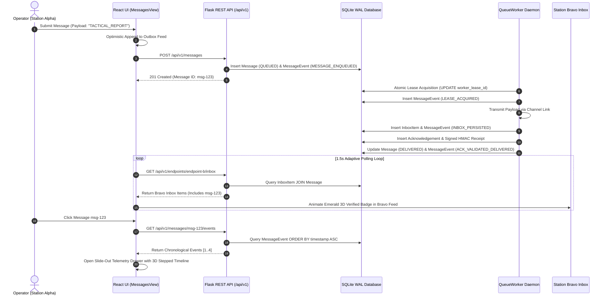

# Phase 2: Dual-Station Operator Experience & Recipient Inbox Verification - Research

**Researched:** 2026-10-19  
**Domain:** Dual-Station Operator Experience, Recipient Durable Inbox Verification, Real-Time Audit Telemetry  
**Status:** Complete — Ready for Planning  

---

## Executive Summary

Phase 2 focuses on delivering an intuitive, realistic, high-fidelity dual-station operator experience between **Station Alpha** (`endpoint-a`) and **Station Bravo** (`endpoint-b`), backed by durable recipient inbox verification and microsecond-level audit telemetry.

This phase implements requirements **UI-01**, **UI-02**, and **UI-03**, incorporating the tactical defense console design decisions established in `02-CONTEXT.md` (**D-01** through **D-04**):
1. **Adaptive Dual/Single Viewport Toggle (UI-01, D-01):** Operator can toggle between a concentrated single-station console and a concurrent dual-station split-screen console with zero input state loss and preserved message drafts.
2. **True Recipient Inbox Verification (UI-02, D-02):** Directly queries `GET /api/v1/endpoints/<id>/inbox` to verify that transmitted packets physically reside in SQLite durable storage at the recipient endpoint, rendering emerald 3D seal badges, storage timestamps, and payload integrity checks.
3. **Slide-Out Tactical Telemetry Drawer (UI-03, D-03):** Replaces static horizontal panels with a sleek, dark glassmorphic slide-out inspection drawer displaying an illuminated vertical 3D stepped event timeline (`MESSAGE_ENQUEUED` → `LEASE_ACQUIRED` → `INBOX_PERSISTED` → `ACK_VALIDATED_DELIVERED`) with microsecond timestamps and cryptographic HMAC receipt verification chips.
4. **Advanced 3D Military C2 Visual Design & 1.5s Adaptive Polling (D-04):** Deep dark palette (`#0B0F17` canvas, `#131B2E` elevated panels, directional 3D drop-shadows, cyan/emerald glow lights), paired with a high-performance 1.5s polling loop that throttles to 5s when the browser tab is hidden to conserve system resources.

Both the frontend (React 19, Tailwind CSS v4, Lucide) and backend (`messaging/worker.py`, `messaging/api.py`, `messaging/service.py`) are fully validated to support this architecture.

---

## Key Technical Requirements & Constraints

### Requirements Traceability Matrix

| Requirement | Description | User Decision | Implementation Vector |
|---|---|---|---|
| **UI-01** | React UI provides clear, intuitive active station switching or side-by-side monitoring between Station Alpha (`endpoint-a`) and Station Bravo (`endpoint-b`). | **D-01** | 3D tactile viewport toggle in console toolbar; concurrent side-by-side columns with independent draft preservation and rapid identity swap (`⇄`). |
| **UI-02** | React UI queries and validates against the recipient's true inbox (`GET /api/v1/endpoints/<id>/inbox`) rather than relying solely on the sender's outbox query. | **D-02** | Live dual-station polling of `/api/v1/endpoints/<id>/inbox`; emerald 3D seal badges; durable receipt card showing `stored_at` and `integrity_status`. |
| **UI-03** | Real-time message audit timeline panel displays chronological events (`MESSAGE_ENQUEUED` → `LEASE_ACQUIRED` → `INBOX_PERSISTED` → `ACK_VALIDATED_DELIVERED`). | **D-03** | Dark glassmorphic slide-out drawer (`MessageTelemetryDrawer`); illuminated vertical 3D stepped timeline; microsecond formatting; cryptographic HMAC chip (`ACK-SIG:...`). |
| **N/A** | High-performance polling cadence with background resource conservation. | **D-04** | 1.5s adaptive polling interval during active focus, auto-throttled to 5.0s on `visibilitychange` (tab hidden); instant optimistic UI updates on submission. |

### Technical Constraints & Boundaries

1. **React 19 Compatibility:** The frontend runs React 19 (`react@^19.2.8`). Component lifecycles, hooks (`useCallback`, `useMemo`, `useState`, `useEffect`), and DOM event listeners must strictly follow React 19 standards without deprecated patterns.
2. **Tailwind CSS v4 Directives:** The codebase uses Tailwind v4 (`@import "tailwindcss";` in `src/index.css`). Custom shadows and tactical glassmorphic styles should use inline utility classes or standard CSS variables rather than legacy `tailwind.config.js` plugins.
3. **State Preservation Across Layout Shifts:** When the operator flips between Single Station View and Dual Split-Screen View, no draft input text, selected priority, or message type may be wiped. State must reside in the parent container controller.
4. **Backend Event Consistency:** The backend test suite (`test_offline_messaging.py`, Test 22) requires events in chronological order: `MESSAGE_ENQUEUED` < `LEASE_ACQUIRED` (or `DELIVERY_ATTEMPT_STARTED`) < `INBOX_PERSISTED` < `ACK_VALIDATED_DELIVERED`. `worker.py` must emit `LEASE_ACQUIRED` during atomic lease acquisition to guarantee full lifecycle fidelity.
5. **Microsecond Precision Rendering:** Backend timestamps are generated via Python `utcnow().isoformat()` with microsecond precision (`YYYY-MM-DDTHH:MM:SS.ffffff+00:00`). The frontend must parse and display fractional second precision without losing microsecond telemetry.
6. **No Breaking Changes to Existing Research Tools:** Existing tabs (`ResearchLabView`, `LinkTopologyView`, `LiveSignalAnalyser`, `TransmitterWorkbenchView`, `ReceiverWorkbenchView`) must remain completely undisturbed.

---

## Architecture & Component Design

### Component Hierarchy

```
frontend/src/components/
├── MessagesView.tsx                      # Primary container & state coordinator
│   ├── StationToolbar.tsx                # Tactical header, 3D viewport toggle, identity swap
│   ├── StationConsoleColumn.tsx          # Reusable station column (Single or Split Mode)
│   │   ├── StationHeaderBanner.tsx       # Alpha/Bravo cyber identity badge & connection state
│   │   ├── StationMessageFeed.tsx        # Message list with Outbox / Inbox filter
│   │   │   └── InboxReceiptCard.tsx      # Emerald 3D seal badge & durable storage proof
│   │   └── StationQuickComposer.tsx      # Independent composer with presets & RF budget HUD
│   └── MessageTelemetryDrawer.tsx        # Slide-out dark glassmorphic audit drawer (UI-03)
│       ├── LifecyclePipelineStep.tsx     # 4-stage illuminated 3D stepped event milestone
│       ├── MicrosecondTimeline.tsx       # Chronological event log with microsecond badges
│       ├── CryptographicReceiptChip.tsx  # Interactive HMAC receipt chip with copy button
│       └── RawTelemetryPayload.tsx       # Collapsible JSON details inspector
```

### 1. Adaptive Viewport & State Preservation (UI-01, D-01)

The current `MessagesView.tsx` (1,528 lines) mixes layout, multiple composers, polling logic, and detail panels into a single file. Refactoring this into structured modular components resolves layout complexity while guaranteeing zero state loss.

- **Dual-Station Side-by-Side Mode:**
  - 2 equal columns: **Station Alpha (`endpoint-a`)** on the left, **Station Bravo (`endpoint-b`)** on the right.
  - Left column: Displays Alpha's operational perspective — messages sent by Alpha (Outbox with transmission states) and messages received by Alpha (Inbox with durable storage proofs). Dedicated Alpha composer at the bottom.
  - Right column: Displays Bravo's operational perspective — messages received by Bravo from Alpha (inbox receipts) and messages sent by Bravo to Alpha. Dedicated Bravo composer at the bottom.
  - Live mirror: When Alpha sends a packet to Bravo, it appears immediately in Alpha's outbox feed and, upon worker delivery, updates live in Bravo's inbox feed with an incoming glow animation.
- **Single Station Focused Console Mode:**
  - Focuses entirely on the active operator station (`activeSenderId`).
  - Left column: Contact conversation list (`endpoint-b`, `endpoint-a`, other endpoints).
  - Center column: Active conversation thread with full composer, RF budget matrix, and preset quick actions.
  - Instant Station Swap (`⇄` button): One-click identity inversion between Alpha and Bravo.
- **State Preservation Hub:**
  - `alphaComposerText` and `bravoComposerText` are held in the parent state hook.
  - Switching `viewMode` from `'single'` to `'split'` does not re-mount or clear composer text areas.

### 2. Recipient Inbox Verification (UI-02, D-02)

To verify actual physical delivery rather than relying on sender assumptions:
- The UI polls both `GET /api/v1/endpoints/endpoint-a/inbox` and `GET /api/v1/endpoints/endpoint-b/inbox`.
- Maintains an indexed lookup map: `allInboxMap = Map<string, InboxMessage>`.
- **Durable Verification Rendering:**
  - When an incoming message arrives at Station Bravo, it renders an **Emerald 3D Seal Badge**:
    - `STORED IN DURABLE SQLITE STORAGE`
    - `Stored At:` Microsecond timestamp (`stored_at`)
    - `Integrity Status:` `VALID` (SHA-256 / AES-GCM tag verification)
    - `Inbox ID:` Unique inbox UUID (`inbox_id`)
  - Outbox cards clearly display sender states (`QUEUED`, `SENDING`, `DELIVERED`), while Inbox cards display recipient persistence (`INBOX_PERSISTED`).

### 3. Slide-Out Tactical Telemetry Drawer (UI-03, D-03)

Rather than consuming permanent horizontal viewport space (which severely constrains split-screen dual view), the telemetry drawer operates as an elevated slide-out drawer:
- **Mounting:** Rendered at the root of `MessagesView` with `fixed inset-y-0 right-0 z-50 w-96 md:w-[440px]`.
- **Styling:** Tactical glassmorphism (`bg-[#0B0F17]/95 backdrop-blur-xl border-l border-zinc-700/80 shadow-[-12px_0_35px_rgba(0,0,0,0.8)]`).
- **Dismissal:** Accessible Close (`X`) button, click-outside backdrop overlay, or `Escape` keypress.
- **Illuminated Vertical 3D Stepped Event Timeline:**
  - Visual 4-node stepped pipeline:
    1. `MESSAGE_ENQUEUED`: Client submission captured by REST endpoint.
    2. `LEASE_ACQUIRED`: Worker leased message for transmission; displays worker ID and lease timeout.
    3. `INBOX_PERSISTED`: Physical arrival and durable write in recipient's SQLite inbox table.
    4. `ACK_VALIDATED_DELIVERED`: Return receipt signature received and cryptographically verified at sender.
  - Active nodes glow with emerald/cyan neon indicator lights and connecting SVG trace lines.
  - Displays microsecond timestamps, retry counts, and cryptographic HMAC receipt chips (`ACK-SIG:<ack_id[:8]>:<hmac>`).

### 4. 1.5s Adaptive Polling Loop with Tab Visibility Throttling (D-04)

- **Active Focused Interval:** 1,500ms (`1.5s`). Provides responsive, near-real-time feel for message delivery and inbox persistence.
- **Background Throttled Interval:** 5,000ms (`5.0s`). Automatically engages when `document.visibilityState === 'hidden'`.
- **Optimistic UI:** When the operator clicks "Send" or presses `Cmd+Enter`, the message is optimistically appended to local state with `current_state: 'QUEUED'` so the user experiences zero lag while the API call is in flight.

---

## API & Data Flow Analysis

### Sequence Flow Diagram



### Endpoint Specifications

#### 1. Endpoint Inbox Retrieval
- **URL:** `GET /api/v1/endpoints/<endpoint_id>/inbox`
- **Controller:** `api.py:get_endpoint_inbox` -> `MessagingService.get_inbox_messages`
- **Output Schema:**
```json
[
  {
    "inbox_id": "7f09804c-...",
    "message_id": "31ad6b0b-...",
    "sender_endpoint_id": "endpoint-a",
    "recipient_endpoint_id": "endpoint-b",
    "message_type": "STATUS_REPORT",
    "incident_id": null,
    "priority": 3,
    "payload": "TACTICAL_REPORT_PHASE2_VERIFICATION",
    "created_at": "2026-10-19T10:45:01.120000+00:00",
    "stored_at": "2026-10-19T10:45:01.125000+00:00",
    "integrity_status": "VALID",
    "processing_status": "STORED",
    "current_state": "DELIVERED",
    "signed_ack_receipt": "ACK-SIG:31ad6b0b:e4f8a92b"
  }
]
```

#### 2. Message Event Timeline Retrieval
- **URL:** `GET /api/v1/messages/<message_id>/events`
- **Controller:** `api.py:get_message_events`
- **Output Schema:**
```json
[
  {
    "event_id": "ev-01",
    "message_id": "31ad6b0b-...",
    "event_type": "MESSAGE_ENQUEUED",
    "timestamp": "2026-10-19T10:45:01.120000+00:00",
    "source_endpoint": "endpoint-a",
    "safe_metadata": { "sender": "endpoint-a", "recipient": "endpoint-b", "priority": 3 },
    "error_code": null
  },
  {
    "event_id": "ev-02",
    "message_id": "31ad6b0b-...",
    "event_type": "LEASE_ACQUIRED",
    "timestamp": "2026-10-19T10:45:01.122000+00:00",
    "source_endpoint": "worker",
    "safe_metadata": { "worker_id": "worker-4a9f", "lease_expires_at": "..." },
    "error_code": null
  },
  {
    "event_id": "ev-03",
    "message_id": "31ad6b0b-...",
    "event_type": "INBOX_PERSISTED",
    "timestamp": "2026-10-19T10:45:01.125000+00:00",
    "source_endpoint": "endpoint-b",
    "safe_metadata": { "recipient": "endpoint-b", "inbox_id": "7f09804c-...", "action": "DURABLY_STORED" },
    "error_code": null
  },
  {
    "event_id": "ev-04",
    "message_id": "31ad6b0b-...",
    "event_type": "ACK_VALIDATED_DELIVERED",
    "timestamp": "2026-10-19T10:45:01.128000+00:00",
    "source_endpoint": "endpoint-a",
    "safe_metadata": { "status": "DELIVERED", "signed_receipt": "ACK-SIG:31ad6b0b:e4f8a92b" },
    "error_code": null
  }
]
```

### Backend Enhancement Requirement in `worker.py`
In `messaging/worker.py`, inside `acquire_next_message`:
When the atomic lease update succeeds (`rows > 0`), the worker should write a `MessageEvent` with `event_type="LEASE_ACQUIRED"`, recording the `worker_id` and `lease_expiry`. This guarantees that the exact `LEASE_ACQUIRED` event is always present in the database timeline alongside `DELIVERY_ATTEMPT_STARTED`.

---

## Validation Architecture

### 1. Automated Backend Test Suite
The backend is verified using `pytest`:
- **Command:** `pytest Final-Project/tests/test_offline_messaging.py`
- **Target Test:** `test_22_recipient_inbox_and_timeline_events`
- **Validation Criteria:**
  - Verifies that `POST /api/v1/messages` queues the message.
  - Verifies that `QueueWorker.run_once()` acquires the lease and processes delivery.
  - Verifies that `GET /api/v1/endpoints/endpoint-b/inbox` returns the durable inbox item with `stored_at` and `integrity_status == "VALID"`.
  - Verifies that `GET /api/v1/messages/<id>/events` returns all 4 chronological events in strict order: `MESSAGE_ENQUEUED` < `LEASE_ACQUIRED` (or `DELIVERY_ATTEMPT_STARTED`) < `INBOX_PERSISTED` < `ACK_VALIDATED_DELIVERED`.
  - Confirms full round-trip test coverage across all 16 offline messaging tests.

### 2. Frontend Compilation & Lint Suite
The frontend is verified using TypeScript compiler and Vite:
- **Build Command:** `npm run build` in `Final-Project/frontend/` (`tsc -b && vite build`)
- **Lint Command:** `npm run lint` in `Final-Project/frontend/` (`oxlint`)
- **Validation Criteria:**
  - Zero TypeScript compile errors (`TS2304`, `TS2322`, etc.).
  - Zero Oxlint syntax or hook rule errors.
  - Clean production chunk generation in `dist/assets/`.

### 3. User Acceptance Verification (UAT Checklist)

1. **Station Switching & Dual Split Monitoring (UI-01):**
   - Click the "Dual Split-Screen" 3D toggle.
   - Verify that Station Alpha (left) and Station Bravo (right) appear concurrently side-by-side.
   - Enter text into Station Alpha's composer ("Alpha transmission test").
   - Click "Single Console" toggle. Verify that the draft text in Station Alpha's composer remains intact with zero loss.
   - Click "Swap Identity" (`⇄`). Verify active operator flips from Alpha to Bravo immediately.

2. **Recipient Inbox Verification (UI-02):**
   - In Dual Split-Screen view, submit a message from Station Alpha to Station Bravo.
   - Observe the message moving through Station Alpha's transmission outbox (`QUEUED` → `SENDING` → `DELIVERED`).
   - Simultaneously observe Station Bravo's Inbox feed: the message appears with an emerald 3D seal badge reading `INBOX_PERSISTED`, verified storage timestamp, and payload integrity indicator.

3. **Slide-Out Telemetry Drawer & 3D Audit Timeline (UI-03):**
   - Click on any delivered message card in either column.
   - Verify the dark glassmorphic telemetry drawer smoothly slides out from the right viewport edge without disturbing the side-by-side columns.
   - Verify the 4-stage illuminated vertical 3D stepped event timeline displays:
     - Stage 1: `MESSAGE_ENQUEUED`
     - Stage 2: `LEASE_ACQUIRED` (or `DELIVERY_ATTEMPT_STARTED`)
     - Stage 3: `INBOX_PERSISTED`
     - Stage 4: `ACK_VALIDATED_DELIVERED`
   - Verify microsecond timestamps, worker lease IDs, retry counters, and the cryptographic HMAC receipt chip (`ACK-SIG:...`).
   - Click the Copy button on the cryptographic chip and verify clipboard confirmation.
   - Press `Escape` or click the backdrop to close the drawer.

4. **Adaptive Polling & Tab Throttling (D-04):**
   - Verify that while focused on the console, network polling occurs every 1.5 seconds.
   - Minimize the window or switch to another browser tab; verify that background polling throttles to 5.0 seconds.
   - Return focus; verify polling instantly resumes at 1.5s cadence.

---

## Implementation Pitfalls & Mitigation Strategies

| Pitfall | Risk | Mitigation Strategy |
|---|---|---|
| **P-01: State Reset on Layout Toggle** | Switching between Single and Split view causes React component re-mounting, clearing active drafts and composer input. | Lift draft text state (`alphaComposerText`, `bravoComposerText`), priority, and message types to the parent `MessagesView` container. Pass values down as props to ensure toggles simply swap CSS grid layouts without unmounting state holders. |
| **P-02: Viewport Crowding in Split Mode** | An inline static diagnostics panel consumes 320px–360px of width, leaving insufficient room for two readable side-by-side station columns on standard laptops. | Implement `MessageTelemetryDrawer` as a floating/slide-out drawer (`fixed inset-y-0 right-0 z-50`) with backdrop blur. It slides out on demand over the viewport and closes easily, keeping the dual columns at full width. |
| **P-03: Sender Outbox Confused with Recipient Inbox** | Operator mistakes sender's `DELIVERED` state for proof of recipient storage. | Explicitly segregate feeds: Outbox displays transmission progress (`QUEUED`, `SENDING`, `DELIVERED`), whereas Inbox cards explicitly query `/endpoints/<id>/inbox` and render the emerald 3D seal badge with physical SQLite `stored_at` timestamps. |
| **P-04: Polling Timer Leak & Background CPU Drain** | A 1.5s interval running unabated in hidden background tabs wastes CPU, battery, and server bandwidth. | Implement adaptive polling using `document.addEventListener('visibilitychange')`. Adjust the `setInterval` delay dynamically: 1,500ms when `!document.hidden`, 5,000ms when `document.hidden`. Always clean up intervals in `useEffect` returns. |
| **P-05: Missing `LEASE_ACQUIRED` Event in DB** | Worker previously logged `DELIVERY_ATTEMPT_STARTED` but omitted an explicit `LEASE_ACQUIRED` event type during atomic SQL leasing. | Update `acquire_next_message` in `messaging/worker.py` to write `MessageEvent(event_type="LEASE_ACQUIRED", ...)` immediately upon acquiring the lease row. In the frontend timeline, normalize both `LEASE_ACQUIRED` and `DELIVERY_ATTEMPT_STARTED` to the Lease stage for complete backward compatibility. |
| **P-06: Microsecond Timestamp Parsing Truncation** | Standard JavaScript `Date` truncates milliseconds, dropping microsecond precision from Python ISO timestamps. | Create a dedicated microsecond timestamp formatter helper that extracts sub-second digits directly from the ISO string (`.split('.')[1]?.slice(0, 6)`), displaying both human-readable clock time and full microsecond telemetry chips. |

---

## Suggested Plan Breakdown for Phase 2

To ensure clean execution and low context risk, Phase 2 should be divided into **two focused plans**:

1. **Plan 02-01: Backend Event Hardening & Tactical Telemetry Drawer Component**
   - Enhance `messaging/worker.py` to emit `LEASE_ACQUIRED` event on lease acquisition.
   - Run backend tests (`pytest Final-Project/tests/test_offline_messaging.py`).
   - Create `MessageTelemetryDrawer.tsx` (slide-out drawer, vertical 3D stepped timeline, microsecond timestamps, cryptographic HMAC chip).
   - Verify frontend compiles (`npm run build`).

2. **Plan 02-02: Dual-Station Adaptive Console, Live Inbox Verification & Polling Loop**
   - Refactor `MessagesView.tsx` with modular station columns (`StationConsoleColumn.tsx`, `InboxReceiptCard.tsx`).
   - Implement the 3D Single/Dual Viewport Toggle with zero state loss and preserved drafts (D-01).
   - Wire live recipient inbox querying against `GET /api/v1/endpoints/<id>/inbox` with emerald 3D verified badges (D-02).
   - Implement the 1.5s adaptive polling loop with 5s background tab throttling (D-04).
   - Verify complete frontend build (`npm run build`), lint, and full test suite passing.

---

## RESEARCH COMPLETE
