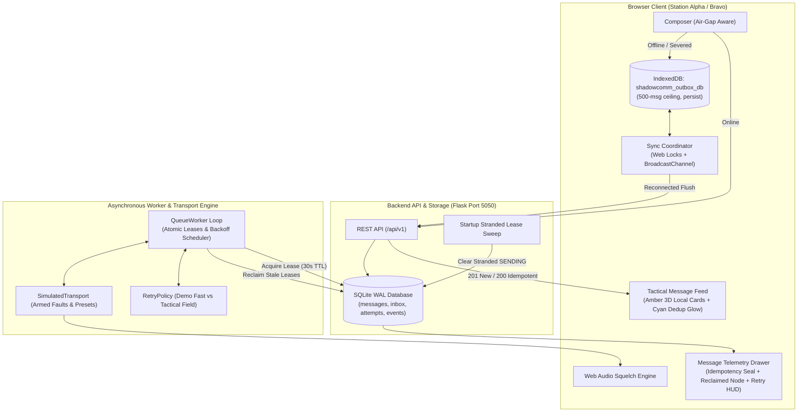

# Phase 3: Fault Injection, Offline Outages & Client Re-Sync - Research

**Researched:** 2026-10-19  
**Domain:** Tactical Communications / Reliable Store-and-Forward / Fault Tolerance  
**Status:** Complete — Ready for Planning  

---

## Executive Summary

Phase 3 focuses on validating and delivering mission-critical store-and-forward resilience for **SHADOWCOMM**. Operational field tactical environments suffer from severed connections, deliberate electronic warfare (EW) jamming, physical RF shadow zones, packet drops, client disconnects, and background worker node crashes.

The primary objective of this phase is to ensure **zero message loss**, **deterministic client and server state reconciliation**, **strict duplicate suppression**, and **autonomous worker crash recovery**.

All 22 implementation decisions locked during `/gsd-discuss-phase` (D-01 through D-22 in `03-CONTEXT.md`) have been analyzed against the current codebase (`messaging/transport.py`, `messaging/retry_policy.py`, `messaging/api.py`, `messaging/worker.py`, `frontend/src/services/outboxDb.ts`, and React view components). This research document defines the exact architecture, backend modifications, frontend enhancements, API contracts, and validation tests needed for Phase 3.

---

## Key Technical Requirements & Constraints

### 1. Requirements Breakdown

| Requirement | Description | Current State | Phase 3 Target |
|---|---|---|---|
| **FLT-01** | Simulated link transport supports dynamic impairment injection (outage toggle, latency, packet drop, ACK loss) via UI and REST API. | Basic manual sliders in `ConnectivityView.tsx` and basic methods in `transport.py`. No presets or single-shot arming. | Tactical Quick-Select Presets, single-shot armed fault buttons ("Drop Next Message", "Drop Next ACK", "Corrupt Next HMAC"), illuminated 3D status pills in Header/Banners, Web Audio radio squelch/beep, and radar sweep line. |
| **FLT-02** | Client messages composed while backend is offline persist in browser `IndexedDB` (`shadowcomm_outbox_db`) and automatically flush to backend upon link recovery. | `outboxDb.ts` has basic CRUD; `MessagesView.tsx` has basic sync loop without visual local outbox cards in feed or multi-tab locks. | Distinct 3D amber pulsing card in feed with `LOCAL STORED` badge; persistent Header/Console badge `📦 N LOCAL QUEUED` with click-to-flush; multi-tab Web Lock + BroadcastChannel leader election; air-gap composer adaptation; dual timestamp display; `navigator.storage.persist()` and 500-message ceiling. |
| **FLT-03** | Duplicate message submissions using the same `client_idempotency_key` are safely deduplicated with idempotent HTTP 200 responses. | Backend `MessagingService.submit_message` returns existing message with 200; frontend ignores `is_new` flag and does not provide visual dedup feedback. | Immediate client-side CTA lockout; tactical confirmation toast ("Deduplicated: Existing record returned"); smooth cyan card highlight glow; dedicated IDEMPOTENCY SEAL chip in Telemetry Drawer; seamless offline sync reconciliation. |
| **FLT-04** | Background worker reclaims stale leases from crashed workers and reschedules delivery attempts using exponential backoff with jitter. | `RetryPolicy.reclaim_stale_leases` exists but has no manual API trigger; no worker crash simulation; no startup stranded lease sweep; fixed backoff parameters. | Illuminated `WORKER LEASE RECLAIMED` timeline node in Telemetry Drawer; active Retry Telemetry HUD with live countdown ("Attempt N/5 • Next in X.Xs"); crash & reclaim test buttons in `ConnectivityView.tsx`; red `FAILED_PERMANENT` cards with "Force Re-Queue"; dual-profile backoff tuning ("Demo Fast" vs "Tactical Field"); startup stranded lease sweep. |

### 2. Constraints & Critical Environmental Safeguards

1. **macOS Apple Silicon OpenBLAS Safety:** In all Python entry points and test fixtures, `import torch` **MUST** precede `numpy` and `scipy` to prevent Mach-O linker symbol collisions (`SIGSEGV 139`).
2. **Strict Git Prohibition:** Phase agents **MUST NOT** perform git commits, pushes, merges, or resets.
3. **Single Port Architecture:** The application runs canonically on port 5050 (Flask serving compiled React SPA at `/` and REST API at `/api/v1`).
4. **Browser Permissions & Resilience:** `navigator.storage.persist()` and `navigator.locks` require graceful degradation for environments without permissions or Web Locks support.
5. **Web Audio Autoplay Policies:** Browser autoplay restrictions require `AudioContext` to initialize lazily or resume upon the operator's first user interaction.

---

## Architecture & Component Design



### 1. Transport & Fault Injection Engine (`messaging/transport.py` & `messaging/api.py`)

#### A. Single-Shot Armed Faults
In addition to statistical drop rates (`drop_message_prob`, `drop_ack_prob`), operators need deterministic single-shot arming buttons:
- `arm_drop_next_message: bool`: Drops the forward transmission of the next leased packet, setting error code `PACKET_DROPPED`. Automatically resets to `False` once triggered.
- `arm_drop_next_ack: bool`: Delivers payload to receiver inbox, but drops the return ACK, setting error code `ACK_LOST`. Automatically resets to `False` once triggered.
- `arm_corrupt_next_hmac: bool`: Injects an invalid HMAC signature or returns `HMAC_VERIFICATION_FAILED` error. Automatically resets to `False` once triggered.

#### B. Tactical Presets Matrix (D-01)
| Preset Name | State | Latency | Packet Drop | ACK Drop | Operational Scenario |
|---|---|---|---|---|---|
| **Nominal Clear Link** | Online | 0 ms | 0% | 0% | Baseline clean line-of-sight RF |
| **Urban EW Jamming** | Online | 50 ms | 30% | 10% | Dense urban multi-path & hostile jamming |
| **Severed Air-Gap Outage** | Severed (Offline) | 0 ms | 100% | 100% | Complete physical link disruption / radio silence |
| **GEO Satellite Link** | Online | 800 ms | 5% | 5% | High-latency geostationary orbit relay |

### 2. Browser Storage & Synchronization Subsystem (`frontend/src/services/outboxDb.ts` & `syncService.ts`)

#### A. IndexedDB Schema (`shadowcomm_outbox_db`)
- Object Store: `local_messages`
- Primary Key: `client_idempotency_key` (String UUID)
- Indexes: `sync_status`, `created_at`, `sender_endpoint_id`
- Storage Persistence: Execute `navigator.storage.persist()` on boot.
- Safe Storage Ceiling: Hard limit of 500 messages; amber warning banner when count > 400.

#### B. Multi-Tab Web Lock & BroadcastChannel Synchronization (D-17)
- **Web Locks API:** Use `navigator.locks.request('shadowcomm_outbox_sync', async () => { ... })` to ensure only one tab runs the background flush loop at any given moment.
- **BroadcastChannel:** Open `new BroadcastChannel('shadowcomm_outbox_channel')`. When the leader tab flushes an item or updates local storage, it posts an event (`OUTBOX_UPDATED`, `ITEM_SYNCED`) so secondary tabs re-query IndexedDB and update their outbox badges instantly without race conditions.

#### C. Visual Local Outbox Card in Feed (D-05)
Local messages in `PENDING_LOCAL` status must be rendered in the feed alongside server messages:
- Amber pulsing border (`border-amber-500/70 shadow-[0_0_15px_rgba(245,158,11,0.2)] animate-pulse`).
- Badges: `[📦 LOCAL STORED - INDEXEDDB]` and `[PENDING SYNC]`.
- Action: "Flush Now" button directly on the card.
- Dual Timestamps: "Composed: [timestamp]" and "Queued: PENDING SERVER ACK".

### 3. Idempotency & Duplicate Feedback Subsystem (FLT-03)

#### A. Submission Flow & Status Codes
- Unique constraint in database: `UniqueConstraint('sender_endpoint_id', 'client_idempotency_key', name='uq_sender_idempotency')`.
- If new: Server inserts row, sets state to `QUEUED`, logs `MESSAGE_ENQUEUED`, and returns **HTTP 201 Created** with `{"is_new": true, ...}`.
- If duplicate: Server finds existing record, returns **HTTP 200 OK** with `{"is_new": false, ...}`.

#### B. UI Debounce & Duplicate Visual Confirmation (D-09, D-11)
- **Immediate Debounce:** Clicking "Transmit Packet" locks a single unique UUID (`client_idempotency_key`), disables the CTA button, and displays an animated spinner.
- **Duplicate Toast:** If `is_new === false`, display a tactical cyan notification toast:
  > `[DEDUPLICATED] Existing canonical message record returned. No duplicate enqueued.`
- **Card Highlight:** Scroll to and highlight the existing message card with an animated cyan border glow (`ring-2 ring-cyan-400 shadow-[0_0_25px_rgba(6,182,212,0.4)]`) for 3 seconds.
- **Idempotency Seal in Telemetry Drawer:** Render a dedicated badge:
  `[🛡️ IDEMPOTENCY SEAL: {uuid} • DEDUPLICATION SAFE]`.

### 4. Worker Crash Recovery & Exponential Backoff Subsystem (FLT-04)

#### A. Lease Lifecycle & Stale Lease Reclamation
- When a worker leases a message:
  ```python
  Message.current_state = MessageState.SENDING.value
  Message.worker_lease_id = self.worker_id
  Message.lease_expires_at = now + timedelta(seconds=self.lease_timeout)
  ```
- If the worker crashes or is killed, `lease_expires_at` lapses.
- `RetryPolicy.reclaim_stale_leases(session)` finds messages in `SENDING` where `lease_expires_at < now`.
- It resets them to `FAILED_RETRYABLE`, sets `next_attempt_at = now - 1s`, and writes a `WORKER_LEASE_RECLAIMED` event preserving metadata:
  ```json
  {
    "previous_worker_id": "worker-abc1234",
    "lease_expires_at": "2026-10-19T12:00:00Z",
    "reason": "Previous worker did not finish before lease expired",
    "lease_timeout_seconds": 30.0
  }
  ```

#### B. Startup Stranded Lease Sweep (D-22)
When the backend server or worker process boots up, any message left in `SENDING` status is guaranteed to be orphaned (since the previous process exited):
- Implement `RetryPolicy.recover_stranded_leases(session)`:
  Immediately transition *all* `SENDING` messages to `FAILED_RETRYABLE` with `LEASE_EXPIRED` without waiting for `lease_expires_at` to lapse.

#### C. Dual-Profile Backoff Tuning (D-20)
Configure backoff parameters dynamically via `RetryPolicy`:
- **Demo Fast Retries:** Base delay 0.5s, max delay 5.0s, jitter 0.1s. (Ideal for live demonstration and rapid automated testing).
- **Tactical Field Retries:** Base delay 2.0s, max delay 60.0s, jitter 0.5s. (Standard operational tactical field behavior).
- Calculation: $\text{delay} = \min(\text{max\_delay}, \text{base\_delay} \times 2^{\text{attempt} - 1}) + \text{random}(0, \text{jitter})$.

#### D. Active Retry Telemetry HUD & Real-Time Countdown (D-14)
For messages in `FAILED_RETRYABLE` or `AWAITING_ACK`:
- Real-time countdown pill on message cards and Telemetry Drawer:
  `[⏳ Attempt 2/5 • Next retry in 3.4s (Backoff + Jitter)]`.
- Updates dynamically every 100ms via `requestAnimationFrame` or `setInterval`.

#### E. Permanent Failure & Operator Force Re-Queue (D-16)
- When `attempt_count >= max_attempts`: message enters `FAILED_FINAL` with `last_error_code = "RETRY_LIMIT_EXHAUSTED"`.
- Render distinct Red 3D Card with "Retry Limit Exhausted [5/5]" badge.
- Operator action button: **"Force Re-Queue Transmission"**.
- Invoking `POST /api/v1/messages/<id>/retry`:
  - **CRITICAL:** Resets `attempt_count = 0` (so it gets a fresh quota of 5 attempts).
  - Resets `current_state = "QUEUED"`, `next_attempt_at = now`, `worker_lease_id = None`.
  - Logs `MANUAL_RETRY_REQUESTED` audit event.

---

## API & Data Flow Analysis

### 1. REST API Contract Extensions

#### `POST /api/v1/sim/transport`
Updates transport parameters or activates tactical presets.
```json
// Request Body
{
  "preset": "URBAN_JAMMING", // or "NOMINAL", "AIR_GAP", "SATELLITE"
  "is_online": true,
  "latency_ms": 50.0,
  "drop_message_prob": 0.3,
  "drop_ack_prob": 0.1,
  "reset": false
}
```

#### `POST /api/v1/sim/faults`
Arming single-shot faults.
```json
// Request Body
{
  "action": "arm_drop_message", // "arm_drop_ack", "arm_corrupt_hmac", "disarm_all"
  "message_id": "*"
}
// Response (200 OK)
{
  "status": "fault_armed",
  "armed_faults": {
    "drop_message": true,
    "drop_ack": false,
    "corrupt_hmac": false
  }
}
```

#### `POST /api/v1/worker/reclaim`
Manually triggers immediate stale lease reclamation.
```json
// Response (200 OK)
{
  "reclaimed_count": 2,
  "timestamp": "2026-10-19T12:05:00.123456Z"
}
```

#### `POST /api/v1/worker/crash-simulation`
Simulates worker crash by forcibly aborting active lease or creating an expired lease.
```json
// Response (200 OK)
{
  "status": "worker_crash_simulated",
  "affected_message_id": "msg-9f4a-...",
  "simulated_worker_id": "crashed-worker-sim",
  "lease_expires_at": "2026-10-19T12:00:00.000000Z"
}
```

#### `GET /api/v1/worker/retry-profile` & `POST /api/v1/worker/retry-profile`
Gets or toggles active backoff profile.
```json
// POST Body: {"profile": "FAST"} or {"profile": "TACTICAL"}
// Response (200 OK)
{
  "active_profile": "FAST",
  "base_delay": 0.5,
  "max_delay": 5.0,
  "jitter": 0.1,
  "max_attempts": 5
}
```

#### Model Serialization Extension (`Message.to_dict()`)
Add missing fields to ensure parity with frontend TypeScript types:
```python
"worker_lease_id": self.worker_lease_id,
"lease_expires_at": self.lease_expires_at.isoformat() if self.lease_expires_at else None,
"retry_count": self.attempt_count,
"max_retries": 5,
"next_retry_at": self.next_attempt_at.isoformat() if self.next_attempt_at else None,
```

---

## Validation Architecture

The test matrix must ensure 100% automated regression verification without flaky time dependencies.

### 1. Pytest Unit & Integration Suite (`tests/test_offline_messaging.py` & `tests/test_fault_injection.py`)

1. **Test FLT-01: Tactical Presets & Armed Fault Injections**
   - Verify preset application: Nominal (0ms, 0%), Urban (50ms, 30%), Air-Gap (Offline), Satellite (800ms, 5%).
   - Verify single-shot armed message drop: Transmit packet -> dropped on first attempt -> armed flag auto-clears -> second packet delivers cleanly without drop.
   - Verify single-shot armed ACK drop: Transmit packet -> stored in receiver inbox -> return ACK dropped -> state `AWAITING_ACK` -> armed flag auto-clears.
   - Verify link reset returns transport to 0ms latency and 0% drops.

2. **Test FLT-02: Client Offline Outbox & Re-Sync**
   - Store message in local outbox structure during simulated server 503 / connection failure.
   - Reconnect link -> execute background flush -> assert message ingested into server database with HTTP 201 -> local item purged -> message transitions to `DELIVERED`.

3. **Test FLT-03: Strict Deduplication & Idempotency**
   - Submit message with `client_idempotency_key = "k1"`, verify HTTP 201 and `is_new: True`.
   - Submit second identical request with `client_idempotency_key = "k1"`, verify HTTP 200, `is_new: False`, identical `message_id`, and exactly 1 row in `messages` table.
   - Rapid concurrent submissions of the same key return the same record with zero race-condition duplicates.

4. **Test FLT-04: Lease Reclamation, Startup Sweep & Backoff**
   - Simulate worker crash leaving message in `SENDING` with expired lease -> call `reclaim_stale_leases` -> message transitions to `FAILED_RETRYABLE` with `WORKER_LEASE_RECLAIMED` event preserving `previous_worker_id`.
   - Verify `recover_stranded_leases()` on server startup resets all stranded `SENDING` messages immediately.
   - Verify exponential backoff calculation under both `FAST` and `TACTICAL` profiles.
   - Verify manual re-queue from `FAILED_FINAL` resets `attempt_count = 0` and permits 5 fresh delivery attempts.

5. **Fix Deterministic Simulation Suite Timing (`tests/test_simulation_1000_messages.py:226`)**
   - The test assertion `assert delivered_first == 100` failed because processing 150 items through SQLite in a tight `drain_worker` loop took ~2.5s, allowing early dropped items (2.0s backoff) to elapse their `next_attempt_at` during the same drain pass.
   - Mitigation: Ensure `drain_worker` in tests accepts an optional `allow_retries=False` flag or set base backoff during that phase high enough (e.g. 10.0s) so retries are only processed when explicitly triggered.

### 2. Frontend Build & Quality Verification
- **TypeScript Typecheck:** `tsc -b` must pass with zero compilation errors.
- **Vite Bundle Build:** `npm run build` must generate production distribution assets in `frontend/dist/`.
- **Linter Check:** `npx oxlint src/` must pass with zero errors.

---

## Implementation Pitfalls & Mitigation Strategies

| Pitfall | Root Cause | Impact | Mitigation Strategy |
|---|---|---|---|
| **Attempt Quota Trap on Manual Retry** | `retry_message` resets state to `QUEUED` but previously did not reset `attempt_count`. | Message was in `FAILED_FINAL` with 5 attempts. Next attempt becomes attempt 6 $\ge 5$, immediately failing again on first retry. | Explicitly set `msg.attempt_count = 0` in `MessagingService.retry_message()`. |
| **Armed Fault Leakage** | Armed faults (`arm_drop_next_message`) lingering across tests or unrelated transmissions. | Subsequent messages randomly dropped unexpectedly. | Auto-disarm immediately after one transmission in `SimulatedTransport.transmit()`. Provide explicit `disarm_all` and `reset()` cleanup. |
| **AudioContext Autoplay Blocking** | Browsers reject `new AudioContext()` or `.resume()` without user interaction. | Console warning / audio failure on page load. | Initialize audio context lazily on the first user click (e.g., clicking presets, transmit, or unmute button). Catch and ignore `NotAllowedError`. |
| **Web Locks Compatibility Fallback** | Environments like older WebViews or non-secure origins might lack `navigator.locks`. | Uncaught `TypeError: Cannot read properties of undefined (reading 'request')`. | Feature-detect `if ('locks' in navigator)`; fallback to atomic localStorage timestamp flag if unavailable. |
| **Multi-Tab Sync Flooding** | Multiple open tabs attempting to flush the offline outbox simultaneously upon link recovery. | Duplicate API calls and race conditions on IndexedDB deletions. | Use Web Locks leader election: exactly one tab acquires the lock to flush. Post `OUTBOX_FLUSHED` via `BroadcastChannel` to update peer tabs. |
| **Field Name Mismatch (Backend vs Frontend)** | Backend model uses `attempt_count` and `next_attempt_at`, while frontend types declare `retry_count` and `next_retry_at`. | Telemetry HUD shows `undefined` countdowns. | Ensure `Message.to_dict()` provides both canonical and alias properties (`retry_count`, `max_retries`, `next_retry_at`, `worker_lease_id`, `lease_expires_at`). |

---

## RESEARCH COMPLETE
