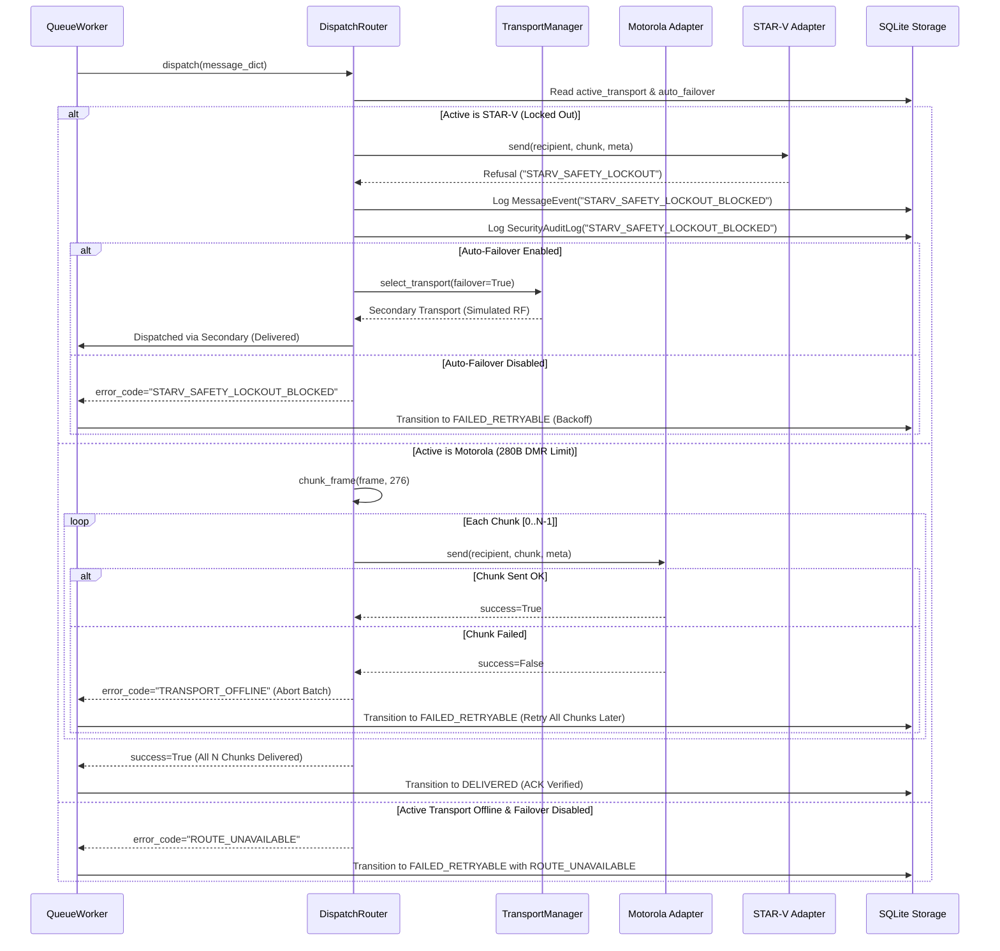

# Phase 4: Tactical Multi-Transport Broker & Hardware Safety Lockout - Research

**Researched:** 2026-10-19  
**Status:** Complete & Ready for Planning  
**Target Requirements:** TRN-01, TRN-02, TRN-03, TRN-04  
**User Decisions Covered:** D-01 through D-08 (from `04-CONTEXT.md`)  

---

## Executive Summary

Phase 4 establishes an enterprise-grade tactical multi-transport routing broker for the SHADOWCOMM platform. It enforces unified transport readiness validation (`READY`, `SIMULATION_ONLY`, `LOCKED_OUT`, `OFFLINE`), transparent 280-byte Motorola MOTOTRBO DMR Tier-II payload fragmentation and XCMP protocol simulation, permanent software safety lockout with high-severity security audit logging for the STAR-V tactical SDR adapter, and dual-view relay node store-and-forward telemetry monitoring with autonomous flight safety failsafe cutoffs.

The existing codebase contains solid scaffolding:
1. `integration/manager.py` contains `TransportManager` singleton with adapter registration and readiness filtering.
2. `messaging/dispatch.py` provides `DispatchRouter` with DMR frame splitting (`chunk_frame`) using 4-byte headers (`<uint16 total><uint16 index>`) and SQLite `system_settings` persistence.
3. `integration/motorola/adapter.py` enforces the 280-byte limit and interfaces with `MotorolaHardwareBridge` (MNIS UDP / Raspberry Pi GPIO PTT).
4. `integration/starv/adapter.py` enforces `StarVSafetyLockoutError` and permanent lockout.
5. `integration/relay_nodes/manager.py` defines `RelayNode` and `RelayNodeManager` with threshold-based forwarding rules and decoupled flight failsafe attributes.
6. The frontend contains `DevicesView.tsx`, `LinkTopologyView.tsx`, `StationConsoleColumn.tsx`, and `MessageTelemetryDrawer.tsx`.

The core work for Phase 4 centers on unifying these components into a seamless operational experience:
- Adding **Operator-Pinned Transport with Auto-Failover Toggle** (D-01) and durable **`ROUTE_UNAVAILABLE`** hold under backoff (D-02).
- Implementing **Live DMR Burst HUD** in the quick composer and **Atomic Frame Retries** (D-03, D-04).
- Creating the **Interactive Tactical Lockout Dossier Modal** in `DevicesView` with live test bench buttons (`Test Soft Refusal` & `Test Hard Command Lockout`), plus **Illuminated Crimson Lockout Seal** in `MessageTelemetryDrawer` (D-05, D-06).
- Unifying **Relay Node Telemetry** across `DevicesView` and 3D `LinkTopologyView` with autonomous failsafe cutoff indicators and explicit `[FLIGHT SAFETY ISOLATION: ACTIVE]` aerial badges (D-07, D-08).

---

## Key Technical Requirements & Constraints

### 1. Requirements Breakdown

| Requirement | Scope & Verification | Target Modules |
|---|---|---|
| **TRN-01** | `TransportManager` validates transport readiness (`READY`, `SIMULATION_ONLY`, `LOCKED_OUT`, `OFFLINE`) before dispatching payloads. Respects pinned transport selection and auto-failover policy. If route is unavailable, holds message in durable queue as `FAILED_RETRYABLE` with `ROUTE_UNAVAILABLE`. | `integration/manager.py`<br>`messaging/dispatch.py`<br>`messaging/retry_policy.py`<br>`messaging/api.py` |
| **TRN-02** | Motorola MOTOTRBO TMS adapter enforces 280-byte DMR packet ceilings and XCMP protocol simulation. Outbound frames exceeding 280 bytes are transparently split into ordered self-describing chunks (`<uint16 total><uint16 index><data>`). Any chunk drop fails the attempt and triggers atomic re-transmission of all chunks on backoff. | `integration/motorola/adapter.py`<br>`messaging/dispatch.py`<br>`frontend/src/components/StationConsoleColumn.tsx` |
| **TRN-03** | STAR-V tactical SDR adapter enforces a strict software safety lockout preventing unauthorized physical RF transmission. Outbound transmission attempts targeting or forced onto STAR-V log `STARV_SAFETY_LOCKOUT_BLOCKED` in `MessageEvent` and `SecurityAuditLog`. Interactive dossier modal provides soft refusal and hard command dry-run tests. | `integration/starv/adapter.py`<br>`messaging/api.py`<br>`frontend/src/components/DevicesView.tsx`<br>`frontend/src/components/MessageTelemetryDrawer.tsx` |
| **TRN-04** | Relay node manager provides store-and-forward telemetry (battery %, temperature, storage %, queue depth, forwarding counts) with decoupled flight safety failsafes. Autonomous cutoff suspends forwarding when battery $\le 5\%$ or storage $\ge 98\%$. Aerial relays display `[FLIGHT SAFETY ISOLATION: ACTIVE]`. | `integration/relay_nodes/manager.py`<br>`frontend/src/components/DevicesView.tsx`<br>`frontend/src/components/topology/LinkTopologyView.tsx` |

### 2. Operational Constraints

1. **Mac Dynamic Linker Safety (Apple Silicon OpenBLAS Collision):**  
   All Python files and tests MUST import `torch` before `numpy` or `scipy`. Failure to follow this import order results in `SIGSEGV 139` symbol collision crashes on macOS arm64.
2. **Strict Hardware Boundary Isolation:**  
   Physical RF transmission is strictly prohibited unless `MOTOROLA_RADIO_APPROVED=true` is explicitly set in the environment. STAR-V transmission is permanently blocked in software with zero operational override.
3. **No Silent Packet Loss:**  
   When a transport is offline or locked out and failover is unavailable, messages MUST NOT be dropped or marked `FAILED_FINAL`. They must be held in SQLite durable queue with status `FAILED_RETRYABLE` and error code `ROUTE_UNAVAILABLE`.
4. **No Git Mutations:**  
   GSD planner and executor must not perform automatic `git commit`, `git push`, or `git reset`.

---

## Architecture & Component Design

### 1. Transport Broker & Dispatch Layer (`integration/manager.py` & `messaging/dispatch.py`)

```
+-----------------------------------------------------------------------------------+
|                                  OPERATOR CONSOLE                                 |
|   Active Transport: [Motorola MOTOTRBO | Simulated RF | Relay Gateway]            |
|   Auto-Failover Toggle: [ ENABLED / DISABLED ]                                    |
+-----------------------------------------+-----------------------------------------+
                                          |
                                          v
+-----------------------------------------------------------------------------------+
|                         REST API / Shared Persistence                             |
|   POST /api/v1/transports/active     -> Persists to SQLite system_settings        |
|   POST /api/v1/transports/failover   -> Sets auto_failover boolean in settings    |
+-----------------------------------------+-----------------------------------------+
                                          |
                                          v
+-----------------------------------------------------------------------------------+
|                      DispatchRouter / TransportManager                            |
|                                                                                   |
|  1. Read active_transport & auto_failover from storage                            |
|  2. Check primary transport readiness:                                            |
|     - If READY or SIMULATION_ONLY and link ONLINE -> Route to primary             |
|     - If OFFLINE / LOCKED_OUT:                                                    |
|         - If auto_failover == TRUE:                                               |
|             Fail over to secondary operational adapter (Simulated RF / Relay)     |
|         - If auto_failover == FALSE:                                              |
|             Return ROUTE_UNAVAILABLE -> Durable Queue Hold (FAILED_RETRYABLE)     |
|                                                                                   |
|  3. DMR 280-Byte Burst Chunking:                                                  |
|     - Payload frame > 276 bytes -> split into chunks with <uint16 total><uint16 idx>|
|     - Send chunks sequentially; if ANY chunk fails -> abort & retry all on backoff|
+-----------------------------------------------------------------------------------+
```

#### Detailed Logic Updates:
1. **`SystemSetting` Storage Keys:**
   - `"active_transport"`: ID of selected transport (e.g., `"motorola-mototrbo-01"`), or `""`/`null` for simulated link.
   - `"auto_failover"`: `"true"` or `"false"`. Defaults to `"true"` to provide resilient out-of-the-box routing.
2. **`DispatchRouter.dispatch(message_dict)`:**
   - Evaluates active transport readiness (`adapter.readiness`) and connection state (`adapter.connection_state`).
   - If active transport is `starv-tactical-locked`:
     - Triggers `STARV_SAFETY_LOCKOUT_BLOCKED` security audit logging.
     - If `auto_failover` is disabled, returns `{"delivered_to_receiver": False, "error_code": "STARV_SAFETY_LOCKOUT_BLOCKED", ...}`.
   - If active transport is unavailable (offline or missing):
     - If `auto_failover` is enabled: fails over to next available adapter in `transport_manager` or falls back to simulated transport.
     - If `auto_failover` is disabled: returns `{"delivered_to_receiver": False, "error_code": "ROUTE_UNAVAILABLE", ...}`.
3. **`messaging/retry_policy.py`:**
   - Add `"ROUTE_UNAVAILABLE"` and `"STARV_SAFETY_LOCKOUT_BLOCKED"` to `RETRYABLE_ERROR_CODES`.
   - Ensures messages held due to offline routes or locked-out transports are preserved with backoff retries rather than discarded.

---

### 2. Motorola DMR Fragmentation & Live Composer HUD (TRN-02, D-03, D-04)

1. **Self-Describing Packet Structure:**
   - Total burst ceiling: $280\text{ bytes}$.
   - Chunk header: $4\text{ bytes}$ (`<HH` = unsigned 16-bit `total_chunks`, unsigned 16-bit `chunk_index`).
   - Maximum data payload per chunk: $280 - 4 = 276\text{ bytes}$.
2. **Atomic Frame Retry Contract:**
   - If transmission of chunk $k \in [0, N-1]$ fails, the router aborts immediately.
   - Delivery attempt is recorded as `FAILED`.
   - Upon exponential backoff timer expiry, worker re-transmits the message from chunk $0$. No out-of-order or partial reconstruction occurs.
3. **Live Chunk HUD in `StationConsoleColumn.tsx`:**
   - Computes:
     $$\text{rawBytes} = \text{length}(\text{UTF-8 encoded composer text})$$
     $$\text{envelopeBytes} = \text{rawBytes} + 28 \quad (\text{12B nonce} + \text{16B tag})$$
     $$\text{dmrChunks} = \max\left(1, \left\lceil \frac{\text{envelopeBytes}}{276} \right\rceil\right)$$
     $$\text{dmrWireBudget} = \text{dmrChunks} \times 280\text{ B}$$
   - When Motorola transport is active (or when payload exceeds 276 bytes), displays an illuminated badge:
     `DMR Bursts: N chunks • XXX B wire budget`

---

### 3. STAR-V Tactical SDR Safety Lockout & Audit Logging (TRN-03, D-05, D-06)

1. **Permanent Software Lockout Guarantee:**
   - `StarVAdapter.readiness` = `TransportReadiness.LOCKED_OUT`
   - `StarVAdapter.connection_state` = `TransportConnectionState.OFFLINE`
   - `StarVAdapter.supported_operations` = `[]`
   - `StarVAdapter.send()` returns `{"success": False, "error_code": "STARV_SAFETY_LOCKOUT", ...}`
   - `StarVAdapter.command_transmit()` raises `StarVSafetyLockoutError`
2. **High-Severity Security Audit Event (`STARV_SAFETY_LOCKOUT_BLOCKED`):**
   - Attempted transmission targeted at STAR-V records:
     - `MessageEvent` with `event_type="STARV_SAFETY_LOCKOUT_BLOCKED"`
     - `SecurityAuditLog` entry in SQLite with `action="STARV_SAFETY_LOCKOUT_BLOCKED"`, `severity="HIGH"`, and metadata containing station ID and rationale.
3. **Interactive Tactical Lockout Dossier Modal (`StarVLockoutDossierModal.tsx`):**
   - Clickable STAR-V card in `DevicesView.tsx` opens this modal.
   - Rationale: Proprietary frequency-hopping (ECCM), COMSEC/TRANSEC crypto lockout risk, statutory FCC/defense transmission violation.
   - The 4 Statutory Prerequisites (rendered as locked items with red padlocks):
     1. **Vendor Interface Control Document (ICD):** STARS-V Mk III pinout and serial framing specification (Status: `MISSING`).
     2. **Official Defense Authorization:** Security authorization for external serial/IP data commanding (Status: `UNAUTHORIZED`).
     3. **Station Frequency License:** Valid operational frequency allocation and station transmission license (Status: `NOT LICENSED`).
     4. **COMSEC Protocol Keying:** Operational TRANSEC cryptographic keys and fill device handshake (Status: `RESTRICTED`).
   - Simulated Safety Dry-Run Test Bench:
     - Button 1: **Test Soft Refusal** (`POST /api/v1/transports/starv/test-lockout` with `test_type="soft_refusal"`): Calls `send()`, captures graceful soft refusal (`STARV_SAFETY_LOCKOUT`), logs audit event, and displays verified response.
     - Button 2: **Test Hard Command Lockout** (`POST /api/v1/transports/starv/test-lockout` with `test_type="hard_command"`): Calls `command_transmit()`, catches `StarVSafetyLockoutError`, logs audit event, and confirms hardware safety boundary is active.
4. **Message Telemetry Drawer (`MessageTelemetryDrawer.tsx`):**
   - When inspecting a message that encountered `STARV_SAFETY_LOCKOUT_BLOCKED` or `STARV_SAFETY_LOCKOUT`, renders an illuminated crimson lockout seal:
     `[HARDWARE SAFETY LOCKOUT: STAR-V RF KEYING BLOCKED]`
     `Statutory COMSEC and RF safety boundary active`

---

### 4. Relay Node Telemetry & Decoupled Failsafes (TRN-04, D-07, D-08)

1. **Relay Node Telemetry Schema Compatibility:**
   In `integration/relay_nodes/manager.py`, `RelayNode.to_dict()` must supply both canonical and frontend-friendly field aliases to prevent undefined/NaN renders:
   ```python
   {
       "node_id": self.node_id,
       "display_name": self.display_name,
       "node_type": self.node_type.value,
       "owner": self.owner,
       "status": self.status.value,
       "battery_percentage": round(self.battery_percentage, 1),
       "battery_level_pct": round(self.battery_percentage, 1),      # Frontend compatibility
       "temperature_celsius": round(self.temperature_celsius, 1),
       "storage_used_pct": round(self.storage_used_pct, 1),
       "storage_usage_pct": round(self.storage_used_pct, 1),        # Frontend compatibility
       "connected_endpoints": self.connected_endpoints,
       "last_health_check_at": self.last_health_check_at,
       "last_forwarding_at": self.last_forwarding_at,
       "forwarded_message_count": self.forwarded_message_count,
       "queue_depth": getattr(self, "queue_depth", 0),
       "queued_bundles_count": getattr(self, "queue_depth", 0),    # Frontend compatibility
       "flight_failsafe_independent": self.flight_failsafe_independent,
       "is_independent_payload": self.flight_failsafe_independent, # Frontend compatibility
       "is_approved": self.is_approved,
       "failsafe_cutoff_active": self.battery_percentage <= 5.0 or self.storage_used_pct >= 98.0,
   }
   ```
2. **Autonomous Failsafe Cutoff Rules (D-08):**
   - Battery $\le 5.0\%$: Immediate cutoff (`can_forward_to()` returns `False`).
   - Storage $\ge 98.0\%$: Immediate cutoff (`can_forward_to()` returns `False`).
   - Direct station-to-station link remains operational when relay cuts off.
3. **Decoupled Flight Safety Isolation:**
   - Aerial relay (`relay-aerial-sim-01`) has `node_type = RelayNodeType.AERIAL_PAYLOAD_SIMULATED`.
   - Prominently displays `[FLIGHT SAFETY ISOLATION: ACTIVE]` badge, confirming communications payload has no physical control over flight avionics/propulsion.
4. **Dual-View Monitoring (D-07):**
   - **`DevicesView.tsx`:** Tactical relay cards showing battery gauge (green > 20%, amber 6-20%, red $\le 5\%$), storage gauge (green < 80%, amber 80-97%, red $\ge 98\%$), temperature in Celsius, queue depth, and forwarding counters. Includes interactive slider or simulation buttons to test cutoff.
   - **`LinkTopologyView.tsx`:** 3D Three.js scene renders relay markers between Alpha and Bravo. When failsafe cutoff is triggered, marker turns amber/red with `[CUTOFF]` indicator, and active packet trajectory bypasses the relay directly between stations.

---

## API & Data Flow Analysis

### 1. Complete REST API Endpoints for Phase 4

| Method | Endpoint | Description | Request Body | Response Payload |
|---|---|---|---|---|
| `GET` | `/api/v1/transports` | Lists all registered transport adapters | None | Array of `TransportAdapter` dicts |
| `GET` | `/api/v1/transports/active` | Queries current active transport & failover settings | None | `{"active_transport": str, "mode": str, "is_live": bool, "auto_failover": bool, "bridge": dict}` |
| `POST` | `/api/v1/transports/active` | Sets active transport and optionally failover toggle | `{"transport_id": str or null, "auto_failover": bool}` | Updated status payload |
| `POST` | `/api/v1/transports/failover` | Sets auto-failover toggle independently | `{"auto_failover": bool}` | `{"auto_failover": bool, "active_transport": str}` |
| `GET` | `/api/v1/transports/<id>` | Queries health check & metrics for specific transport | None | Detailed health dictionary |
| `POST` | `/api/v1/transports/starv/test-lockout` | Executes dry-run safety verification test | `{"test_type": "soft_refusal" or "hard_command"}` | `{"status": "BLOCKED", "mechanism": str, "details": str, "audit_logged": bool}` |
| `GET` | `/api/v1/relays` | Lists all relay nodes with telemetry | None | Array of `RelayNode` dicts |
| `GET` | `/api/v1/relays/<id>` | Details for specific relay node | None | Relay node dict |
| `POST` | `/api/v1/relays/<id>/telemetry` | Injects/updates telemetry for simulation & testing | `{"battery": float, "temperature": float, "storage_pct": float, "status": str}` | Updated relay node dict |
| `POST` | `/api/v1/relays/<id>/reset` | Resets relay node telemetry to nominal default values | None | Reset relay node dict |

### 2. Message Dispatch State Flow



---

## Validation Architecture

### 1. Pytest Test Suites

The test suite must verify all 4 requirements and user decisions:

1. **`tests/integration/test_adapters.py`:**
   - `test_motorola_adapter_capability_and_limits`: DMR 280-byte ceiling enforcement.
   - `test_starv_adapter_safety_lockout`: Software lockout refusal.
   - `test_starv_command_transmit_hard_lockout`: Verification that `command_transmit()` raises `StarVSafetyLockoutError`.
   - `test_starv_safety_audit_event_logging`: Verification that dispatch to STAR-V logs `STARV_SAFETY_LOCKOUT_BLOCKED`.
   - `test_transport_manager_pinned_with_failover`: Verification of pinned transport routing with auto-failover toggle.
   - `test_transport_manager_route_unavailable_hold`: Verification of durable queue hold (`ROUTE_UNAVAILABLE`) when route is unavailable and failover is disabled.
2. **`tests/integration/test_relay_nodes.py`:**
   - `test_relay_node_creation_and_telemetry`: Telemetry fields and getters.
   - `test_relay_failsafes_battery_and_storage`: Battery $\le 5\%$ and storage $\ge 98\%$ cutoffs.
   - `test_simulated_aerial_relay_independence`: `flight_failsafe_independent` is strictly decoupled.
   - `test_relay_serialization_compatibility`: `to_dict()` contains both Python and frontend property keys.
   - `test_relay_telemetry_rest_api`: `POST /api/v1/relays/<id>/telemetry` dynamically affects forwarding decisions.
3. **`tests/test_live_dispatch.py`:**
   - Verify DMR chunking with `<HH` header.
   - Verify atomic batch retry (if any chunk fails, attempt fails and re-transmits all chunks).
   - Verify auto-failover persistence across worker processes.
   - Verify `POST /api/v1/transports/starv/test-lockout` REST endpoint for both soft refusal and hard command lockout.

### 2. Frontend Validation

1. **TypeScript Build:**
   ```bash
   cd Final-Project/frontend && npm run build
   ```
   Must compile cleanly with zero TypeScript errors.
2. **Frontend Linter:**
   ```bash
   cd Final-Project/frontend && npm run lint
   ```
   Must pass with zero lint errors.

---

## Implementation Pitfalls & Mitigation Strategies

| Risk / Pitfall | Impact | Mitigation Strategy |
|---|---|---|
| **Apple Silicon Linker Collision (`SIGSEGV 139`)** | Importing `numpy` or `scipy` before `torch` crashes Python with OpenBLAS memory fault. | Enforce `import torch` as the very first scientific import in every modified or new Python file and test file. |
| **DMR Chunk Header Overrun (284B wire violation)** | Adding 4-byte header to a 280-byte payload exceeds the 280-byte DMR ceiling. | Maximum chunk payload slice is strictly $280 - 4 = 276\text{ bytes}$. Total chunk byte size is capped at 280 bytes. |
| **Silent Discard on Route Unavailable** | If `ROUTE_UNAVAILABLE` is missing from `RETRYABLE_ERROR_CODES`, unroutable messages immediately transition to `FAILED_FINAL` and get dropped. | Register `"ROUTE_UNAVAILABLE"` and `"STARV_SAFETY_LOCKOUT_BLOCKED"` in `RETRYABLE_ERROR_CODES` in `messaging/retry_policy.py`. |
| **Relay Telemetry Key Mismatch** | Python emits `battery_percentage` while TypeScript expects `battery_level_pct`, causing `NaN%` in UI. | Update `RelayNode.to_dict()` to supply both keys, and update TypeScript `types/index.ts` to accept both. |
| **Multi-Process Worker Divergence** | Operator flips failover or active transport in web UI, but background worker process doesn't see the change. | Store both `active_transport` and `auto_failover` in SQLite `system_settings` table. `QueueWorker` calls `resolve_dispatch()` on each pass. |
| **Partial Multi-Burst Ingestion** | If chunks arrive out of order or partially over lossy radio channel, corrupt assembly occurs. | Enforce atomic re-transmission: if any chunk in the burst fails, the entire batch fails and is re-transmitted as a cohesive unit. |

---

## Recommended Plan Slicing for Phase 4

To ensure rigorous execution and clean validation, Phase 4 should be divided into two cohesive execution plans:

### Plan 04-01: Backend Multi-Transport Broker, DMR Chunking & Hardware Safety Lockout
- **Focus:** Backend routing logic, DMR fragmentation, safety lockout audit events, and relay telemetry.
- **Tasks:**
  1. Update `messaging/retry_policy.py` to add `ROUTE_UNAVAILABLE` and `STARV_SAFETY_LOCKOUT_BLOCKED` to `RETRYABLE_ERROR_CODES`.
  2. Enhance `integration/manager.py` and `messaging/dispatch.py` with operator pinning, auto-failover toggle, and atomic DMR chunking retries.
  3. Enhance `integration/starv/adapter.py` and `messaging/api.py` with `STARV_SAFETY_LOCKOUT_BLOCKED` audit logging and `/transports/starv/test-lockout` endpoint.
  4. Enhance `integration/relay_nodes/manager.py` with queue depth, alias serialization, and `/relays/<id>/telemetry` REST endpoints.
  5. Add unit and integration tests in `test_adapters.py`, `test_relay_nodes.py`, and `test_live_dispatch.py`. Run `pytest -v`.

### Plan 04-02: Frontend Tactical Transport Broker, STAR-V Dossier Modal & Relay Telemetry Views
- **Focus:** User experience across DevicesView, StationConsoleColumn, MessageTelemetryDrawer, and LinkTopologyView.
- **Tasks:**
  1. Update `types/index.ts` and `services/api.ts` with new transport, failover, relay, and STAR-V test client methods.
  2. Implement `StarVLockoutDossierModal.tsx` and integrate it into `DevicesView.tsx` with live test bench buttons.
  3. Add Relay Telemetry Cards to `DevicesView.tsx` with battery/storage gauges, temperature, and `[FLIGHT SAFETY ISOLATION: ACTIVE]` badges.
  4. Add Live DMR Burst Counter HUD badge to `StationConsoleColumn.tsx` composer.
  5. Add illuminated Crimson Lockout Seal and DMR chunk details to `MessageTelemetryDrawer.tsx`.
  6. Update `LinkTopologyView.tsx` and `model.ts` for relay failsafe cutoff visualization.
  7. Verify with `npm run build` and `npm run lint`.

---

## RESEARCH COMPLETE
