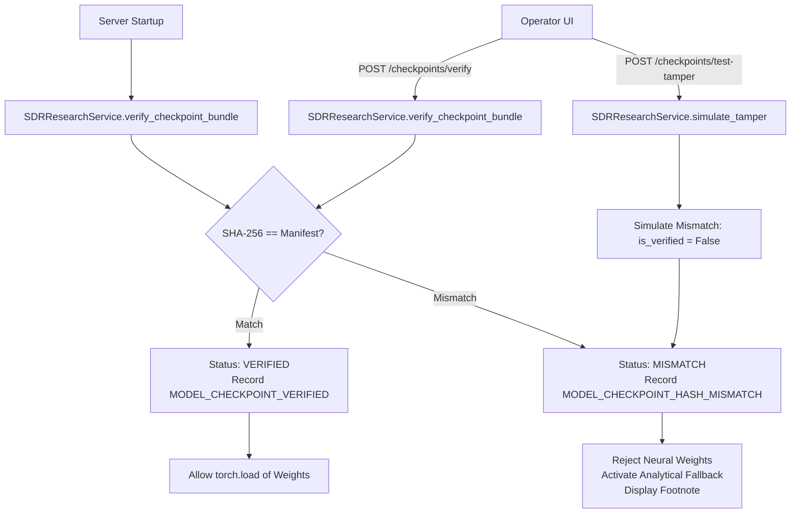

# Phase 5: Research Lab Model Governance & SDR Physical Layer - Research

**Researched:** 2026-10-20  
**Status:** Complete  
**Author:** GSD Phase Researcher  

---

## Executive Summary

Phase 5 delivers verifiable model governance, Apple Silicon Metal Performance Shaders (MPS) hardware acceleration with deterministic CPU fallback, empirical scientific visualizations, and synchronized Software-Defined Radio (SDR) physical layer flowgraphs.

### Current System Health & Baseline
- **Backend Test Suite:** 212/212 unit and integration tests passing in 52.81s across all transports, crypto subsystems, offline queues, and anomaly monitors.
- **Frontend Build & Linter:** Vite 8 + React 19 + TypeScript build completes in 641ms (`tsc -b && vite build`) with zero Oxlint errors.
- **Production Neural Checkpoint:** `Final-Project/lpi_v4/run/lpi_v4.best.pt` has exact verified SHA-256 digest `0e8e515355be8bffb48fc27ad63b8e4a4aead57b72d2b5ad969d58aeb1c0887c`, fully matching `Final-Project/lpi_v4/run/export_manifest.json` at training epoch 16.
- **Hardware Acceleration Probe:** Apple Silicon MPS is available and functional on Darwin ARM64 (`torch.backends.mps.is_available() == True`). Neural generator (`LPIGenerator`) executes on MPS cleanly. Neural decoder (`LPIDecoder`) encounters an unsupported complex floating-point operation (`ComplexFloat` in blind square-loop phase sync `blind_phase()`), requiring a deterministic fallback to CPU.
- **GNU Radio Flowgraphs:** `Final-Project/lpi_v4/tx_lpi_v4.grc` and `rx_lpi_v4.grc` are already calibrated to 245.76 kS/s and 2.484 GHz. The top-level legacy flowgraphs `Final-Project/grc/tx_lpi_cgan.grc` and `grc/rx_lpi_cgan.grc` currently reference 750 MHz and 1 MS/s, and must be harmonized to 2.484 GHz and 245.76 kS/s.

---

## Key Technical Requirements & Constraints

### Requirements Traceability (from REQUIREMENTS.md)
- **RSH-01:** Research Lab verifies SHA-256 digest of PyTorch model checkpoints against `export_manifest.json` before loading.
- **RSH-02:** Research Lab detects Apple Silicon Metal Performance Shaders (MPS) hardware acceleration with deterministic CPU fallback.
- **RSH-03:** Interactive research console displays empirical BER vs SNR curves, I/Q constellations, and 8-domain EW statistics battery.
- **RSH-04:** GNU Radio Companion flowgraphs (`tx_lpi_v4.grc`, `rx_lpi_cgan.grc`) and Ettus USRP UHD drivers operate at 245.76 kS/s and 2.484 GHz.

### User Decisions Traceability (from 05-CONTEXT.md)

| Decision ID | Domain | User Intent & Specification |
|---|---|---|
| **D-01** | Checkpoint Tamper Defense | Soft Warning with Analytical Fallback on Digest Mismatch: If SHA-256 does not match `export_manifest.json`, reject loading unverified neural weights, log audit event, and activate synthetic pseudo-random IQ fallback. |
| **D-02** | Governance Panel | Dedicated Governance Panel with Live Hash Seal in Checkpoints & Integrity sub-tabs rendering verified digest, manifest match badge, and "Re-Verify Checkpoint" button. |
| **D-03** | Model Scope | Strict V4 primary focus (`lpi_v4.best.pt`); Gen 1 files (`generator_lpi.pt`, `decoder_lpi.pt`, `lpi_checkpoint.pt`) cataloged as read-only historical archives. |
| **D-04** | Digest Lifecycle | Startup verification with cached state in `SDRResearchService` + `POST /api/v1/research/checkpoints/verify` endpoint for on-demand re-hashing. |
| **D-05** | Bundle Completeness | Full bundle integrity check: validates `lpi_v4.best.pt` SHA-256 and existence/sizes of bundle components (`generator_lpi.pt`, `decoder_lpi.pt`, `lpi_config.json`). |
| **D-06** | Audit Trail | Record `MODEL_CHECKPOINT_VERIFIED` (INFO) on success and `MODEL_CHECKPOINT_HASH_MISMATCH` (HIGH) on mismatch into SQLite `security_audit_logs`. |
| **D-07** | Tamper Simulation | Interactive dry-run tamper test bench via `POST /api/v1/research/checkpoints/test-tamper` demonstrating analytical fallback without mutating files on disk. |
| **D-08** | Fallback Visuals | Subtle card footnote `(Analytical Fallback Active: Neural Inference Disabled)` when analytical fallback is active. |
| **D-09** | Acceleration & Fallback | Hybrid auto-acceleration with deterministic CPU fallback. Run `LPIGenerator` on MPS; fallback gracefully to CPU if `LPIDecoder` throws `TypeError` on `ComplexFloat`. |
| **D-10** | Hardware Telemetry | 3D Tactical Hardware Matrix & Device Status Pill in UI displaying active backend, PyTorch build, GPU/CPU architecture, and inference latency. |
| **D-11** | Speed Benchmark | Dual-Device Speed Benchmark (MPS vs CPU) endpoint `POST /api/v1/research/benchmark/compare` running identical batches side-by-side. |
| **D-12** | Linker Safety | Strict `import torch` preceding `numpy`/`scipy` across all Python entry points; thread pool governance for CPU inference passes. |
| **D-13** | BER/SNR Plotting | Logarithmic interactive chart with 95% CI shading for BER vs SNR sweep (0 to 10 dB) on semi-log scale ($10^0$ to $10^{-5}$) with Matched-Filter and Field curves. |
| **D-14** | Training History | Multi-trace interactive convergence viewer for 74-epoch history: (1) Generator Loss & BCE, (2) Link BER at 5 dB, (3) Stealth Score $S_c$ & EW Gate progression. |
| **D-15** | EW Gate Matrix | 8-cell tactical gate matrix with scientific rationale tooltips and `[8 / 8 EW GATES PASSED: OPTIMAL STEALTH]` master banner. |
| **D-16** | Sample Generator | Interactive sample generator (128 / 256 / 512 / 1024 samples) with "Generate New Frame" button and hover crosshairs. |
| **D-17** | Data Export | Multi-format scientific export (JSON and CSV) for evaluation metrics and training history. |
| **D-18** | Dual-Track EW | Side-by-side comparison of LPI-CGAN (Track A) vs conventional RRC QPSK (Track B). |
| **D-19** | Live Polling | Continuous fast polling (2.0s) when actively viewing Research Lab. |
| **D-20** | Tab Throttling | Adaptive background tab throttling: relaxes polling from 2.0s to 10.0s when `document.hidden` is detected. |
| **D-21** | SDR Flowgraph Sync | Harmonize `grc/tx_lpi_cgan.grc` and `grc/rx_lpi_cgan.grc` from 750 MHz and 1 MS/s to 2.484 GHz and 245.76 kS/s. |
| **D-22** | SDR Standby | Amber `[SDR: STANDBY / DISCONNECTED]` pill when USRP is disconnected; safely inhibit physical RF transmission; use recorded baseline for displays. |
| **D-23** | Flowgraph Inspector | Interactive signal chain diagram from transmitter to receiver with parameter pills (245.76 kS/s, 2.484 GHz, RS(42,34), ZC-64). |
| **D-24** | Safety Interlock | Two-step operator confirmation & physical keying interlock switch before live RF keying at 2.484 GHz. |

### Technical Constraints
- **Apple Silicon Dynamic Linker Safety:** `import torch` MUST precede `numpy` and `scipy` imports across all entry points and test modules to avoid OpenBLAS symbol collision `SIGSEGV 139`.
- **Git Restrictions:** Automated git commits, pushes, and resets are strictly prohibited.
- **Reversibility Consideration:** Changes to flowgraph YAML structures and model execution wrappers are designated as costly; changes must be tested with strict regression assertions.

---

## Architecture & Component Design

### 1. Checkpoint Integrity & Governance Subsystem



#### Core Components & File Responsibilities
1. **`Final-Project/integration/sdr_research/service.py`:**
   - **`verify_checkpoint_bundle()`**: Computes SHA-256 for `lpi_v4.best.pt` and validates against `export_manifest.json` (`0e8e515355be8bffb48fc27ad63b8e4a4aead57b72d2b5ad969d58aeb1c0887c`).
   - **Bundle Completeness Validation**: Verifies existence and non-zero byte size of `generator_lpi.pt`, `decoder_lpi.pt`, and `lpi_config.json`.
   - **Cached Verification State**: Stores `_verification_cache = {"verified": bool, "digest": str, "timestamp": str, "tamper_simulated": bool}` to prevent redundant disk I/O on every API call.
   - **Tamper Simulation Engine**: `simulate_tamper(active: bool)` sets `_tamper_simulated = active` without mutating on-disk weights.
   - **Governed Model Loader**: When `_tamper_simulated` is True or digest does not match manifest, `load_model()` refuses to invoke `torch.load()` on neural weights and returns `{"fallback": True, "reason": "DIGEST_MISMATCH"}`.
   - **`get_signal_sample()` Update**: In fallback mode, synthesizes Gaussian pseudo-random IQ samples and attaches `fallback_active: True`, `footnote: "(Analytical Fallback Active: Neural Inference Disabled)"`.
2. **`Final-Project/messaging/api.py`:**
   - Exposes `POST /api/v1/research/checkpoints/verify`: Re-computes hashes on-demand, writes `MODEL_CHECKPOINT_VERIFIED` or `MODEL_CHECKPOINT_HASH_MISMATCH` to SQLite `security_audit_logs`.
   - Exposes `POST /api/v1/research/checkpoints/test-tamper`: Toggles simulated tamper mode, writes `MODEL_CHECKPOINT_HASH_MISMATCH` to `security_audit_logs`.

---

### 2. Hybrid Hardware Acceleration & Fallback Engine

```mermaid
flowchart TD
    DeviceDetect[Probe torch.backends.mps] --> MPSAvailable{MPS Available?}
    MPSAvailable -->|Yes| DeviceMPS[Backend: MPS\nRecommended: mps]
    MPSAvailable -->|No| DeviceCPU[Backend: CPU\nRecommended: cpu]

    GenTask[LPIGenerator Forward Pass] --> RunGen[Execute on MPS / CPU]
    RunGen --> GenSuccess{Success?}
    GenSuccess -->|Yes| ReturnGen[Return (2, T) Baseband Tensor]
    GenSuccess -->|Kernel Error| CatchGen[Catch RuntimeError/TypeError\nRecord Fallback in Telemetry\nExecute on CPU]

    DecTask[LPIDecoder Forward Pass] --> ComplexCheck{MPS Backend?}
    ComplexCheck -->|Yes: ComplexFloat Unsupported| AutoCPUDec[Graceful Execution on CPU\nAvoids torch.polar TypeError]
    ComplexCheck -->|No| NormalCPUDec[Execute on CPU]
```

#### Core Components & File Responsibilities
1. **`Final-Project/integration/sdr_research/service.py`:**
   - **`get_environment_metadata()` Extension**: Returns `active_inference_backend`, `fallback_active`, `fallback_reason`, `thread_count`, `mps_available`, `mps_built`.
   - **`run_comparative_benchmark(frames: int = 64)`**:
     - Runs `frames` through `LPIGenerator` on CPU with `time.perf_counter()`.
     - Runs `frames` through `LPIGenerator` on MPS with `torch.mps.synchronize()` before and after timing.
     - Computes execution time (ms), latency per frame (ms/frame), throughput (frames/s), and speedup factor ($T_{\text{CPU}} / T_{\text{MPS}}$).
   - **Thread Pool Management**: Configures CPU thread pool via `torch.set_num_threads(min(4, os.cpu_count()))` to govern resource consumption during fallback runs.
2. **`Final-Project/messaging/api.py`:**
   - Exposes `POST /api/v1/research/benchmark/compare`: Accepts `{"frames": 64}`, triggers comparative benchmark, returns side-by-side performance data.

---

### 3. Empirical Scientific Visualizations Suite

#### Recharts Semi-Logarithmic Scale with 95% CI Shading (D-13)
The empirical BER vs SNR sweep from `Final-Project/lpi_v4/run/eval.json` spans $10^0$ (at 0 dB) down to 0.0 (at 8–10 dB). A linear axis crushes values below $10^{-2}$.
- **Data Transformation for Log Scale:**
  - Map each SNR point ($0, 2, 4, 6, 8, 10$ dB).
  - When BER is $0.0$, clamp to display floor $10^{-5}$ for Recharts `<YAxis scale="log" domain={[1e-5, 1]} />`.
  - Format tooltip to show: `0.0 (Zero Bit Errors / Perfect Decoding)` when raw BER is 0.
  - Calculate 95% Confidence Interval upper and lower bounds:
    $\text{CI}_{95,\text{upper}} = \text{field\_ber} + \text{field\_ci95}$,
    $\text{CI}_{95,\text{lower}} = \max(10^{-5}, \text{field\_ber} - \text{field\_ci95})$.
  - Render `<Area>` with `fill="#065f46" fillOpacity={0.3}` covering the CI band between upper and lower bounds.
  - Overlay `<Line>` for Matched-Filter BER (`#10b981`) and Field BER (`#38bdf8`), with toggleable Frame Error Rate (FER) (`#f59e0b`).

#### Multi-Trace Convergence Viewer (D-14)
`Final-Project/lpi_v4/run/lpi_v4.csv` contains 74 recorded epochs.
- Provide a 3-segment view selector:
  1. **Loss & Convergence:** `loss_G` (Generator Loss) and `bce` (Binary Cross-Entropy reconstruction loss).
  2. **Error Rates:** `ber5` (Link BER at 5 dB threshold) and `ber_link` (Uncoded channel BER).
  3. **Stealth & Gates:** $S_c$ (Composite Stealth Score) and `n_pass` (Number of passed EW gates out of 8).
- Include an interactive hover scrubber displaying exact numeric values at each epoch.

#### 8-Cell Tactical Gate Matrix (D-15)
Render a dedicated 8-cell responsive tactical grid with scientific rationale tooltips:

| Gate | Domain | Baseline Value | Gate Threshold | Scientific Rationale |
|---|---|---|---|---|
| **1** | Kolmogorov-Smirnov ($p$) | 0.8646 | $p > 0.05$ | Tests amplitude marginal against standard Gaussian null hypothesis $H_0 \sim \mathcal{N}(0,1)$. |
| **2** | Excess Kurtosis ($\kappa$) | 2.9907 | $|\kappa - 3.0| \le 0.15$ | Measures fourth standardized moment; natural thermal noise exhibits mesokurtic distribution $\kappa = 3.0$. |
| **3** | Spectral Entropy ($H$) | 0.9566 | $H > 0.95$ | Welch/Hann PSD flatness; prevents detectable energy concentration in sub-bands. |
| **4** | IQ Circularity ($\rho$) | 0.0107 | $\rho < 0.15$ | Proper complex noise pseudo-covariance $E[z^2] \approx 0$; prevents elliptic constellation signatures. |
| **5** | PAPR Deviation | 0.0087 dB | $\|\Delta\text{PAPR}\| < 3\text{ dB}$ | Compares peak-to-average power ratio to Gaussian reference to eliminate power amplifier ripple signatures. |
| **6** | Spectral Correlation ($S_{\text{cf}}$) | 1.0129 | $S_{\text{cf}} < 3.0$ | Cyclic autocorrelation peak relative to noise; eliminates cyclostationary baud-rate lines. |
| **7** | Fourth-Order Cumulant ($C_{42}$) | -0.0048 | $\|C_{42}\| < 0.30$ | Higher-Order Statistics cumulant is zero for complex Gaussian processes. |
| **8** | Wigner-Ville Spread ($W_{\text{vd}}$) | 1.0166 | $W_{\text{vd}} < 3.70$ | Time-frequency energy concentration ratio; ensures uniform flat plane without localized chirp ridges. |

Include a prominent summary badge: `[8 / 8 EW GATES PASSED: OPTIMAL STEALTH]`.

#### Interactive Sample Generator (D-16)
- Controls: Frame size selector (128, 256, 512, 1024 samples) and "Generate New Frame" action button.
- Interaction: Renders baseband I/Q constellation diagram with crosshair tooltips showing instantaneous $I$, $Q$, and power ($I^2 + Q^2$).

#### Multi-Format Scientific Export (D-17)
- Provide one-click "Export JSON" and "Export CSV" buttons.
- Exports structured experiment data with epoch metrics, confidence bounds, and hardware metadata.

#### Adaptive Polling & Background Throttling (D-19, D-20)
- Polling timer: 2.0s when tab is active (`document.hidden == false`).
- Throttled timer: 10.0s when tab is in background (`document.hidden == true`).
- Cleans up interval timers on component unmount.

---

### 4. SDR Physical Layer & Hardware Flowgraphs

#### GNU Radio Companion Synchronization (D-21)
The project contains four GRC flowgraph definitions:
1. `Final-Project/lpi_v4/tx_lpi_v4.grc` — already set to `center_freq = 2.484e9` and `samp_rate = 245760`.
2. `Final-Project/lpi_v4/rx_lpi_v4.grc` — already set to `center_freq = 2.484e9` and `samp_rate = 245760`.
3. `Final-Project/grc/tx_lpi_cgan.grc` — currently configured for `750000000` (750 MHz) and `1000000` (1 MS/s). Must be updated to:
   - `samp_rate`: `245760` (comment: `245.76 kS/s covert streaming`)
   - `center_freq`: `2484000000` (comment: `2.484 GHz ISM Channel 14`)
4. `Final-Project/grc/rx_lpi_cgan.grc` — currently configured for `750000000` and `1000000`. Must be updated to:
   - `samp_rate`: `245760` (comment: `245.76 kS/s covert streaming`)
   - `center_freq`: `2484000000` (comment: `2.484 GHz ISM Channel 14`)
5. Associated compiled Python runners (`grc/tx_lpi_cgan.py`, `grc/rx_lpi_cgan.py`, and root duplicates) must have matching defaults.

#### Hardware Standby & Operator Interlock (D-22, D-24)
- **Standby Detection:** `workstation_service.probe_sdr_hardware()` queries UHD driver; if device is not attached, returns `device_connected: false`.
- **UI Standby Pill:** Displays amber `[SDR: STANDBY / DISCONNECTED]` indicator.
- **RF Keying Safety Interlock:** Live transmission requires:
  1. A physical toggle switch in UI (`Arm RF Transmission`).
  2. A confirmation modal verifying ISM Channel 14 regulatory compliance.

---

## API & Data Flow Analysis

### Endpoint Specification

| Method | Endpoint | Query / Body | Response Payload | Purpose |
|---|---|---|---|---|
| `GET` | `/api/v1/research/checkpoints` | None | `{ "v4_checkpoints": {...}, "root_checkpoints": {...}, "manifest_verified": bool, "bundle_intact": bool }` | Audit checkpoint presence and integrity. |
| `POST` | `/api/v1/research/checkpoints/verify` | None | `{ "success": true, "verified": true, "sha256": "0e8e5153...", "bundle_files": {...}, "audit_log_id": "..." }` | On-demand re-hashing and SQLite audit trail generation. |
| `POST` | `/api/v1/research/checkpoints/test-tamper` | `{"tamper": bool}` | `{ "tamper_simulated": true, "fallback_active": true, "audit_log_id": "...", "status": "ANALYTICAL_FALLBACK_ACTIVE" }` | Dry-run tamper simulation without disk mutation. |
| `GET` | `/api/v1/research/environment` | None | `{ "platform": "macOS...", "is_apple_silicon": true, "mps_available": true, "active_backend": "mps", "thread_count": 4, "fallback_active": false }` | Real-time execution environment telemetry. |
| `POST` | `/api/v1/research/benchmark/compare` | `{"frames": 64}` | `{ "frames": 64, "cpu": {"time_ms": 42.1, "ms_per_frame": 0.658}, "mps": {"time_ms": 14.5, "ms_per_frame": 0.226, "available": true}, "speedup_factor": 2.9 }` | Side-by-side CPU vs MPS inference latency benchmark. |
| `GET` | `/api/v1/research/training-history` | `?limit=100` | Array of 74 `TrainingEpoch` objects (`epoch`, `loss_G`, `bce`, `ber5`, `ber_link`, `Sc`, `n_pass`). | Empirical convergence logs. |
| `GET` | `/api/v1/research/evaluation` | None | `EvaluationReport` object (`block_stealth`, `block_link` 0–10 dB, `ci95`, `gate_verdict`). | 8-domain EW battery & SNR sweep data. |
| `GET` | `/api/v1/research/signal-sample` | `?n=128|256|512|1024` | `{ "source": "LPI_CGAN_NEURAL_GENERATOR", "constellation": [...], "spectrum": [...], "waveform": [...], "fallback_active": false }` | Live discrete baseband samples. |

---

## Validation Architecture

### 1. Automated Backend Test Suite
Create a dedicated test module `Final-Project/tests/test_research_governance.py` with comprehensive assertions:
- **`test_checkpoint_sha256_matches_manifest()`**:
  - Asserts that SHA-256 of `lpi_v4/run/lpi_v4.best.pt` equals `0e8e515355be8bffb48fc27ad63b8e4a4aead57b72d2b5ad969d58aeb1c0887c`.
  - Verifies presence of exported bundle components (`generator_lpi.pt`, `decoder_lpi.pt`, `lpi_config.json`).
- **`test_checkpoint_verify_endpoint()`**:
  - Invokes `POST /api/v1/research/checkpoints/verify`.
  - Asserts HTTP 200, `verified: True`, and validates entry in `security_audit_logs` with action `MODEL_CHECKPOINT_VERIFIED`.
- **`test_tamper_simulation_activates_analytical_fallback()`**:
  - Invokes `POST /api/v1/research/checkpoints/test-tamper` with `{"tamper": True}`.
  - Asserts audit log with action `MODEL_CHECKPOINT_HASH_MISMATCH` and severity `HIGH`.
  - Verifies `get_signal_sample()` returns `source: "SYNTHETIC_ANALYTICAL_FALLBACK"` and `fallback_active: True`.
  - Resets tamper mode and verifies clean return to neural generator.
- **`test_apple_silicon_mps_detection_and_fallback()`**:
  - Asserts `get_environment_metadata()` accurately reports Apple Silicon platform and MPS availability.
  - Verifies `LPIGenerator` executes on MPS when available.
  - Verifies `LPIDecoder` gracefully executes on CPU without unhandled `ComplexFloat` exceptions.
- **`test_comparative_benchmark_endpoint()`**:
  - Invokes `POST /api/v1/research/benchmark/compare`.
  - Verifies valid timing results for CPU and MPS, and positive speedup factor.
- **`test_gnuradio_flowgraphs_calibrated_to_2484_ghz()`**:
  - Loads and parses `grc/tx_lpi_cgan.grc` and `grc/rx_lpi_cgan.grc` using YAML parser.
  - Asserts `samp_rate` is `245760` and `center_freq` is `2484000000`.
  - Verifies `lpi_v4/tx_lpi_v4.grc` and `rx_lpi_v4.grc` match `245760` and `2.484e9`.

### 2. Frontend Build & Quality Verification
- `npm run lint` — Oxlint verification across all `.tsx` and `.ts` files (target: 0 errors).
- `npm run build` — TypeScript compilation (`tsc -b`) and Vite production bundling (target: clean exit 0).
- Visual and interactive verification:
  - Semi-logarithmic BER vs SNR curve with shaded 95% CI band rendering properly without zero-value distortion.
  - 3-segment convergence viewer switching cleanly between Loss, BER, and Stealth metrics across 74 epochs.
  - 8-cell gate matrix rendering all 8 domain cards with rationale tooltips and green pass seals.
  - Hash seal pill displaying short digest and verification badge.
  - Comparative benchmark triggering side-by-side CPU/MPS latency cards.
  - Visibility-based adaptive polling relaxing to 10s when backgrounded.

---

## Implementation Pitfalls & Mitigation Strategies

### Pitfall 1: PyTorch MPS `ComplexFloat` Crash in Decoder
- **Root Cause:** `LPIDecoder.blind_phase()` calls `torch.polar(torch.ones_like(re), 2.0 * torch.atan2(im, re))` to perform carrier phase tracking. PyTorch on MPS does not support `ComplexFloat` operations, throwing:
  `TypeError: Trying to convert ComplexFloat to the MPS backend but it does not have support for that dtype.`
- **Mitigation:**
  1. Wrap model execution in `SDRResearchService`: run `LPIGenerator` on MPS (which uses only real-valued convolutions and activations), and execute `LPIDecoder` on CPU.
  2. Implement mathematical real-valued decomposition for blind phase sync if ever running decoder on MPS:
     $\theta_2 = 2 \text{atan2}(im, re)$, $\text{real\_sum} = \sum \cos(\theta_2)$, $\text{imag\_sum} = \sum \sin(\theta_2)$,
     $\phi = 0.5 \text{atan2}(\text{imag\_sum}, \text{real\_sum})$.
  3. Ensure exception handlers catch `(TypeError, RuntimeError)` and fall back to CPU seamlessly, recording the event in diagnostics telemetry.

### Pitfall 2: Dynamic Linker OpenBLAS Segfaults (`SIGSEGV 139`)
- **Root Cause:** On macOS ARM64 with Apple Silicon, importing `numpy` or `scipy` before `torch` causes duplicate symbol conflicts in OpenBLAS/Accelerate frameworks, leading to fatal segmentation faults.
- **Mitigation:** Enforce `import torch` at line 1 of all Python entry points, API routes, service modules, and test fixtures (`conftest.py`).

### Pitfall 3: Recharts Logarithmic Scale Inversion on Zero Values
- **Root Cause:** In `eval.json`, Field BER drops to $0.0$ at SNR = 8 dB and 10 dB. In Recharts, `scale="log"` with a value of $0.0$ evaluates $\log_{10}(0) = -\infty$, which causes Recharts SVG path generators to produce `NaN` coordinates, breaking the entire chart.
- **Mitigation:** In the frontend data mapper:
  - Clamp plotted values to a positive minimum floor: $\max(10^{-5}, \text{val})$.
  - Provide a custom tooltip formatter that displays `0.0 (Zero Errors / Field Perfect)` whenever the underlying metric is 0.

### Pitfall 4: GRC YAML Formatting Drift
- **Root Cause:** GNU Radio flowgraph files (`.grc`) are serialized in YAML with specific parameter block formats. Unstructured regex replacements can corrupt line indentation or YAML quotation styles, causing GNU Radio to reject the flowgraph.
- **Mitigation:** Use strict YAML-safe modifications or targeted character-exact replacements for `samp_rate` and `center_freq`, followed by validation using `yaml.safe_load()`.

### Pitfall 5: Background Tab Resource Drain
- **Root Cause:** A 2.0s polling interval continuously executing baseband generation on the backend can drain battery and consume CPU/GPU resources when the user leaves the browser tab open in the background.
- **Mitigation:** Attach an event listener to `document.addEventListener('visibilitychange', ...)` that dynamically throttles the polling interval to 10.0s when `document.hidden` is true, and resumes 2.0s when the tab is restored.

---

## Recommended Plan Breakdown for Phase 5

### Plan 05-01: Backend Model Governance, MPS Acceleration & SDR Flowgraphs
1. **Model Governance & Tamper Simulation:**
   - Update `Final-Project/integration/sdr_research/service.py`: cached bundle verification, startup check, soft warning with analytical fallback, and tamper simulation flag.
   - Update `Final-Project/messaging/api.py`: add `POST /checkpoints/verify` and `POST /checkpoints/test-tamper` with `SecurityAuditLog` entries.
2. **Hybrid MPS / CPU Acceleration:**
   - Implement hybrid MPS generator execution with automatic CPU fallback.
   - Add `POST /api/v1/research/benchmark/compare` for CPU vs MPS comparative benchmarks.
   - Extend `GET /api/v1/research/environment` with thread allocation and active backend telemetry.
3. **GRC Flowgraph Harmonization:**
   - Harmonize `Final-Project/grc/tx_lpi_cgan.grc` and `grc/rx_lpi_cgan.grc` to 2.484 GHz and 245.76 kS/s.
   - Harmonize compiled Python flowgraphs (`grc/tx_lpi_cgan.py`, `grc/rx_lpi_cgan.py`).
4. **Validation:**
   - Create `Final-Project/tests/test_research_governance.py` covering all new endpoints, tamper modes, and flowgraph YAML checks.

### Plan 05-02: React Research Lab Visualizations, Governance Panels & Polling
1. **Governance & Hardware Telemetry UI:**
   - Update `Final-Project/frontend/src/types/index.ts` and `frontend/src/services/api.ts` with new endpoint types.
   - Add Live Hash Seal card, "Re-Verify Checkpoint" button, and "Simulate Digest Mismatch" button in Checkpoints/Integrity tabs.
   - Add Apple Silicon MPS hardware status pill and Comparative Benchmark tool.
   - Add subtle fallback footnote `(Analytical Fallback Active: Neural Inference Disabled)`.
2. **Scientific Charting Enhancements:**
   - Upgrade BER vs SNR sweep to semi-logarithmic Recharts `<AreaChart>` with shaded 95% CI bands ($10^0$ to $10^{-5}$).
   - Add 3-segment toggle and hover scrubber to 74-epoch training convergence viewer.
   - Upgrade 8-domain EW battery to 8-cell tactical card matrix with scientific rationale tooltips and `[8/8 EW GATES PASSED]` banner.
   - Add interactive sample length controls (128 / 256 / 512 / 1024) and hover crosshairs to constellation diagram.
   - Add JSON and CSV multi-format scientific export buttons.
3. **Adaptive Polling & Safety Interlock:**
   - Implement 2.0s active / 10.0s background tab throttling.
   - Implement SDR physical standby pill and two-step RF keying confirmation modal.
4. **Validation:**
   - Run `npm run lint` and `npm run build` to verify 0 errors.

---

## RESEARCH COMPLETE
