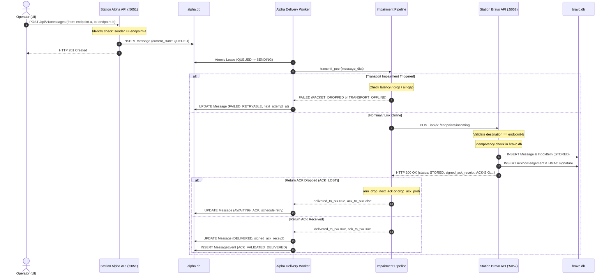

# Phase 6: Multi-Database Physical Isolation & Dedicated Daemon Endpoints - Research

**Researched:** 2026-10-20  
**Status:** Complete & Ready for Planning  
**Target Milestone:** v2.0 (Phase 6 of 9)  
**Requirements Covered:** MDB-01, MDB-02, MDB-03  
**Decisions Addressed:** D-01, D-02, D-03, D-04  

---

## Executive Summary

Phase 6 marks the architectural transition of SHADOWCOMM from a single-database, shared-memory tactical messaging prototype into a genuinely distributed, physically isolated multi-node system. Prior to this phase, Station Alpha and Station Bravo shared a single SQLite file (`shadowcomm_messaging.db`), with cross-station "delivery" modeled via in-process database writes where the sender's worker thread directly inserted records into the recipient's inbox.

In Phase 6, Station Alpha and Station Bravo run as completely distinct operating system processes with separate, dedicated SQLite WAL databases (`alpha.db` and `bravo.db`), dedicated network daemon ports (`:5051` for Station Alpha, `:5052` for Station Bravo), and zero shared in-memory variables or filesystem locks (**MDB-01**). Cross-station message transmission transitions from local database updates to authentic HTTP/REST peer forwarding across simulated channel impairments, with independent outbox queue leasing on the sender and atomic inbox persistence on the receiver (**MDB-02**). Furthermore, the unified React web console is upgraded to monitor and connect directly to both daemon endpoints simultaneously with real-time per-station connection telemetry, independent health diagnostics, and graceful fallback to browser IndexedDB offline outboxes when a daemon is taken offline (**MDB-03**).

The research establishes that this transition can be accomplished with 100% backward compatibility for the existing 218 automated pytest test suite, requiring no breaking changes to cryptographic envelopes, state machine rules, or RF research lab components.

---

## Key Technical Requirements & Constraints

### 1. Requirements Matrix

| Requirement | Description | Target Component | Verification Mechanism |
|---|---|---|---|
| **MDB-01** | Backend supports running independent Station Alpha and Station Bravo database processes (`alpha.db` on port 5051 and `bravo.db` on port 5052) with zero shared in-memory variables or filesystem locks. | `messaging/db.py`, `messaging/server.py` | Pytest multi-process isolation test verifying separate SQLite WAL handles and independent table state. |
| **MDB-02** | Message transmission between isolated stations occurs strictly over simulated IP/REST transport endpoints with independent queue leasing and status persistence on each node. | `messaging/transport.py`, `messaging/api.py`, `messaging/worker.py` | Pytest peer-forwarding test with simulated air-gap outage and HTTP ingest verification. |
| **MDB-03** | React UI console supports connecting to both independent station daemon ports with live connection state and independent health diagnostics. | `frontend/src/services/api.ts`, `frontend/src/components/MessagesView.tsx`, `StationConsoleColumn.tsx` | TypeScript compilation, Oxlint validation, and live dual-endpoint connection HUD rendering. |

### 2. User Decisions from Phase Discussion (06-CONTEXT.md)

- **D-01: Unified Gateway + Direct Access.** The canonical web interface runs on port 5050 (or Vite dev 5173/5050) providing a side-by-side dual-feed monitoring dashboard connected to both Station Alpha (`http://127.0.0.1:5051/api/v1`) and Station Bravo (`http://127.0.0.1:5052/api/v1`). Additionally, each daemon independently serves its own standalone tactical console directly at its dedicated port (`:5051` or `:5052`).
- **D-02: REST Peer-to-Peer Transport with Impairment Pipeline.** When Station Alpha dispatches a message addressed to Station Bravo, Alpha's background delivery worker makes an HTTP POST request to Station Bravo's incoming ingest endpoint (`http://127.0.0.1:5052/api/v1/endpoints/incoming`) routed through the tactical impairment engine (latency, drop rates, air-gap outage simulation). Station Bravo persists the message in `bravo.db`, issues a signed HMAC ACK back over HTTP, and Alpha reconciles `signed_ack_receipt` in `alpha.db`.
- **D-03: Strict Local Node Identity.** `alpha.db` is initialized with Station Alpha (`endpoint-a`) designated as the local node; submissions attempting to author messages as `endpoint-b` directly into `alpha.db` are rejected with HTTP 403 `IDENTITY_SPOOFING_BLOCKED`. Station Bravo (`bravo.db`) enforces the identical rule for `endpoint-b`. Local drafts cannot forge remote identities.
- **D-04: Unified Multi-Station Launcher.** `scripts/dev.sh` supports a `--dual-station` flag (enabled by default) that spins up Station Alpha on port 5051 (`alpha.db`), Station Bravo on port 5052 (`bravo.db`), and the unified frontend console on port 5050 with single-command `trap cleanup INT TERM EXIT` process lifecycle management. Standalone single-station mode is supported via `--station alpha` or `--station bravo`.

### 3. Critical Platform & Environment Constraints

- **macOS Apple Silicon Linker Safety:** `import torch` MUST precede any `numpy` or `scipy` imports across all entry points, modules, and test fixtures to prevent OpenBLAS symbol collision crashes (`SIGSEGV 139`).
- **SQLite Concurrency & WAL Pragmas:** Every SQLite engine connection MUST execute `PRAGMA busy_timeout=5000` before `PRAGMA journal_mode=WAL` to prevent database lock collisions between HTTP request threads and background delivery worker threads.
- **Git Operations Policy:** Automated subagents MUST NOT execute `git commit`, `git push`, or `git reset`. All repository changes are staged and reviewed by the operator.
- **Backward Compatibility:** All existing 218 passing automated tests in `Final-Project/tests/` MUST continue to pass without modification. If `station_id` or `peer_url` is omitted, the backend defaults to nominal single-node evaluation.

---

## Architecture & Component Design

```
+---------------------------------------------------------------------------------------------------+
|                                      OPERATOR WEB BROWSER                                         |
|                                                                                                   |
|  Unified Gateway Console (Port 5050 / Vite 5173)                                                  |
|  +--------------------------------------------+  +---------------------------------------------+  |
|  | Station Alpha Column                       |  | Station Bravo Column                        |  |
|  | [CONNECTED :5051 | alpha.db]               |  | [CONNECTED :5052 | bravo.db]                |  |
|  | Direct REST: http://127.0.0.1:5051/api/v1    |  | Direct REST: http://127.0.0.1:5052/api/v1     |  |
|  +--------------------------------------------+  +---------------------------------------------+  |
+---------------------------------------------------------------------------------------------------+
                         |                                               |
                         | Direct Client Calls                           | Direct Client Calls
                         v                                               v
+-----------------------------------------------+  HTTP POST    +------------------------------------+
| STATION ALPHA DAEMON (Port 5051)              |  (D-02 Peer)  | STATION BRAVO DAEMON (Port 5052)   |
| Node Identity: endpoint-a (Local)             | ------------> | Node Identity: endpoint-b (Local)  |
|                                               | <------------ |                                    |
| +-------------------------------------------+ |   HMAC ACK    | +--------------------------------+ |
| | Flask API: POST /api/v1/messages          | |               | | Flask API:                     | |
| | (Enforces sender_id == endpoint-a)        | |               | | POST /api/v1/endpoints/incoming| |
| | (Rejects endpoint-b with HTTP 403 D-03)   | |               | | (Deduplicates & Stores Inbox)  | |
| +-------------------------------------------+ |               | +--------------------------------+ |
|                        |                      |               |                  |                 |
|                        v                      |               |                  v                 |
| +-------------------------------------------+ |               | +--------------------------------+ |
| | Delivery Worker (Embedded or Standalone)  | |               | | Delivery Worker                | |
| | - Atomic Lease from alpha.db              | |               | | - Atomic Lease from bravo.db   | |
| | - Simulated Transport Impairment Pipeline | |               | | - Independent State Machine    | |
| | - HTTP POST to Bravo :5052/endpoints/...  | |               | +--------------------------------+ |
| +-------------------------------------------+ |               |                  |                 |
|                        |                      |               |                  v                 |
|                        v                      |               | +--------------------------------+ |
| +-------------------------------------------+ |               | | Physical SQLite: bravo.db      | |
| | Physical SQLite: alpha.db                 | |               | | (data/bravo.db)                | |
| | (data/alpha.db)                           | |               | | - Endpoints (B local, A remote)| |
| | - Endpoints (A local, B remote)           | |               | | - Verified Inbox & Receipts    | |
| | - Outbox Leases & State History           | |               | +--------------------------------+ |
| +-------------------------------------------+ |               +------------------------------------+
+-----------------------------------------------+
```

### 1. Database Layer (`messaging/db.py` & `messaging/models.py`)

1. **Configurable Database File Paths:**
   - Default locations: `Final-Project/data/alpha.db` and `Final-Project/data/bravo.db`.
   - `get_engine(db_path)` automatically ensures the target directory exists via `os.makedirs(os.path.dirname(os.path.abspath(db_path)), exist_ok=True)`.
   - Separate connection pools (`_engines[db_path]` and `_session_factories[db_path]`) guarantee zero shared file descriptors or SQLite connection handles.
2. **Endpoint Node Local Designation:**
   - In `models.py`, `Endpoint` receives an `is_local = Column(Boolean, default=False, nullable=False)` flag.
   - Schema migration in `db.py:_init_db()` adds `is_local` safely using `PRAGMA table_info(endpoints)` and `ALTER TABLE endpoints ADD COLUMN is_local BOOLEAN DEFAULT 0`.
   - `init_db(db_path, station_id=None)` updates `is_local`:
     - In `alpha.db` (`station_id="endpoint-a"`): `endpoint-a.is_local = True`, `endpoint-b.is_local = False`.
     - In `bravo.db` (`station_id="endpoint-b"`): `endpoint-a.is_local = False`, `endpoint-b.is_local = True`.
     - In legacy test databases (`station_id=None`): both remain non-restrictive for backward compatibility.
   - Node configuration is also durably recorded in `system_settings`:
     - `node_station_id`: `"endpoint-a"` or `"endpoint-b"`
     - `node_station_name`: `"Station Alpha"` or `"Station Bravo"`
     - `node_station_port`: `"5051"` or `"5052"`
     - `node_peer_url`: `"http://127.0.0.1:5052/api/v1"` (or `:5051` for Bravo)

### 2. Server & API Layer (`messaging/server.py` & `messaging/api.py`)

1. **Extended Application Factory:**
   ```python
   def create_app(
       db_path: Optional[str] = None,
       station_id: Optional[str] = None,
       station_name: Optional[str] = None,
       port: Optional[int] = None,
       peer_url: Optional[str] = None,
   ) -> Flask:
   ```
   Stores parameters in `app.config["DB_PATH"]`, `app.config["STATION_ID"]`, `app.config["STATION_NAME"]`, `app.config["STATION_PORT"]`, and `app.config["PEER_URL"]`.
2. **CORS Headers for Multi-Port Topology:**
   `add_cors_headers` permits cross-origin communication across `http://127.0.0.1:5050`, `http://localhost:5050`, `http://127.0.0.1:5051`, `http://localhost:5051`, `http://127.0.0.1:5052`, `http://localhost:5052`, `http://127.0.0.1:5173`, and `http://localhost:5173`.
3. **Identity Spoofing Validation in `POST /api/v1/messages` (D-03):**
   ```python
   local_station_id = current_app.config.get("STATION_ID")
   if local_station_id and sender_endpoint_id != local_station_id:
       return jsonify({
           "error": "IDENTITY_SPOOFING_BLOCKED",
           "detail": f"Local node identity is '{local_station_id}'. Local drafts cannot author messages as remote station '{sender_endpoint_id}'."
       }), 403
   ```
4. **Enhanced Diagnostic Health Check `GET /api/v1/health`:**
   Reports node identity metadata:
   ```json
   {
     "status": "HEALTHY",
     "service": "shadowcomm-reliable-messaging",
     "version": "2.0.0",
     "station_id": "endpoint-a",
     "station_name": "Station Alpha",
     "db_path": "alpha.db",
     "port": 5051,
     "peer_url": "http://127.0.0.1:5052/api/v1",
     "worker_status": "RUNNING",
     "transport_mode": "SIMULATION"
   }
   ```
5. **Peer Ingest Endpoint `POST /api/v1/endpoints/incoming` (D-02):**
   Dedicated peer-to-peer ingest route that receives cross-station message bundles, validates destination, deduplicates against local database, stores in recipient inbox, and returns cryptographic HMAC ACK receipt.

### 3. Transport & Delivery Worker Layer (`messaging/transport.py` & `messaging/worker.py`)

1. **Peer Forwarding Impairment Pipeline:**
   When `peer_url` is configured and destination is remote:
   - **Forward Impairment Stage:**
     - Checks `is_online`: if False, returns `error_code="TRANSPORT_OFFLINE"`.
     - Injects configured artificial latency (`time.sleep(latency_ms / 1000)`).
     - Checks single-shot message drop (`arm_drop_next_message`) or statistical drop (`drop_message_prob`): if triggered, returns `error_code="PACKET_DROPPED"`.
     - Checks HMAC corruption: if triggered, returns `error_code="HMAC_VERIFICATION_FAILED"`.
     - Checks deterministic test drop sets.
   - **Network Transmission Stage:**
     - Executes HTTP POST request to `{peer_url}/endpoints/incoming` with JSON message bundle and 5-second timeout.
     - Catches `requests.exceptions.ConnectionError` and `requests.exceptions.Timeout`: converts to retryable `error_code="TRANSPORT_OFFLINE"`.
     - Validates HTTP response status code: non-200 responses converted to retryable `error_code=f"PEER_HTTP_{status_code}"`.
   - **Return Path Impairment Stage (ACK Delivery):**
     - Checks single-shot ACK drop (`arm_drop_next_ack`) or statistical drop (`drop_ack_prob`).
     - If ACK is dropped: returns `delivered_to_receiver=True`, `ack_delivered_to_sender=False`, `error_code="ACK_LOST"`.
     - If ACK succeeds: returns `delivered_to_receiver=True`, `ack_delivered_to_sender=True`, `ack_response=response.json()`.
2. **QueueWorker Reconciliation:**
   - In `worker.py:process_message()`:
     - When `tx_result` includes `ack_response`:
       - Sender transitions message state to `DELIVERED`.
       - Attaches `signed_ack_receipt` returned by remote node.
       - Records `ACK_VALIDATED_DELIVERED` event.
       - Clears lease and commits to `alpha.db`.
       - **Crucial Distinction:** Does NOT call `AckManager.process_incoming_at_receiver()` on the local session; receiver persistence was already executed by the remote peer daemon inside `bravo.db`.
     - When `ack_delivered_to_sender` is False due to `ACK_LOST`:
       - Sender transitions message to `AWAITING_ACK` with exponential backoff.
       - Subsequent retry sends identical packet to Bravo; Bravo detects duplicate, avoids re-inserting into inbox, and returns the existing signed receipt.
     - When `delivered_to_receiver` is False:
       - Sender transitions to `FAILED_RETRYABLE` (or `FAILED_FINAL` on attempt exhaustion).

### 4. Frontend Multi-Station Architecture (`frontend/src/`)

1. **Station-Aware API Clients (`services/api.ts`):**
   - Refactor `ApiClient` to accept `baseUrl: string`.
   - Export canonical instances:
     - `api`: default gateway client (`/api/v1`)
     - `alphaApi`: dedicated Station Alpha client (`http://127.0.0.1:5051/api/v1` or `/api/v1` when browsed on `:5051`)
     - `bravoApi`: dedicated Station Bravo client (`http://127.0.0.1:5052/api/v1` or `/api/v1` when browsed on `:5052`)
   - Export helper `getStationApiClient(stationId: string): ApiClient`.
2. **Independent Station Feed Wiring (`MessagesView.tsx` & `StationConsoleColumn.tsx`):**
   - Station Alpha column queries `alphaApi` for:
     - `getInbox('endpoint-a')`
     - `getOutbox('endpoint-a')`
     - `getHealth()`
     - `submitMessage(...)`
   - Station Bravo column queries `bravoApi` for:
     - `getInbox('endpoint-b')`
     - `getOutbox('endpoint-b')`
     - `getHealth()`
     - `submitMessage(...)`
3. **Live Health & Connection Diagnostics HUD:**
   - Each column renders an active connection badge:
     - Connected: `[CONNECTED :5051 | alpha.db]` (illuminated cyan for Alpha, emerald for Bravo)
     - Disconnected: `[OFFLINE :5052 | Unreachable]` (amber/rose pulse)
   - When a station is offline, message composition seamlessly routes to browser IndexedDB offline outbox (`outboxDb.ts`).
   - When the station daemon comes back online, `syncService` flushes pending outbox messages to the respective station.

### 5. Multi-Daemon Process Launcher (`scripts/dev.sh` & `scripts/stop_dev.sh`)

1. **Launcher Flags & Topology:**
   - `./scripts/dev.sh --dual-station` (default):
     - Starts Station Alpha on `:5051` (`data/alpha.db`, `--station-id endpoint-a`, `--peer-url http://127.0.0.1:5052/api/v1`, embedded worker).
     - Starts Station Bravo on `:5052` (`data/bravo.db`, `--station-id endpoint-b`, `--peer-url http://127.0.0.1:5051/api/v1`, embedded worker).
     - Starts Gateway & Frontend server on `:5050` (serving React UI).
     - Single `trap cleanup INT TERM EXIT` terminates all background PIDs cleanly.
   - `./scripts/dev.sh --station alpha`:
     - Starts Station Alpha only on `:5051` (serving standalone tactical console).
   - `./scripts/dev.sh --station bravo`:
     - Starts Station Bravo only on `:5052` (serving standalone tactical console).
2. **Shutdown Script (`scripts/stop_dev.sh`):**
   - Terminates processes listening on ports `5050`, `5051`, `5052`, and `5173`.
   - Cleans up any orphaned `messaging.worker` or `messaging.server` processes.

---

## API & Data Flow Analysis

### 1. Cross-Station Message Forwarding Flow



### 2. Endpoints Specification

#### A. Peer Ingest Endpoint: `POST /api/v1/endpoints/incoming`

- **Purpose:** Ingests a cross-station message delivered by a remote peer daemon.
- **Headers:**
  - `Content-Type: application/json`
  - `X-Endpoint-Token: <token>` (optional pre-shared secret token)
- **Request Body:**
  ```json
  {
    "message_id": "9b1deb4d-3b7d-4bad-9bdd-2b0d7b3dcb6d",
    "client_idempotency_key": "msg-1729410000000-abc123",
    "sender_endpoint_id": "endpoint-a",
    "recipient_endpoint_id": "endpoint-b",
    "payload": "Tactical status report payload",
    "message_type": "STATUS_REPORT",
    "incident_id": null,
    "priority": 1,
    "created_at": "2026-10-20T03:00:00.000000",
    "expires_at": "2026-10-21T03:00:00.000000"
  }
  ```
- **Response Body (HTTP 200 OK / 201 Created):**
  ```json
  {
    "status": "STORED",
    "message_id": "9b1deb4d-3b7d-4bad-9bdd-2b0d7b3dcb6d",
    "ack_id": "ack-6f3a1e8c",
    "origin_endpoint": "endpoint-b",
    "destination_endpoint": "endpoint-a",
    "stored_at": "2026-10-20T03:00:01.123456",
    "signed_ack_receipt": "ACK-SIG:ack-6f3a:7d4b92e8fa10c3b4",
    "is_duplicate": false
  }
  ```
- **Error Responses:**
  - HTTP 400 Bad Request: missing required fields (`message_id`, `sender_endpoint_id`, `recipient_endpoint_id`, `payload`).
  - HTTP 422 Unprocessable Entity: `recipient_endpoint_id` does not match local node station ID.

#### B. Message Composition Endpoint: `POST /api/v1/messages` (Updated)

- **Identity Enforcement:**
  - If `app.config["STATION_ID"]` is set (e.g. `endpoint-a`):
    - Rejects request with `sender_endpoint_id != "endpoint-a"` with HTTP 403:
      ```json
      {
        "error": "IDENTITY_SPOOFING_BLOCKED",
        "detail": "Local node identity is 'endpoint-a'. Local drafts cannot author messages as remote station 'endpoint-b'."
      }
      ```

#### C. Diagnostic Health Check Endpoint: `GET /api/v1/health` (Updated)

- **Response Body (HTTP 200 OK):**
  ```json
  {
    "status": "HEALTHY",
    "service": "shadowcomm-reliable-messaging",
    "version": "2.0.0",
    "station_id": "endpoint-a",
    "station_name": "Station Alpha",
    "db_path": "alpha.db",
    "port": 5051,
    "peer_url": "http://127.0.0.1:5052/api/v1",
    "worker_status": "RUNNING",
    "transport_mode": "SIMULATION"
  }
  ```

---

## Validation Architecture

### 1. Automated Test Suite (Pytest)

A new dedicated test file `Final-Project/tests/test_multi_database_isolation.py` will be created with comprehensive test coverage:

| Test Case Name | Objective | Verification Criteria |
|---|---|---|
| `test_database_physical_isolation` | Verify `alpha.db` and `bravo.db` are created as separate files with distinct SQLite connections and zero shared data. | Records inserted in `alpha.db` do not appear in `bravo.db`. Both databases can write concurrently without lock contention. |
| `test_identity_spoofing_rejection` | Verify that Station Alpha rejects drafts claiming to be Station Bravo, and vice-versa. | Submitting `sender="endpoint-b"` to Alpha returns HTTP 403 `IDENTITY_SPOOFING_BLOCKED`. Submitting `sender="endpoint-a"` to Bravo returns HTTP 403. |
| `test_peer_incoming_ingest` | Verify `POST /api/v1/endpoints/incoming` ingests packets, creates inbox items, and generates valid HMAC receipts. | Response contains `signed_ack_receipt`. Message and `InboxItem` are stored in recipient DB. |
| `test_peer_incoming_duplicate_replay` | Verify that submitting identical packet twice returns existing receipt without duplicate inbox rows. | Exactly 1 `InboxItem` present in DB. Second response returns identical `signed_ack_receipt`. |
| `test_peer_cross_station_delivery` | Verify end-to-end delivery from Alpha worker to Bravo ingest with signed receipt reconciliation. | Message in `alpha.db` transitions to `DELIVERED` with `signed_ack_receipt`. Message in `bravo.db` appears in inbox. |
| `test_peer_air_gap_outage_handling` | Verify that when Bravo daemon is unreachable, Alpha's message transitions to `FAILED_RETRYABLE`. | Alpha worker catches `ConnectionError`, sets `error_code="TRANSPORT_OFFLINE"`, schedules exponential retry. Bravo DB remains unaffected. |
| `test_peer_ack_loss_reconciliation` | Verify that if return ACK is dropped, message enters `AWAITING_ACK`, and subsequent retry successfully reconciles receipt. | Message reaches `AWAITING_ACK`, retries against Bravo, retrieves existing receipt, and completes delivery. |
| `test_health_endpoint_diagnostics` | Verify `GET /api/v1/health` reports node identity and configuration. | Response contains expected `station_id`, `station_name`, `db_path`, `port`, and `peer_url`. |

### 2. Frontend Build & Quality Gates

- **Type Check:** `tsc -b` completes with 0 errors.
- **Production Build:** `npm run build` succeeds, generating minified chunks in `frontend/dist/`.
- **Linter Check:** Oxlint passes with 0 syntax or hook rule violations.

### 3. End-to-End Daemon Smoke Verification

A shell script `scripts/verify_dual_station.sh` will verify the live multi-daemon environment:
1. Boot dual stations via `./scripts/dev.sh --dual-station`.
2. Query health checks on ports 5050, 5051, and 5052.
3. Submit message on Station Alpha (5051) addressed to Bravo (5052).
4. Assert message delivery in Bravo's inbox on port 5052 within 2 seconds.
5. Terminate Station Bravo, submit second message on Alpha, and verify status is `FAILED_RETRYABLE` in Alpha's outbox.
6. Restart Station Bravo, verify second message delivers automatically.
7. Run `scripts/stop_dev.sh` and verify all ports are freed.

---

## Implementation Pitfalls & Mitigation Strategies

### Pitfall 1: Dynamic Linker Collision on Apple Silicon
- **Risk:** Importing `numpy` or `scipy` before `torch` triggers `SIGSEGV 139` (OpenBLAS symbol clash) on macOS Apple Silicon.
- **Mitigation:** Ensure `import torch` is the absolute first line of executable code in `messaging/server.py`, `messaging/db.py`, `tests/conftest.py`, and any new test files.

### Pitfall 2: SQLite WAL Mode Concurrency Race
- **Risk:** Concurrent processes attempting `CREATE TABLE` or switching to `WAL` mode simultaneously fail with `sqlite3.OperationalError: database is locked`.
- **Mitigation:** Execute `PRAGMA busy_timeout=5000` immediately upon SQLite connection before `PRAGMA journal_mode=WAL`. Maintain `_init_lock` in `db.py` to serialize schema creation within each process.

### Pitfall 3: Ingest Idempotency & Replay Loops
- **Risk:** A network timeout or return ACK drop causes Alpha to retry delivery. If Bravo's ingest endpoint does not check for existing records, it might insert duplicate messages into Bravo's inbox.
- **Mitigation:** `AckManager.process_incoming_at_receiver` must query for existing `InboxItem` by `(recipient_endpoint_id, message_id)`. If present, it logs `DUPLICATE_DELIVERY_IGNORED` and immediately returns the existing `Acknowledgement` and HMAC signature.

### Pitfall 4: Cross-Origin Resource Sharing (CORS) Blocks
- **Risk:** The React frontend served from port 5050 (or Vite dev 5173) fetching directly from Station Alpha (`:5051`) or Station Bravo (`:5052`) gets blocked by browser CORS policy.
- **Mitigation:** Configure `add_cors_headers` on both daemons to explicitly allow origins `http://127.0.0.1:5050`, `http://localhost:5050`, `http://127.0.0.1:5051`, `http://127.0.0.1:5052`, and `http://127.0.0.1:5173`, including support for `OPTIONS` preflight responses.

### Pitfall 5: Regression of Existing 218 Tests
- **Risk:** Existing unit tests instantiate single-node test clients where both `endpoint-a` and `endpoint-b` exist in the same database without running peer servers. Adding strict identity checks or peer HTTP forwarding could break existing tests.
- **Mitigation:** Keep all Phase 6 multi-node features opt-in based on explicit configuration. When `station_id` is None, identity spoofing checks are bypassed. When `peer_url` is None, message transmission falls back to the existing in-process simulation link.

### Pitfall 6: Port Zombie Processes on Unclean Shutdown
- **Risk:** Terminating `dev.sh` with `Ctrl+C` leaves background daemon processes bound to ports 5051 or 5052, preventing subsequent launches with `Errno 48 Address already in use`.
- **Mitigation:** In `scripts/dev.sh`, register a comprehensive `trap cleanup INT TERM EXIT` that iterates over all child PIDs. In `scripts/stop_dev.sh`, use `lsof -ti :5050 :5051 :5052 :5173 | xargs kill -9` to aggressively clear all project ports.

---

## Phase 6 Plan Decomposition Preview

Based on this research, Phase 6 should be structured into two sequential execution plans:

1. **Plan 06-01: Backend Multi-Database Physical Isolation & Peer REST Transport**
   - Refactor `messaging/db.py` for configurable paths, auto-directory creation, and `is_local` endpoint seeding.
   - Refactor `messaging/server.py` to accept `--station-id`, `--station-name`, `--port`, `--peer-url`, and expanded CORS origins.
   - Update `messaging/api.py` with `GET /api/v1/health` metadata, `POST /api/v1/endpoints/incoming` peer ingest route, and `POST /api/v1/messages` HTTP 403 spoofing rejection.
   - Update `messaging/transport.py` and `messaging/worker.py` with peer HTTP transmission and remote receipt reconciliation.
   - Implement `tests/test_multi_database_isolation.py` covering isolation, spoofing, peer forwarding, and fault handling.
   - Verify all 218 existing tests + new isolation tests pass.

2. **Plan 06-02: Dual-Daemon Launcher & Frontend Multi-Station Console Integration**
   - Refactor `frontend/src/services/api.ts` to support multi-station endpoints (`alphaApi`, `bravoApi`).
   - Update `frontend/src/components/MessagesView.tsx` and `StationConsoleColumn.tsx` to wire Station Alpha to `:5051` and Station Bravo to `:5052`.
   - Implement live per-station connection status indicators and independent diagnostic badges.
   - Update `scripts/dev.sh` with `--dual-station`, `--station alpha`, `--station bravo`, and single-command process cleanup trap.
   - Update `scripts/stop_dev.sh` to clear ports 5050, 5051, 5052, and 5173.
   - Validate full TypeScript build, linting, and end-to-end dual-station message flow.

---

## RESEARCH COMPLETE
