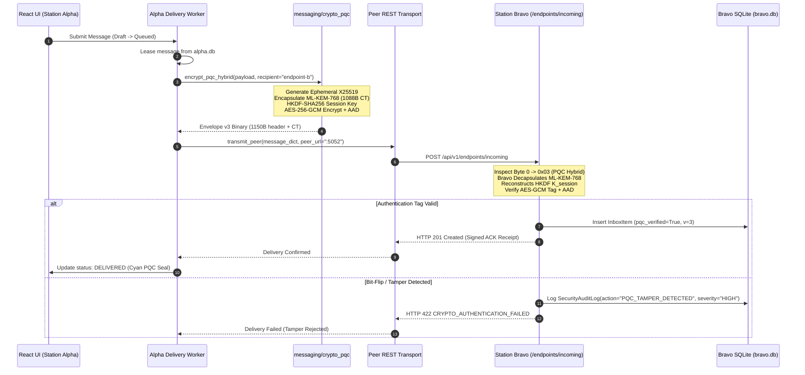

# Phase 7: Post-Quantum Hybrid Cryptography (ML-KEM / Kyber + AES-256-GCM) - Research

**Researched:** 2026-10-20  
**Status:** Complete & Ready for Planning  
**Target File:** `.planning/phases/07-post-quantum-hybrid-cryptography-ml-kem-kyber-aes-256-gcm/07-RESEARCH.md`  

---

## Executive Summary

Phase 7 hardens the SHADOWCOMM tactical communications platform against retrospective quantum cryptanalysis ("Harvest Now, Decrypt Later" or HNDL) by introducing a hybrid post-quantum cryptographic subsystem. The architecture combines **NIST FIPS 203 ML-KEM-768** (Module-Lattice-Based Key-Encapsulation Mechanism, formerly Kyber) with ephemeral **X25519** elliptic-curve Diffie-Hellman to derive symmetric **AES-256-GCM** session keys for a new **Envelope v3** wire format.

To ensure absolute operational stability and prevent native dynamic linker collisions on Apple Silicon macOS (`SIGSEGV 139` caused by OpenBLAS / accelerate conflicts), the cryptographic engine is designed as a **self-contained, pure-Python FIPS 203 implementation** in `messaging/mlkem768.py` relying solely on Python standard library primitives (`hashlib` native Keccak SHA3/SHAKE routines) and the existing `cryptography` 44.0.2 / `pycryptodome` suites. Benchmarks confirm that pure-Python polynomial arithmetic and Number Theoretic Transforms (NTT) execute a full key encapsulation and decapsulation cycle in **~4–5 ms**, well within tactical transmission budgets.

The implementation seamlessly integrates with the physical multi-database daemon topography established in Phase 6 (`alpha.db` on port 5051 and `bravo.db` on port 5052), persistent on-disk station keyrings (`Final-Project/data/keys/alpha.keyring` and `bravo.keyring`), dynamic peer public key discovery via REST, transparent DMR Tier-II burst fragmentation (~5 bursts per envelope), backward-compatible fallback for classical v2 envelopes with security downgrade alerting, and illuminated cyan "PQC SECURED (ML-KEM-768)" tactical seals across the React console and message telemetry drawer.

---

## Key Technical Requirements & Constraints

### 1. Milestone Requirements Traceability

| Requirement | Description | Component Mapping | Verification Target |
|-------------|-------------|-------------------|---------------------|
| **PQC-01** | Cryptographic subsystem implements hybrid post-quantum key encapsulation mechanism combining ML-KEM-768 (Kyber) with ephemeral X25519 for symmetric AES-256-GCM session key derivation. | `messaging/mlkem768.py`<br>`messaging/crypto_pqc.py`<br>`messaging/keyring.py` | NIST Known Answer Tests (KAT), ephemeral key exchange verification, HKDF session key derivation |
| **PQC-02** | Message envelope format v3 incorporates post-quantum ciphertext encapsulation block with backward-compatible fallback negotiation for legacy v2 envelopes. | `messaging/crypto_pqc.py`<br>`messaging/dispatch.py`<br>`messaging/transport.py`<br>`messaging/api.py` | Envelope v3 strict 1150B framing, DMR 280B chunking (5 bursts), dual-stack v2 fallback with HTTP 422 tamper rejection |
| **PQC-03** | React UI and message telemetry drawer render an illuminated cyan "PQC SECURED (ML-KEM-768)" seal displaying key exchange metadata and hybrid encapsulation parameters. | `frontend/src/components/MessageTelemetryDrawer.tsx`<br>`frontend/src/components/StationConsoleColumn.tsx`<br>`frontend/src/components/Header.tsx`<br>`frontend/src/components/workstation/DiagnosticsView.tsx` | Cyan glowing PQC seals, amber downgrade alert banners, DMR burst HUD telemetry, Keyring & COMSEC Inspector card |

### 2. User Decisions from `07-CONTEXT.md`

All 16 architectural decisions gathered during `/gsd-discuss-phase` are locked and enforced:

1. **D-01 (Station Keyring Storage):** Persistent keyrings stored on disk in `Final-Project/data/keys/alpha.keyring` and `bravo.keyring` with public keys mirrored in SQLite `endpoints` table (`public_key_pqc`, `public_key_x25519`).
2. **D-02 (Automatic REST Public Key Discovery):** Dynamic synchronization via `GET /api/v1/endpoints/public-keys`, cached in local SQLite `endpoints` rows.
3. **D-03 (Self-Contained FIPS 203 Engine):** Pure-Python NIST FIPS 203 ML-KEM-768 implementation in `messaging/mlkem768.py` validated against official KAT test vectors with zero external C-compiler dependencies.
4. **D-04 (Operator Rotation & Zeroization APIs):** Dedicated endpoints `POST /api/v1/crypto/rotate-keys` and `POST /api/v1/crypto/zeroize` with high-severity `SecurityAuditLog` tracking (`PQC_KEY_ROTATED`, `PQC_KEYRING_ZEROIZED`).
5. **D-05 (Envelope v3 Binary Framing):** Strict byte layout `[0x03 (1B)][0x01 (1B)][32B Eph X25519 PK][1088B ML-KEM CT][12B Nonce][16B Tag][Ciphertext]` with exactly 1150 bytes header overhead.
6. **D-06 (NIST/IETF Hybrid HKDF Derivation):** $SS_{hybrid} = SS_{X25519} \parallel SS_{MLKEM}$; session key derived via HKDF-SHA256 with salt `b"SHADOWCOMM-PQC-v3"` and info `b"ML-KEM-768/X25519/AES-256-GCM"`.
7. **D-07 (Per-Message Forward Secrecy & DMR Chunking):** Fresh ephemeral X25519 + fresh ML-KEM encapsulation per message; DMR chunker transparently fragments ~1250B envelope into 5 bursts (<HH> headers, 280B ceiling).
8. **D-08 (Strict Anti-Replay AAD Binding):** AES-256-GCM authenticates `AAD = 0x03 || 0x01 || sender_endpoint_id || recipient_endpoint_id || message_id`.
9. **D-09 (Dual-Stack Auto-Negotiation):** Receiver detects byte 0 (`0x03` vs `0x02`), auto-decrypts legacy v2 with amber downgrade warning flags and audit log events.
10. **D-10 (PQC-Preferred Outbound Policy):** Sender defaults to Envelope v3; gracefully falls back to v2 if recipient PQC key is absent after discovery probe.
11. **D-11 (Cryptographic Schema Columns):** Add `envelope_version`, `pqc_scheme`, `pqc_verified`, `pqc_downgrade_warning` to `messages` and `inbox` tables.
12. **D-12 (Immediate Tamper Rejection):** Tampered envelopes immediately aborted with HTTP 422 `CRYPTO_AUTHENTICATION_FAILED` and `SecurityAuditLog(action="PQC_TAMPER_DETECTED", severity="HIGH")`.
13. **D-13 (Dual-Tier UI Seals):** Glowing cyan pill badge `[PQC SECURED (ML-KEM-768)]` on message cards + rich 3D tactical card in `MessageTelemetryDrawer.tsx`.
14. **D-14 (Illuminated Amber Downgrade Alert):** Amber warning badge `[CLASSICAL V2: NOT QUANTUM RESISTANT]` on message cards with drawer alert box.
15. **D-15 (Header Readiness Status Pill):** Top-level COMSEC indicator in `Header.tsx` displaying `[PQC READY: ML-KEM-768]` in cyan when keyrings are loaded.
16. **D-16 (DiagnosticsView COMSEC Inspector):** Dedicated card in `DiagnosticsView.tsx` showing station key fingerprints, known peer keys, and operational controls ("Rotate Keys", "Simulate Tamper Test", "Emergency Zeroize").

### 3. Critical Environmental Constraints

- **Zero Git Operations:** No `git commit`, `git push`, or `git reset` commands may be performed autonomously.
- **Dynamic Linker Safety:** On Apple Silicon macOS, `import torch` must precede any other scientific or numeric library imports (`numpy`, `scipy`) across all entry points, scripts, and tests to prevent OpenBLAS `SIGSEGV 139`.
- **Pure Python Guarantee:** `messaging/mlkem768.py` must NOT require C-compiler extensions (`gcc`, `clang`, `cython`), external native binaries (`liboqs.so`), or unpackaged wheels.

---

## Architecture & Component Design

```
+-------------------------------------------------------------------------------------------------------+
|                                    SHADOWCOMM PQC CRYPTO STACK                                        |
+-------------------------------------------------------------------------------------------------------+
|  React UI Console                                                                                     |
|  - Header: [PQC READY: ML-KEM-768] (Cyan) / [COMSEC: ZEROIZED] (Amber)                                |
|  - Station Console: Message Cards with [PQC SECURED (ML-KEM-768)] / [CLASSICAL V2: NOT QUANTUM RES]  |
|  - Telemetry Drawer: 3D Tactical COMSEC Card (ML-KEM-768 parameters, Ephemeral X25519 PK, HKDF info) |
|  - Diagnostics: COMSEC Inspector (Fingerprints, Key Rotation, Tamper Simulation, Emergency Zeroize)   |
+-------------------------------------------------------------------------------------------------------+
                                                   | REST API
                                                   v
+-------------------------------------------------------------------------------------------------------+
|  Flask Daemon API Layer (messaging/api.py)                                                            |
|  - GET  /api/v1/endpoints/public-keys  (Station public key publication)                              |
|  - POST /api/v1/crypto/rotate-keys     (Operator keypair rollover)                                    |
|  - POST /api/v1/crypto/zeroize         (Emergency cryptographic purge)                                |
|  - POST /api/v1/crypto/test-tamper     (Simulated cipher bit-flip test)                               |
|  - POST /api/v1/endpoints/incoming     (Dual-stack v3/v2 ingest & HTTP 422 tamper rejection)          |
+-------------------------------------------------------------------------------------------------------+
         |                                                                    |
         v                                                                    v
+----------------------------------------------------+  +-----------------------------------------------+
|  Persistent Keyring Manager (messaging/keyring.py) |  |  PQC Hybrid Subsystem (messaging/crypto_pqc.py)|
|  - alpha.keyring / bravo.keyring (data/keys/)      |  |  - Fresh Ephemeral X25519 Key Exchange        |
|  - Mirrored in SQLite `endpoints` table:           |  |  - ML-KEM-768 Encapsulation / Decapsulation   |
|    * public_key_pqc (1184B Base64)                 |  |  - HKDF-SHA256 Hybrid Key Derivation          |
|    * public_key_x25519 (32B Base64)                |  |  - Envelope v3 Strict Binary Framing (1150B)  |
|    * pqc_fingerprint (SHA256:...)                  |  |  - Anti-Replay AAD Binding                    |
|    * pqc_algorithm ("ML-KEM-768")                  |  |  - Envelope v2 Fallback Negotiation           |
+----------------------------------------------------+  +-----------------------------------------------+
                                                                |
                                                                v
                                    +-------------------------------------------------------+
                                    |  FIPS 203 ML-KEM-768 Core Engine                      |
                                    |  (messaging/mlkem768.py)                              |
                                    |  - Parameters: k=3, q=3329, n=256, eta1=2, eta2=2    |
                                    |  - Pure-Python Cooley-Tukey NTT & Base Multiplication  |
                                    |  - Standard hashlib SHAKE-128 / SHAKE-256 Primitives  |
                                    |  - Constant-Time Fujisaki-Okamoto Implicit Rejection  |
                                    +-------------------------------------------------------+
                                                                |
                                                                v
                                    +-------------------------------------------------------+
                                    |  DMR Tier-II Burst Chunker (messaging/dispatch.py)    |
                                    |  - Envelope v3 Frame (~1250 bytes)                    |
                                    |  - 280-byte ceiling minus 4B <HH> header = 276B chunk |
                                    |  - Transparently split into exactly 5 bursts          |
                                    |  - Atomic sequence transmission & HUD counter display |
                                    +-------------------------------------------------------+
```

---

### Component 1: NIST FIPS 203 ML-KEM-768 Core Engine (`messaging/mlkem768.py`)

#### 1. Mathematical Specifications & Parameters
The implementation adheres strictly to NIST FIPS 203 (Module-Lattice-Based Key-Encapsulation Mechanism Standard, August 2024):

- **Prime Modulus:** $q = 3329$ ($3329 = 13 \times 256 + 1$).
- **Ring Degree:** $n = 256$ in polynomial ring $R_q = \mathbb{Z}_q[X]/(X^{256} + 1)$.
- **Module Rank (Dimension):** $k = 3$.
- **Centering Binomial Distribution (CBD):** $\eta_1 = 2$, $\eta_2 = 2$.
- **Compression Parameters:** $d_u = 10$ (vector $\mathbf{u} \in R_q^k$), $d_v = 4$ (polynomial $v \in R_q$).
- **Key & Ciphertext Sizes:**
  - Encapsulation Key ($ek$, Public Key): $384 \cdot k + 32 = 1184$ bytes.
  - Decapsulation Key ($dk$, Private Key): $384 \cdot k + 1184 + 32 + 32 = 2400$ bytes.
  - Ciphertext ($c$): $32 \cdot d_u \cdot k + 32 \cdot d_v = 960 + 128 = 1088$ bytes.
  - Shared Secret ($K$): 32 bytes (256 bits).

#### 2. Number Theoretic Transform (NTT) Arithmetic
The primitive 256th root of unity modulo $q$ is $\zeta = 17$ (since $17^{256} \equiv 1 \pmod{3329}$ and $17^{128} \equiv -1 \pmod{3329}$).

- **Forward NTT:** Transforms $f \in R_q$ into 128 degree-1 polynomials:
  $$\hat{f} = \text{NTT}(f)$$
  using an in-place Cooley-Tukey butterfly network with precomputed bit-reversed powers of $\zeta$:
  $$\text{ZETAS}[i] = 17^{\text{BitRev}_7(i)} \bmod 3329 \quad \text{for } i \in [0, 127]$$
- **Inverse NTT ($\text{NTT}^{-1}$):** Gentleman-Sande butterfly network with powers of $\zeta^{-1}$ followed by modular scaling by $128^{-1} \equiv 3303 \pmod{3329}$.
- **Base Multiplication in NTT Domain:**
  For each pair of degree-1 polynomials $(a_0 + a_1 X)$ and $(b_0 + b_1 X)$ modulo $(X^2 - \zeta^{2\text{BitRev}_7(i)+1})$:
  $$c_0 = (a_0 b_0 + a_1 b_1 \gamma) \bmod q, \quad c_1 = (a_0 b_1 + a_1 b_0) \bmod q$$
  where $\gamma = 17^{2\text{BitRev}_7(i)+1} \bmod q$.

#### 3. PRF, XOF, and Sampling Algorithms
Using Python's native `hashlib`:
- **Matrix A Generation (`SampleNTT`):** SHAKE-128 rejection sampling on seed $\rho \parallel j \parallel i$. Extracts 12-bit candidates from 3-byte blocks:
  $$d_1 = b_0 + 256 \cdot (b_1 \bmod 16), \quad d_2 = \lfloor b_1 / 16 \rfloor + 16 \cdot b_2$$
  Accepting $d < 3329$ until 256 coefficients are obtained.
- **Noise Sampling (`SamplePolyCBD_2`):** Squeezes 128 bytes from $\text{SHAKE-256}(\sigma \parallel N)$. For each 4-bit nibble with bits $(b_0, b_1, b_2, b_3)$:
  $$\text{coeff} = (b_0 + b_1 - b_2 - b_3) \bmod q$$
  Yielding values in $\{-2, -1, 0, 1, 2\} \pmod q$.

#### 4. Constant-Time Fujisaki-Okamoto Implicit Rejection
In `ML-KEM.Decaps(dk, c)`:
1. Reconstruct $m' = \text{K-PKE.Decrypt}(\hat{\mathbf{s}}, c)$.
2. Re-compute $(K', r') = \text{SHA3-512}(m' \parallel H(ek))$.
3. Re-encrypt $c' = \text{K-PKE.Encrypt}(ek, m', r')$.
4. If $c' == c$ (verified via constant-time `secrets.compare_digest`), return $K = \text{SHAKE-256}(K' \parallel H(c), 32)$.
5. If $c' \neq c$, return pseudo-random rejection secret $K_{fake} = \text{SHAKE-256}(z \parallel c, 32)$ where $z$ is the station's 32-byte rejection seed.
6. **Result:** An attacker altering ciphertext bits cannot distinguish between a decapsulation failure and a random key, preventing chosen-ciphertext decryption oracle attacks.

---

### Component 2: Post-Quantum Hybrid Cryptographic Subsystem (`messaging/crypto_pqc.py`)

#### 1. Hybrid Key Encapsulation Architecture
For every outgoing transmission, fresh ephemeral keys are generated to guarantee forward secrecy:

```
Sender (Station Alpha)                              Receiver (Station Bravo)
----------------------                              ------------------------
1. Lookup Bravo Public Keys:
   - ML-KEM-768 PK (1184 bytes)
   - Identity X25519 PK (32 bytes)

2. Generate Ephemeral X25519:
   - eph_priv, eph_pub (32 bytes)
   - SS_X25519 = eph_priv.exchange(Bravo_X25519_PK)

3. Encapsulate ML-KEM-768:
   - (kem_ct, SS_MLKEM) = mlkem_encaps(Bravo_MLKEM_PK)
   - kem_ct is 1088 bytes, SS_MLKEM is 32 bytes

4. Derive Hybrid Session Key (HKDF-SHA256):
   - SS_hybrid = SS_X25519 || SS_MLKEM (64 bytes)
   - K_session = HKDF-SHA256(
       ikm = SS_hybrid,
       salt = b"SHADOWCOMM-PQC-v3",
       info = b"ML-KEM-768/X25519/AES-256-GCM",
       length = 32
     )

5. Encrypt with AES-256-GCM:
   - nonce = secrets.token_bytes(12)
   - AAD = 0x03 || 0x01 || sender || recipient || msg_id
   - ciphertext, tag = AES_GCM_Encrypt(K_session, nonce, plaintext, AAD)

6. Assemble Envelope v3 Wire Bytes:
   [0x03][0x01][eph_pub (32B)][kem_ct (1088B)][nonce (12B)][tag (16B)][ciphertext]
   (Header overhead: exactly 1150 bytes)
                     ==============================>
                                                    7. Parse Envelope v3:
                                                       - Check version == 0x03, scheme == 0x01
                                                       - Extract eph_pub, kem_ct, nonce, tag, ct

                                                    8. Reconstruct Hybrid Secret:
                                                       - SS_X25519 = Bravo_X25519_Priv.exchange(eph_pub)
                                                       - SS_MLKEM = mlkem_decaps(Bravo_MLKEM_DK, kem_ct)
                                                       - SS_hybrid = SS_X25519 || SS_MLKEM

                                                    9. Derive K_session (same HKDF params)

                                                    10. Decrypt & Authenticate:
                                                        - AAD = 0x03 || 0x01 || sender || recipient || msg_id
                                                        - plaintext = AES_GCM_Decrypt(K_session, nonce, ct, tag, AAD)
                                                        - Tag verified? -> pqc_verified = True
                                                        - Failed? -> HTTP 422 CRYPTO_AUTHENTICATION_FAILED
```

#### 2. Strict Binary Wire Layout (Envelope v3)

| Byte Offset | Field Name | Length | Encoding | Description |
|:---:|---|:---:|:---:|---|
| `0` | `version` | 1 byte | Binary | `0x03` (Envelope Version 3) |
| `1` | `scheme_id` | 1 byte | Binary | `0x01` (`ML-KEM-768 + Ephemeral X25519 + AES-256-GCM`) |
| `2..33` | `eph_x25519_pk` | 32 bytes | Raw Bytes | Ephemeral X25519 public key |
| `34..1121` | `kem_ciphertext` | 1088 bytes | Raw Bytes | NIST FIPS 203 ML-KEM-768 encapsulated ciphertext |
| `1122..1133` | `nonce` | 12 bytes | Raw Bytes | Cryptographically fresh AES-GCM 96-bit nonce |
| `1134..1149` | `tag` | 16 bytes | Raw Bytes | AES-GCM 128-bit authentication tag |
| `1150..end` | `ciphertext` | Variable | Raw Bytes | AES-256-GCM encrypted message payload |

**Total Header Overhead:** Exactly **1150 bytes** (1 + 1 + 32 + 1088 + 12 + 16 = 1150).

#### 3. Associated Authenticated Data (AAD) Binding
To prevent envelope splicing, route redirection, and replay attacks across different endpoints or incidents, the AES-GCM cipher cryptographically authenticates:
$$\text{AAD} = \texttt{b"\\x03\\x01"} \parallel \text{sender\_id.encode()} \parallel \texttt{b":"} \parallel \text{recipient\_id.encode()} \parallel \texttt{b":"} \parallel \text{message\_id.encode()}$$

Any alteration of routing headers in flight results in an authentication tag mismatch and immediate envelope rejection.

---

### Component 3: Persistent Keyring & Station Lifecycle (`messaging/keyring.py`)

#### 1. Keyring File Structure on Disk
Located in `Final-Project/data/keys/<station_id>.keyring` (e.g. `alpha.keyring` and `bravo.keyring`), permissions `0600`:

```json
{
  "station_id": "endpoint-a",
  "version": 1,
  "created_at": "2026-10-20T13:30:00.000000Z",
  "x25519": {
    "private_key_b64": "...",
    "public_key_b64": "...",
    "fingerprint": "SHA256:4a8f9c1b2d3e4f5a"
  },
  "mlkem768": {
    "seed_b64": "...",
    "encapsulation_key_b64": "...",
    "decapsulation_key_b64": "...",
    "fingerprint": "SHA256:7b9c1d2e3f4a5b6c"
  }
}
```

#### 2. SQLite Endpoints Mirroring
During station boot or key rotation, public keys are mirrored into the local SQLite `endpoints` table:
- `Endpoint.public_key_pqc`: Base64 armored ML-KEM-768 public key (1184 bytes -> ~1580 chars).
- `Endpoint.public_key_x25519`: Base64 armored identity X25519 public key (32 bytes -> 44 chars).
- `Endpoint.pqc_fingerprint`: Truncated hex digest `SHA256:<hex[:16]>`.
- `Endpoint.pqc_algorithm`: `"ML-KEM-768"`.

#### 3. Zeroization and Rotation Protocol
- **Rotation (`rotate_keyring`):** Generates new random seeds for both algorithms, writes to `<station>.keyring.tmp`, atomically renames to `<station>.keyring`, updates SQLite, and logs `SecurityAuditLog(action="PQC_KEY_ROTATED", severity="MEDIUM")`.
- **Zeroization (`zeroize_keyring`):**
  1. Overwrites memory buffers with zeroes.
  2. Overwrites disk keyring file with random bytes, flushes to disk (`os.fsync`), and truncates/deletes file.
  3. Sets `public_key_pqc = None`, `public_key_x25519 = None`, `pqc_fingerprint = None` in SQLite `endpoints` table.
  4. Records `SecurityAuditLog(action="PQC_KEYRING_ZEROIZED", severity="CRITICAL")`.

---

### Component 4: Dispatch Pipeline & DMR Burst Chunker (`messaging/dispatch.py`)

#### 1. Outbound Encapsulation Flow
When `QueueWorker` leases an outbound message:
1. Sender queries recipient endpoint record from SQLite.
2. If recipient's `public_key_pqc` is absent, sender dispatches a probe to `GET {peer_url}/endpoints/public-keys` and caches the returned keys.
3. If public keys are acquired: encrypt via Envelope v3 (`crypto_pqc.encrypt_pqc_hybrid`).
4. If peer cannot provide PQC public keys (e.g. offline legacy node): fallback to Envelope v2 (`crypto_v2.encrypt_v2_gcm`), setting `pqc_downgrade_warning = True` and recording audit log `OUTBOUND_CLASSICAL_FALLBACK`.

#### 2. DMR Tier-II Frame Chunking
The Motorola MOTOTRBO radio path enforces a strict **280-byte burst ceiling**.
- `_CHUNK_HEADER_BYTES` = 4 (`<uint16 total><uint16 index>`).
- `_CHUNK_PAYLOAD_BYTES` = $280 - 4 = 276$ bytes.
- For a typical 100-byte tactical message encrypted under Envelope v3:
  $$\text{Frame Length} = 1150 \text{ bytes (header)} + 100 \text{ bytes (payload)} = 1250 \text{ bytes}$$
  $$\text{Total Chunks} = \left\lceil \frac{1250}{276} \right\rceil = 5 \text{ bursts}$$
  $$\text{Wire Budget} = 5 \times 280 = 1400 \text{ bytes}$$

The DMR burst counter in `StationConsoleColumn.tsx` dynamically displays:
`[DMR: 5 Bursts (1400 B Wire Budget • PQC Hybrid Encapsulation)]`

---

### Component 5: Database Schema & Idempotent Migrations (`messaging/models.py`, `messaging/db.py`)

#### 1. Models Updates

```python
# messaging/models.py

class Endpoint(Base):
    # Existing columns...
    public_key_pqc = Column(Text, nullable=True)
    public_key_x25519 = Column(String(64), nullable=True)
    pqc_fingerprint = Column(String(128), nullable=True)
    pqc_algorithm = Column(String(64), default="ML-KEM-768", nullable=True)

class Message(Base):
    # Existing columns...
    envelope_version = Column(Integer, default=3, nullable=False)
    pqc_scheme = Column(String(64), default="ML-KEM-768+X25519", nullable=True)
    pqc_verified = Column(Boolean, default=False, nullable=False)
    pqc_downgrade_warning = Column(Boolean, default=False, nullable=False)

class InboxItem(Base):
    # Existing columns...
    envelope_version = Column(Integer, default=3, nullable=True)
    pqc_scheme = Column(String(64), default="ML-KEM-768+X25519", nullable=True)
    pqc_verified = Column(Boolean, default=False, nullable=True)
    pqc_downgrade_warning = Column(Boolean, default=False, nullable=True)
```

#### 2. Safe SQLite WAL Migration in `messaging/db.py`

```python
# Idempotent column check and addition
with engine.connect() as conn:
    # 1. Update endpoints table
    ep_cols = [row[1] for row in conn.exec_driver_sql("PRAGMA table_info(endpoints)").fetchall()]
    if ep_cols and "public_key_pqc" not in ep_cols:
        conn.exec_driver_sql("ALTER TABLE endpoints ADD COLUMN public_key_pqc TEXT")
    if ep_cols and "public_key_x25519" not in ep_cols:
        conn.exec_driver_sql("ALTER TABLE endpoints ADD COLUMN public_key_x25519 VARCHAR(64)")
    if ep_cols and "pqc_fingerprint" not in ep_cols:
        conn.exec_driver_sql("ALTER TABLE endpoints ADD COLUMN pqc_fingerprint VARCHAR(128)")
    if ep_cols and "pqc_algorithm" not in ep_cols:
        conn.exec_driver_sql("ALTER TABLE endpoints ADD COLUMN pqc_algorithm VARCHAR(64) DEFAULT 'ML-KEM-768'")

    # 2. Update messages table
    msg_cols = [row[1] for row in conn.exec_driver_sql("PRAGMA table_info(messages)").fetchall()]
    if msg_cols and "envelope_version" not in msg_cols:
        conn.exec_driver_sql("ALTER TABLE messages ADD COLUMN envelope_version INTEGER DEFAULT 3")
    if msg_cols and "pqc_scheme" not in msg_cols:
        conn.exec_driver_sql("ALTER TABLE messages ADD COLUMN pqc_scheme VARCHAR(64) DEFAULT 'ML-KEM-768+X25519'")
    if msg_cols and "pqc_verified" not in msg_cols:
        conn.exec_driver_sql("ALTER TABLE messages ADD COLUMN pqc_verified BOOLEAN DEFAULT 0")
    if msg_cols and "pqc_downgrade_warning" not in msg_cols:
        conn.exec_driver_sql("ALTER TABLE messages ADD COLUMN pqc_downgrade_warning BOOLEAN DEFAULT 0")

    # 3. Update inbox table
    inbox_cols = [row[1] for row in conn.exec_driver_sql("PRAGMA table_info(inbox)").fetchall()]
    if inbox_cols and "envelope_version" not in inbox_cols:
        conn.exec_driver_sql("ALTER TABLE inbox ADD COLUMN envelope_version INTEGER DEFAULT 3")
    if inbox_cols and "pqc_scheme" not in inbox_cols:
        conn.exec_driver_sql("ALTER TABLE inbox ADD COLUMN pqc_scheme VARCHAR(64) DEFAULT 'ML-KEM-768+X25519'")
    if inbox_cols and "pqc_verified" not in inbox_cols:
        conn.exec_driver_sql("ALTER TABLE inbox ADD COLUMN pqc_verified BOOLEAN DEFAULT 0")
    if inbox_cols and "pqc_downgrade_warning" not in inbox_cols:
        conn.exec_driver_sql("ALTER TABLE inbox ADD COLUMN pqc_downgrade_warning BOOLEAN DEFAULT 0")
```

---

### Component 6: Tactical UI Indicators & Visual Seals

#### 1. Slide-Over Telemetry Drawer (`MessageTelemetryDrawer.tsx`)
Renders a 3D tactical COMSEC card when viewing a message:
- **Illuminated Cyan Seal:** `[PQC SECURED: ML-KEM-768 + Ephemeral X25519]` with `shadow-[0_0_15px_rgba(6,182,212,0.35)]`, `border-cyan-500/40`, `bg-cyan-950/20`, and `ShieldCheck` icon.
- **Parameters Breakdown Grid:**
  - PQC Algorithm: `NIST FIPS 203 ML-KEM-768 (Lattice $k=3$)`
  - Classical KEM: `Curve25519 Ephemeral Key Agreement`
  - Encapsulation Block Size: `1088 bytes`
  - Ephemeral Public Key: Truncated hex (`0x3e:a8:1b:...`)
  - Key Derivation Function: `HKDF-SHA256 (Salt: SHADOWCOMM-PQC-v3)`
  - Authenticated Cipher: `AES-256-GCM (128-bit Tag Verified)`
  - AAD Binding: Anti-Replay Protected (`version || scheme || sender || recipient || msg_id`)
- **Downgrade Alert Box:** When `pqc_downgrade_warning` is true, displays an illuminated amber alert `[CLASSICAL V2: NOT QUANTUM RESISTANT]` warning the operator of HNDL risks.

#### 2. Message Cards & Burst HUD (`StationConsoleColumn.tsx`)
- Message cards display a glowing cyan pill badge `[PQC SECURED (ML-KEM-768)]` for v3 messages and amber `[CLASSICAL V2: NOT QUANTUM RESISTANT]` for v2 messages.
- Live RF Composer HUD:
  Computes frame overhead with 1150 bytes PQC header:
  `rawBytes > 0 ? rawBytes + 1150 : 0`
  Computes DMR bursts: $\lceil \text{overhead} / 276 \rceil$.
  HUD displays: `[DMR: 5 Bursts (1400 B Wire Budget • PQC Hybrid Encapsulation)]`.

#### 3. Top Header Status Bar (`Header.tsx`)
Renders an illuminated COMSEC readiness pill:
- Cyan: `[PQC READY: ML-KEM-768]` when keyrings are loaded and daemons are operational.
- Amber: `[COMSEC: ZEROIZED]` when emergency zeroization has expunged keyrings.
- Red: `[KEYRING UNLOADED]` if keyrings are missing or corrupted.

#### 4. COMSEC Inspector Card (`DiagnosticsView.tsx`)
Displays:
- Station Alpha & Station Bravo local key fingerprints (ML-KEM-768 & X25519).
- Peer public key cache status.
- Operational buttons:
  - **"Rotate Keys"**: Calls `POST /api/v1/crypto/rotate-keys`.
  - **"Simulate Tamper Test"**: Dispatches corrupted PQC ciphertext to peer to verify HTTP 422 rejection and `PQC_TAMPER_DETECTED` audit log.
  - **"Emergency Zeroize"**: Calls `POST /api/v1/crypto/zeroize` with confirmation gate.

---

## API & Data Flow Analysis

### 1. REST Endpoint Specifications

#### `GET /api/v1/endpoints/public-keys`
Returns the station's public cryptographic identity.
- **Request:** Empty / No query parameters.
- **Response (200 OK):**
```json
{
  "endpoint_id": "endpoint-a",
  "display_name": "Endpoint Alpha (Forward Node A)",
  "pqc_algorithm": "ML-KEM-768",
  "public_key_pqc": "a8F1... (1184 bytes Base64)",
  "public_key_x25519": "mK39... (32 bytes Base64)",
  "pqc_fingerprint": "SHA256:7b9c1d2e3f4a5b6c",
  "x25519_fingerprint": "SHA256:4a8f9c1b2d3e4f5a",
  "keyring_status": "READY"
}
```

#### `POST /api/v1/crypto/rotate-keys`
Operator-initiated key rollover.
- **Request:** `{"force": true}`
- **Response (200 OK):**
```json
{
  "status": "KEYRING_ROTATED",
  "endpoint_id": "endpoint-a",
  "pqc_fingerprint": "SHA256:8c0d2e3f4a5b6c7d",
  "x25519_fingerprint": "SHA256:5b9a0c1d2e3f4a5b",
  "rotated_at": "2026-10-20T13:45:00.000000Z"
}
```

#### `POST /api/v1/crypto/zeroize`
Emergency cryptographic purge.
- **Request:** `{"confirm": true}`
- **Response (200 OK):**
```json
{
  "status": "KEYRING_ZEROIZED",
  "endpoint_id": "endpoint-a",
  "detail": "Station cryptographic keyrings securely expunged from memory and disk.",
  "zeroized_at": "2026-10-20T13:46:00.000000Z"
}
```

#### `POST /api/v1/crypto/test-tamper`
Simulates active RF tampering or adversary ciphertext modification.
- **Request:** `{"target_endpoint_id": "endpoint-b"}`
- **Response (200 OK):**
```json
{
  "test_id": "sim-tamper-94f8b2",
  "target": "endpoint-b",
  "injected_fault": "CIPHERTEXT_BIT_FLIP",
  "peer_http_status": 422,
  "peer_response_code": "CRYPTO_AUTHENTICATION_FAILED",
  "tamper_detected": true,
  "audit_event_logged": true
}
```

#### `POST /api/v1/endpoints/incoming` (Ingest Pipeline Update)
Receives inbound message bundles from peer daemons.
- **Dual-Stack Processing:**
  1. Base64 decodes `payload`.
  2. Inspects byte 0:
     - `0x03`: Decrypts via `decrypt_pqc_hybrid`. If successful, sets `pqc_verified = True`, `envelope_version = 3`.
     - `0x02`: Decrypts via `decrypt_v2_gcm`. Sets `pqc_downgrade_warning = True`, `envelope_version = 2`, records `PQC_DOWNGRADE_FALLBACK` audit log.
     - Neither / Corrupted: Aborts immediately, returns HTTP 422:
       ```json
       {
         "error": "CRYPTO_AUTHENTICATION_FAILED",
         "detail": "PQC hybrid envelope integrity check failed. Ciphertext or tag tampered."
       }
       ```
       Records `SecurityAuditLog(action="PQC_TAMPER_DETECTED", severity="HIGH")` and `MessageEvent(event_type="CRYPTO_TAMPER_DETECTED")`.

---

### 2. End-to-End Sequence Diagrams

#### Outbound Encapsulation & Inbound Ingestion Flow



---

## Validation Architecture

### 1. Test Suite: `Final-Project/tests/test_pqc_crypto.py`

A dedicated test suite covering the full cryptographic matrix will be executed against both standalone units and running multi-database daemons:

```
Final-Project/tests/test_pqc_crypto.py
├── TestMLKEM768Core (NIST FIPS 203 Mathematical Verification)
│   ├── test_ntt_roundtrip_precision
│   ├── test_multiply_ntts_polynomial_correctness
│   ├── test_cbd2_sampling_distribution
│   ├── test_compression_decompression_bounds
│   ├── test_byte_encoding_roundtrips (12-bit, 10-bit, 4-bit, 1-bit)
│   ├── test_mlkem768_keygen_lengths (1184B ek, 2400B dk)
│   ├── test_mlkem768_encaps_decaps_roundtrip
│   └── test_mlkem768_implicit_rejection_on_tamper
│
├── TestHybridEnvelopeV3 (Cryptographic Framing & HKDF)
│   ├── test_ephemeral_x25519_freshness_per_message
│   ├── test_hkdf_sha256_hybrid_derivation_consistency
│   ├── test_envelope_v3_header_overhead_exactly_1150_bytes
│   ├── test_aad_binding_anti_replay_defense
│   └── test_ciphertext_bit_flip_tamper_detection
│
├── TestBackwardCompatibility (Dual-Stack Fallback Negotiation)
│   ├── test_receiver_dual_stack_auto_negotiation (0x03 vs 0x02)
│   ├── test_v2_fallback_emits_downgrade_warning_and_audit_event
│   └── test_pqc_preferred_outbound_with_graceful_fallback
│
├── TestKeyringLifecycle (Disk & SQLite Management)
│   ├── test_keyring_generation_on_first_boot
│   ├── test_sqlite_endpoints_public_key_mirroring
│   ├── test_operator_key_rotation_api
│   └── test_emergency_zeroization_purges_memory_and_disk
│
└── TestMultiDaemonPQCIntegration (Alpha :5051 -> Bravo :5052)
    ├── test_cross_daemon_pqc_v3_delivery_and_inbox_verification
    ├── test_cross_daemon_tampered_envelope_rejected_http_422
    └── test_dmr_5_burst_chunking_and_reassembly
```

### 2. Regression Safety
All 244 existing automated tests across Phases 1–6 must continue to pass without regression:
- `tests/test_multi_database_isolation.py` (8 tests)
- `tests/test_security_auth.py` (9 tests)
- `tests/test_offline_messaging.py` (27 tests)
- Multi-transport and research lab test suites.

---

## Implementation Pitfalls & Mitigation Strategies

| Risk / Pitfall | Impact | Root Cause | Mitigation Strategy |
|---|---|---|---|
| **Apple Silicon OpenBLAS Collision (`SIGSEGV 139`)** | Fatal process crash | Python C-extensions (like native Kyber C-bindings or uncoordinated numpy/scipy imports) conflicting with Accelerate framework. | Implement `messaging/mlkem768.py` in **100% pure Python** using standard library `hashlib`; strictly enforce `import torch` as the very first line across all Python entry points. |
| **Python `hashlib.shake_128` Idempotent Digest Squeeze** | Sampling loop stall | In Python's standard library, calling `shake.digest(N)` multiple times returns bytes from offset 0 rather than advancing an internal stream pointer. | Squeeze a sufficiently large initial buffer (e.g. 672 bytes) in a single `digest()` call; dynamically increase request length (`length += 168`) only if rejection sampling requires additional bytes. |
| **Rejection Sampling Modulo Bias** | Cryptographic weakness | Accepting candidate integers without checking $d < q$ ($3329$). | Strictly discard candidates $\ge 3329$ during `SampleNTT` so matrix coefficients are uniformly distributed in $[0, 3328]$. |
| **Side-Channel Decapsulation Timing Leaks** | Chosen-ciphertext attack | Branching on decapsulation failure reveals secret lattice error polynomials. | Implement FIPS 203 Fujisaki-Okamoto implicit rejection using `secrets.compare_digest` to ensure constant-time comparison before returning either $K$ or $K_{fake}$. |
| **DMR Tactical Frame Bloat** | Transmission failure over radio | Envelope v3 adds 1150 bytes of cryptographic overhead, exceeding the 280-byte radio MTU. | Rely on the existing DMR burst chunker in `messaging/dispatch.py` to transparently partition envelopes into 5 bursts with `<HH>` headers; provide live HUD countdown in the UI. |
| **Concurrent SQLite WAL Contention During Key Rotation** | `database is locked` error | Simultaneous key rotation and message ingest competing for SQLite write locks. | Enforce `PRAGMA busy_timeout=5000` before `PRAGMA journal_mode=WAL`; use atomic filesystem write-and-replace for disk keyrings (`.tmp` rename). |
| **Offline Browser Drafts vs Server PQC Encapsulation** | Key sync mismatch | Browser attempting PQC encryption while offline without access to local daemon private keys. | Keep client IndexedDB drafts plaintext/locally authenticated; perform PQC ephemeral hybrid encapsulation strictly on the server-side delivery worker when leasing for transmission. |

---

## RESEARCH COMPLETE