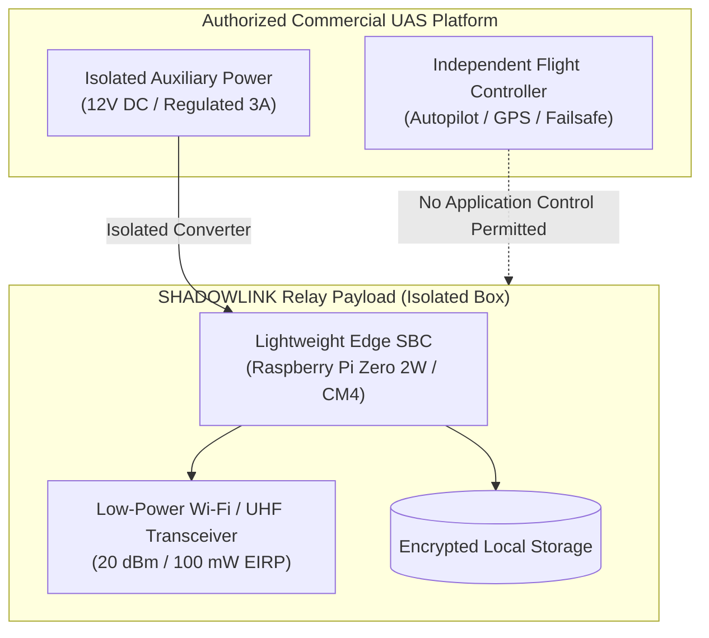

# AERIAL RELAY FEASIBILITY ASSESSMENT

**Topic**: Aerial Communications Relay Integration  
**Target Platform**: Tethered Aerostat / Commercial Multirotor UAS  
**Safety Classification**: NON-STEALTH, LAWFUL CONNECTIVITY EXTENSION ONLY  
**Evaluation Status**: Feasibility Study & Software Simulation Only  

---

## 1. Scope & Prohibitions

> [!CAUTION]
> **STRICT SAFETY & ETHICAL DIRECTIVE**:
> - The aerial relay subsystem is designed **exclusively for lawful civilian connectivity extension** (disaster response, search and rescue, flood relief, industrial operations, and controlled network drills).
> - Any design, modification, or optimization aimed at stealth, covert insertion, surveillance evasion, or radar/RF signature suppression is **STRICTLY PROHIBITED**.
> - The system shall never assume flight control or interfere with drone avionics.

---

## 2. Engineering Feasibility Analysis

### 2.1. Payload Mass & Power Budget
- **Maximum Permissible Payload Mass**: 450 grams (compatible with DJI Matrice 300/350 RTK or tethered aerostat).
- **Power Consumption**: 5.5 W nominal (5V @ 1.1A under active transmission).
- **Flight Endurance Impact**: Reduces standard multirotor hover time by ~12–15%. Tethered configurations provide indefinite operational persistence.

### 2.2. Thermal & Environmental Constraints
- **Propeller Downwash**: Provides forced-air convection, mitigating thermal buildup during hover.
- **Ingress Protection**: Transit enclosure must satisfy IP54 (dust and splash resistance) without adding excessive weight.

---

## 3. Regulatory Prerequisites (India / Global)

Before conducting any radiating or airborne field test in India:
1. **DGCA Drone Rules Compliance**:
   - Unique Identification Number (UIN) registered on the **Digital Sky** platform.
   - Certified Remote Pilot in Command (RPIC).
   - Operation restricted to designated Green Zones, or explicit permission acquired for Yellow/Red Zones.
2. **DoT / WPC Wireless Planning & Coordination Approvals**:
   - Equipment Type Approval (ETA) or Experimental Trial License for radiating transmitters operating outside license-exempt bands.
   - Strict adherence to maximum permitted EIRP in 2.4 GHz / 5.8 GHz ISM bands.

---

## 4. Current Status: Simulation Only

The physical aerial adapter remains **LOCKED OUT** in the codebase. All aerial relay testing is routed through the simulated node `relay-aerial-sim-01` in [`integration/relay_nodes/manager.py`](file:///Users/sabhay/Downloads/PROJECT%2013OCT/Final-Project/integration/relay_nodes/manager.py).
