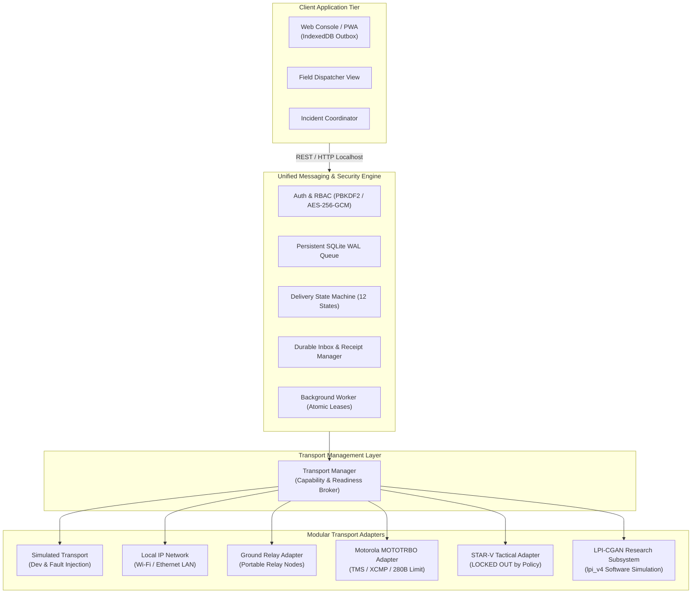

# SHADOWLINK FIELD: SYSTEM ARCHITECTURE SPECIFICATION

**System**: SHADOWLINK Resilient Communications Platform  
**Document**: Architecture Design Document (ADD)  
**Version**: 2.0.0-Pilot  
**Status**: APPROVED FOR CONTROLLED PILOT EVALUATION  

---

## 1. Architectural Philosophy: The Decoupled Communications Engine

The foundational principle of SHADOWLINK is the strict separation of **Message Intent** from **Physical Transport Execution**:

---

## 2. Subsystem Decompositions

### 2.1. Client Application Tier
- **Local Outbox Storage**: Utilizes browser IndexedDB (`shadowcomm_outbox`) to persist drafts and queued messages on the client before network dispatch.
- **Reachability Sync Manager**: Monitors backend availability via periodic health ping (`/api/v1/health`) and automatically drains local outbox when connection returns.
- **Incident Messaging Controls**: Exposes typed templates for 10 incident coordination schemas (`TEXT`, `STATUS_REPORT`, `CHECK_IN`, `ASSISTANCE_REQUEST`, etc.).

### 2.2. Identity & Access Control Subsystem
- **User Authentication**: Secure password verification via PBKDF2-SHA256 (`werkzeug.security`).
- **Role-Based Access Control (RBAC)**:
  - `ADMINISTRATOR`: Full control over users, endpoints, transport parameters, and security audit logs.
  - `OPERATOR`: Permitted to compose messages, view assigned inboxes, and execute incident check-ins.
  - `VIEWER`: Read-only access to status and message history.
- **Session Management**: Cryptographically random session tokens (32-byte hex) with 60-minute inactivity timeouts and explicit revocation on logout.
- **Brute-Force Throttling**: Automatically locks accounts for 15 minutes after 5 consecutive failed login attempts.

### 2.3. Messaging & Queue Delivery Engine
- **Persistent Storage**: SQLite with Write-Ahead Logging (`PRAGMA journal_mode = WAL`) and 5,000 ms busy timeout.
- **Worker Concurrency**: Queue delivery workers lease candidate messages using atomic conditional SQL updates (`UPDATE messages SET current_state='SENDING', worker_lease_id=... WHERE message_id=... AND current_state='QUEUED'`).
- **Durable Acknowledgements**: Receipts are generated only after receiver inbox transactions commit, including message hash, timestamp, and signature.
- **Deduplication**: Strict uniqueness constraints on `(recipient_endpoint_id, message_id)` prevent duplicate inbox records.

### 2.4. Transport Management Subsystem
- Common interface defined in [`integration/base.py`](file:///Users/sabhay/Downloads/PROJECT%2013OCT/Final-Project/integration/base.py) (`BaseTransportAdapter`).
- Every adapter explicitly reports its verified capabilities, readiness, link state, and size constraints.
- When an adapter is unavailable, the transport manager preserves the message in the queue with a descriptive diagnostic code (`NO_AUTHORIZED_ROUTE_AVAILABLE`).

### 2.5. Relay Node Subsystem
- [`integration/relay_nodes/manager.py`](file:///Users/sabhay/Downloads/PROJECT%2013OCT/Final-Project/integration/relay_nodes/manager.py) manages portable ground relays, vehicle gateways, and simulated aerial relays.
- Real-time telemetry monitoring: battery percentage, temperature, and disk storage.
- Failsafe rule: Communications payloads on mobile or aerial platforms are strictly decoupled from flight safety and vehicle control.

---

## 3. Reliability & Operations Layer
- **Structured Audit Trails**: Every state transition generates a timestamped `MessageEvent` record.
- **Security Audit Logging**: Ingestion of login events, failed attempts, and administrative updates into `security_audit_logs`.
- **System Health Diagnostics**: Real-time inspection of database queue depth, oldest pending message, failed attempts, and adapter readiness via `/api/v1/queue/stats` and `/api/v1/health`.
