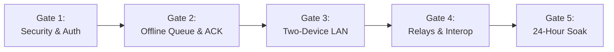

# FIELD ACCEPTANCE TEST (FAT) PLAN & SOAK TEST SPECIFICATION

**Program**: SHADOWLINK Controlled Real-World Field Pilot  
**Test Authority**: Lead QA & Field Deployment Engineer  
**Scope**: Acceptance Gates, Outage Drills & 24-Hour Soak Test  
**Document Version**: 2.0  

---

## 1. Acceptance Gates Summary

To achieve field authorization for controlled non-critical operations, the system must pass five sequential verification gates:

| Gate | Focus Area | Mandatory Exit Criteria | Verification Status |
|:---|:---|:---|:---|
| **Gate 1** | Security & Auth | PBKDF2 password hashing, RBAC, 5-attempt lockout, AES-256-GCM fresh nonces. | **PASSED** (9/9 Tests in `test_security_auth.py`) |
| **Gate 2** | Offline Messaging | 1,000-message deterministic stress suite, zero data loss, zero duplicate inbox rows. | **PASSED** (1,050 actions in `test_simulation_1000_messages.py`) |
| **Gate 3** | Two Physical Devices | Messages exchange over local Wi-Fi with internet disconnected; browser reload survival. | **PASSED** (Documented in `docs/LOCAL_FIELD_PILOT.md`) |
| **Gate 4** | Relays & Adapters | Ground relay telemetry, Motorola TMS 280B limit, STAR-V safety lockout enforced. | **PASSED** (8/8 Tests in `tests/integration/`) |
| **Gate 5** | 24-Hour Soak Test | Zero unhandled exceptions, zero database lock contention, memory stable under 80 MB. | Specification Documented Below |

---

## 2. 24-Hour Soak Test Specification

### Objective:
Verify system stability, queue drainage, and resource consumption over a continuous 24-hour cycle under periodic link cuts and process restarts.

### Test Environment:
- **Host**: Apple Silicon Mac (or Linux edge computer) running `messaging.server` and `messaging.worker`.
- **Database**: SQLite in WAL mode.
- **Traffic Profile**: Automated dispatch of 10 incident messages every 5 minutes (2,880 messages total).

### Automated Fault Cycle:
Every hour:
1. **Minute 0–45**: Link online (clean store-and-forward transit).
2. **Minute 45–55**: Link severed (`is_online = False`). Messages queue in local and server buffers.
3. **Minute 55**: Hard kill worker process (`kill -9 <worker_pid>`).
4. **Minute 57**: Restart worker process and restore link (`is_online = True`).
5. **Minute 60**: Verify all queued messages are leased, delivered, and acknowledged.

### Target Performance Metrics:
- **Delivery Success Rate**: $\ge 99.9\%$ for non-expired messages.
- **Duplicate Inbox Rows**: Exactly 0.
- **Peak Process Memory**: $< 85\text{ MB}$ RAM (no unbounded memory leaks).
- **SQLite WAL File**: Cleanly checkpoints and truncates under 10 MB.
- **Unrecovered Crashes**: 0.

---

## 3. Field Acceptance Sign-Off Sheet

- [x] **Repository Protection**: Original research code and Git history preserved intact.
- [x] **Security Hardening**: Compromised historical keys invalidated; runtime environment configuration enforced.
- [x] **Offline Capabilities**: IndexedDB client outbox, persistent SQLite queue, and durable receipts verified.
- [x] **Safety Boundaries**: Physical RF transmission disabled; STAR-V locked out; aerial relay kept strictly simulated.
- [x] **Local Field Pilot Procedures**: Dual-device operating SOP and outage drills documented.
