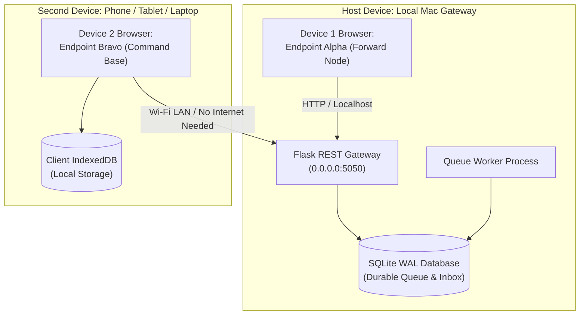

# TWO-DEVICE LOCAL FIELD PILOT GUIDE

**Target System**: ShadowComm / ShadowLink Messaging Engine  
**Configuration Profile**: Dual-Endpoint Local-Network Deployment (No Internet Required)  
**Hardware Requirements**: 1 Primary Host (Mac) + 1 Secondary Device (Phone, Tablet, or Laptop)  

---

## 1. Network Topology & Deployment Architecture



### Pre-Requisite Network Conditions
- Both devices must be on the **same local subnet** (e.g., connected to a common Wi-Fi access point, Ethernet switch, or a personal mobile hotspot hosted by either device).
- **NO INTERNET ACCESS REQUIRED**: The application functions entirely offline on private RFC-1918 subnets (`192.168.x.x` or `10.x.x.x`).

---

## 2. Host Setup (Mac Gateway)

### Step 1: Discover Local LAN IP Address
On your Mac, find your Wi-Fi/Ethernet IP address:
```bash
ipconfig getifaddr en0
# Example output: 192.168.1.145
```

### Step 2: Configure Environment with Independent Tokens
```bash
cd "/Users/sabhay/Downloads/PROJECT 13OCT/Final-Project"

export SHADOWCOMM_HOST="0.0.0.0"
export SHADOWCOMM_PORT="5050"
export SHADOWCOMM_REQUIRE_AUTH="true"
export SHADOWCOMM_SECRET_KEY="$(python3 -c 'import secrets; print(secrets.token_hex(32))')"

# Independent Device Authentication Tokens
export SHADOWCOMM_TOKEN_ENDPOINT_A="token-pilot-alpha-94e82b"
export SHADOWCOMM_TOKEN_ENDPOINT_B="token-pilot-bravo-31a7c4"
```

### Step 3: Start Gateway Server & Queue Worker
In Terminal 1 (Server):
```bash
python3 -m messaging.server --host 0.0.0.0 --port 5050
```

In Terminal 2 (Worker):
```bash
python3 -m messaging.worker --interval 1.0
```

---

## 3. Two-Device Verification Workflow

### Step 4: Open Device 1 (Host Mac - Forward Node A)
1. Open browser to: `http://127.0.0.1:5050`
2. Device 1 represents **Endpoint Alpha (Forward Node A)**.
3. Verify authentication: In the Endpoint Alpha card, the device token is configured as:
   `token-pilot-alpha-94e82b`.

### Step 5: Open Device 2 (Mobile / Second Laptop - Command Base B)
1. On Device 2 (connected to the same Wi-Fi), open the browser to:
   `http://192.168.1.145:5050` (replacing with your Mac's actual IP).
2. Device 2 represents **Endpoint Bravo (Command Base B)**.
3. In the Endpoint Bravo card, the device token is configured as:
   `token-pilot-bravo-31a7c4`.

---

## 4. Controlled Outage & Resilience Drill (Step-by-Step)

Execute the following test procedure to verify offline durability in the field:

### Test Case A: Clean Transmission Between Devices
1. On Device 1 (Alpha), compose message: `"TACTICAL SITREP 01: Team deployed to sector 4."`
2. Click **Enqueue & Send (IndexedDB)**.
3. Observe:
   - Device 1 immediately saves to local browser IndexedDB.
   - Gateway ingests message into SQLite queue.
   - Worker leases and delivers to Endpoint B.
   - Device 2 receives the message in its Durable Inbox.
   - Signed receipt ACK returns to Device 1; status transitions to **DELIVERED (ACK)**.

### Test Case B: Transmission During Severed RF Transport
1. In the Web Console at the top, click **SEVER LINK (OFFLINE)**.
2. On Device 1 (Alpha), compose: `"CRITICAL ALERT 02: Transport severed, holding position."`
3. Click **Enqueue & Send**.
4. Observe:
   - Device 1 records the message locally.
   - Status transitions to `QUEUED` &rarr; `FAILED_RETRYABLE` (Exponential Backoff: 2s, 4s, 8s...).
   - Device 2 receives **NOTHING** during the outage (0 false deliveries).
5. In the top bar, click **RESTORE LINK (ONLINE)**.
6. Observe:
   - Worker automatically detects channel recovery.
   - Message is delivered to Device 2.
   - Receipt ACK returns to Device 1.

### Test Case C: Client Survival Across Browser Reloads
1. Disconnect Device 1 from Wi-Fi entirely.
2. Compose message: `"OFFLINE MEMO 03: Radio completely disconnected."`
3. Click **Enqueue & Send**. Message is saved to browser IndexedDB with status `PENDING_SYNC`.
4. **Hard reload the browser tab** (`Cmd + Shift + R`).
5. Observe:
   - The message is **still present** in the Outbox list loaded directly from IndexedDB!
6. Reconnect Wi-Fi.
7. Observe:
   - Sync Manager detects backend reachability, flushes the local outbox, and delivers the message.

### Test Case D: Gateway Crash & Restart Resilience
1. Compose a message with transport offline so it sits in the backend SQLite queue.
2. Stop the server (`Ctrl + C` in Terminal 1) and stop the worker (`Ctrl + C` in Terminal 2).
3. Verify: Database file `shadowcomm_messaging.db` safely preserves all queued records.
4. Restart server and worker.
5. Re-enable transport: The pending message is delivered without data loss.

---

## 5. Dependency Analysis: What Depends on the Gateway?

| Component | Can Function Without Gateway? | Behavior When Gateway is Offline |
|---|---|---|
| **Client Message Composition** | **YES** | User can compose messages; saved to client IndexedDB outbox. |
| **Local Outbox Inspection** | **YES** | Browser displays all locally queued and synced records. |
| **Inter-Device Transit** | **NO** | Messages cannot hop between Device 1 and Device 2 while the gateway Mac is down. |
| **Receipt Acknowledgements** | **NO** | ACKs cannot be exchanged between devices until gateway resumes. |
| **Database Queue** | **YES** | Messages already accepted by SQLite are safely stored in WAL mode across crashes. |

> [!NOTE]
> In this milestone, store-and-forward routing between distinct physical devices relies on the Mac gateway process. If the Mac crashes, messages queued on clients remain safe in browser storage and will transmit as soon as the Mac gateway restarts.
