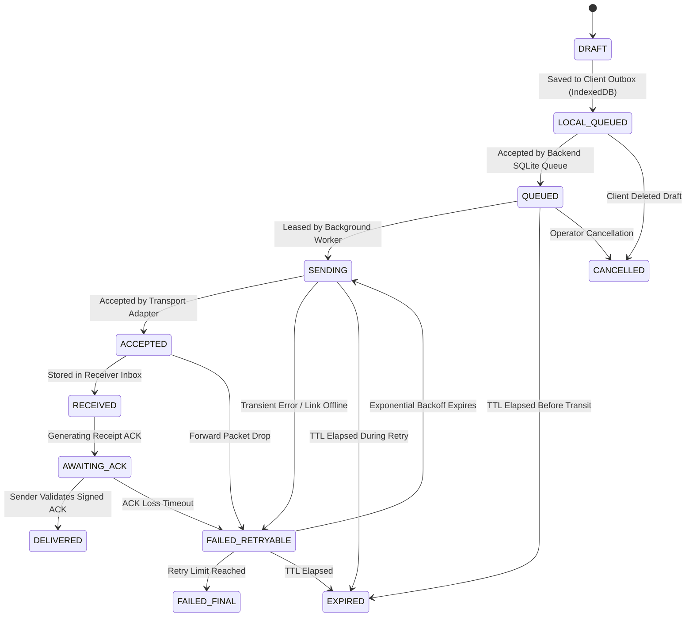

# SHADOWLINK MESSAGE PROTOCOL & STATE MACHINE SPECIFICATION

**Protocol**: SHADOWLINK Resilient Envelope Protocol (SREP)  
**Version**: 2.0  
**Classification**: Specification Document  

---

## 1. Message Structure & Envelope Format

Messages in SHADOWLINK are structured as versioned envelopes containing metadata, routing information, and payload:

```json
{
  "message_id": "9b1deb4d-3b7d-4bad-9bdd-2b0d7b3dcb6d",
  "client_idempotency_key": "c-idemp-alpha-8831-1729000000",
  "incident_id": "INCIDENT-2026-FLOOD-SECTOR4",
  "sender_endpoint_id": "endpoint-a",
  "recipient_endpoint_id": "endpoint-b",
  "message_type": "ASSISTANCE_REQUEST",
  "priority": 1,
  "created_at": "2026-10-15T19:00:00Z",
  "expires_at": "2026-10-16T19:00:00Z",
  "current_state": "QUEUED",
  "payload": "{\"unit_id\": \"TEAM-ALPHA\", \"status\": \"EVACUATION_NEEDED\", \"headcount\": 4, \"gps\": \"28.6139,77.2090\"}"
}
```

### 1.1. Binary Authenticated Encryption Envelope (AES-256-GCM)
When encrypted, the binary payload adopts the following format:
```
+---------------+----------------+-------------------+--------------------+
| Version (1B)  | Nonce (12B)    | Auth Tag (16B)    | Ciphertext (var)   |
| 0x02          | 96-bit Random  | GMAC / Poly1305   | Encrypted Payload  |
+---------------+----------------+-------------------+--------------------+
```

---

## 2. Delivery State Machine (12 States)



### 2.1. Formal State Definitions:
1. `DRAFT`: Message composed in UI, not yet persisted.
2. `LOCAL_QUEUED`: Persisted in client browser IndexedDB; pending network sync.
3. `QUEUED`: Durably accepted into server SQLite queue with idempotency lock.
4. `SENDING`: Leased by worker process with active time-bounded lease.
5. `ACCEPTED`: Handed over to operational transport adapter.
6. `RECEIVED`: Safely committed to receiver's durable inbox table.
7. `AWAITING_ACK`: Forward delivery succeeded; waiting for receipt return.
8. `DELIVERED`: Sender has received and validated the cryptographic receipt ACK.
9. `FAILED_RETRYABLE`: Transient failure; scheduled for retry with exponential backoff.
10. `FAILED_FINAL`: Permanent failure; retry ceiling reached or invalid payload.
11. `EXPIRED`: Message TTL deadline passed; discarded from active delivery.
12. `CANCELLED`: Explicitly aborted by user or administrator.

---

## 3. Incident Coordination Message Types

| Message Type | Purpose & Description | Priority Default | Typical TTL |
|:---|:---|:---|:---|
| `TEXT` | Standard informal operator messaging | 3 (Routine) | 24 Hours |
| `STATUS_REPORT` | Operational unit sitrep (location, readiness, fuel) | 2 (Priority) | 12 Hours |
| `CHECK_IN` | Periodic responder heartbeat and safety confirmation | 2 (Priority) | 4 Hours |
| `ASSISTANCE_REQUEST` | Urgent request for medical, logistical, or evacuation support | 1 (Flash / Emergency) | 48 Hours |
| `INCIDENT_UPDATE` | Broadcast command or tactical situation change | 1 (Flash / Emergency) | 24 Hours |
| `TASK_ASSIGNMENT` | Mission directive assigned to specific field unit | 2 (Priority) | 12 Hours |
| `TASK_ACK` | Unit acknowledgment of task acceptance or completion | 2 (Priority) | 12 Hours |
| `DEVICE_HEALTH` | Automated telemetry (battery, temperature, storage) | 4 (Low) | 2 Hours |
| `GATEWAY_STATUS` | Gateway node capacity and interface availability report | 3 (Routine) | 6 Hours |
| `RECEIPT` | Cryptographic delivery receipt confirmation | 1 (Flash / Immediate) | 48 Hours |

---

## 4. Acknowledgement & Receipt Verification

An ACK record must include:
- `ack_id`: UUID
- `original_message_id`: UUID matching the original message
- `sender_endpoint_id`: Original sender
- `recipient_endpoint_id`: Acknowledging destination
- `ack_type`: `DURABLE_RECEIPT`
- `receipt_signature`: HMAC-SHA256 digest of `(message_id + recipient_endpoint_id + received_at)`
- `creation_timestamp`: Timestamp of receiver inbox commit

### Lost ACK & Deduplication Rule:
If an ACK is dropped in transit, the sender will re-dispatch the message upon backoff expiry. The receiver checks `(recipient_endpoint_id, message_id)`. Upon discovering the message already exists in its inbox, it **suppresses a duplicate insert**, regenerates the original signed receipt ACK, and returns it to the sender.
