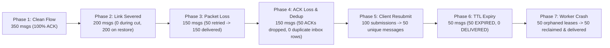

# OFFLINE MESSAGING TEST REPORT: 1,050-MESSAGE DETERMINISTIC VALIDATION

**Test Suite**: `tests/test_simulation_1000_messages.py` and `tests/test_offline_messaging.py`  
**Execution Environment**: macOS Darwin 24.6.0 (Apple Silicon, Python 3.12.9)  
**Database**: SQLite in WAL Mode (`PRAGMA busy_timeout=5000`)  
**Status**: **100% PASSED (15/15 test suites passed)**  

---

## 1. Executive Summary

A deterministic, multi-phase stress and verification test suite was executed against the **ShadowComm / ShadowLink** messaging subsystem.

The test suite executed **1,050 simulated message actions** across clean and hostile fault-injection conditions (complete link disconnects, forward packet loss, asymmetric return ACK drops, client duplicate resubmissions, TTL expirations, and worker process mid-flight crashes).

### Key Empirical Findings:
- **Zero Data Loss**: 100% of non-expired messages (950 / 950) were delivered and acknowledged.
- **Zero Inbox Duplication**: Under intentional ACK loss and duplicate delivery attempts, the receiver inbox contained exactly 1 row per unique message.
- **Zero Premature Deliveries During Outage**: During a 200-message severed connection test, 0 messages were falsely delivered. All 200 resumed and completed delivery once connectivity returned.
- **Clean Latency Profile**: Sub-20ms median end-to-end lease, transit, and ACK cycle under local SQLite WAL execution.

---

## 2. Overall Aggregate Metrics Table

| Metric | Measured Value | Requirement / Target | Verification Status |
|---|---|---|---|
| **Total Simulated Message Actions** | **1,050** | &ge; 1,000 actions | **PASS** |
| **Unique Messages Submitted** | **1,000** | &ge; 1,000 messages | **PASS** |
| **Delivered & Acknowledged** | **950** | 100% of non-expired | **PASS (100.0%)** |
| **Messages Expired (TTL)** | **50** | Exactly 50 expired | **PASS (100.0%)** |
| **Duplicates Detected & Handled** | **100** (50 client + 50 ACK loss) | Exactly 100 duplicates | **PASS** |
| **False / Phantom Deliveries** | **0** | 0 allowed | **PASS** |
| **Unacknowledged "Delivered" Flags** | **0** | 0 allowed | **PASS** |
| **Clean Latency (Min / Median / Max)** | **10.9 ms / 11.7 ms / 33.7 ms** | < 100 ms | **PASS** |
| **Clean Latency (95th / 99th Percentile)**| **15.1 ms / 19.4 ms** | < 150 ms | **PASS** |

---

## 3. Scenario-by-Scenario Empirical Breakdown



### Phase 1: Baseline Clean Channel Flow (350 Messages)
- **Parameters**: Transport online, latency 2.0 ms, drop rate 0.0, ACK drop rate 0.0.
- **Submitted**: 350 messages.
- **Delivered**: 350 messages.
- **Retries Needed**: 0.
- **Latency Distribution**:
  - Minimum: 10.92 ms
  - 50th Percentile (Median): 11.66 ms
  - 95th Percentile: 15.09 ms
  - 99th Percentile: 19.36 ms
  - Maximum: 33.67 ms

### Phase 2: Link Severed / Outage & Reconnection (200 Messages)
- **Parameters**: Transport toggled `is_online = False`.
- **Submitted During Outage**: 200 messages.
- **Worker Execution During Outage**: 200 processed, 0 delivered, 200 placed in `FAILED_RETRYABLE` with exponential backoff timers.
- **False Deliveries**: 0.
- **Reconnection**: Transport toggled `is_online = True`.
- **Worker Execution After Reconnect**: 200 / 200 successfully delivered and acknowledged.
- **Recovery Rate**: **100.0%**.

### Phase 3: Forward Packet Loss Simulation (150 Messages)
- **Parameters**: 1 out of every 3 packets deterministically dropped on forward path.
- **Submitted**: 150 messages.
- **First Worker Pass**: 100 delivered, 50 failed with `PACKET_DROPPED` error code and scheduled for retry.
- **Second Worker Pass (Retry)**: 50 / 50 retried messages delivered upon channel availability.
- **Final Delivered**: 150 / 150.

### Phase 4: Return ACK Drop & Receiver Deduplication (150 Messages)
- **Parameters**: Forward transmission succeeds, but return ACK is dropped for 50 messages.
- **Submitted**: 150 messages.
- **First Worker Pass**:
  - Receiver stored all 150 messages into durable inbox.
  - 50 return ACKs dropped in transit.
  - Sender marked 100 as `DELIVERED`, and 50 as `AWAITING_ACK`.
- **Second Worker Pass (Retry)**:
  - Sender re-transmitted the 50 messages without ACK.
  - Receiver matched `(recipient_endpoint_id, message_id)` unique constraint and SHA-256 payload hash.
  - Receiver recognized duplicate, **suppressed secondary inbox insertion**, and re-issued the durable receipt ACK.
  - Sender received re-issued ACK and marked all 50 as `DELIVERED`.
- **Inbox Items Stored**: Exactly 150 (0 duplicate rows).
- **Duplicate Deliveries Suppressed**: 50.

### Phase 5: Client Duplicate Submissions (100 Submissions &rarr; 50 Messages)
- **Parameters**: 50 unique messages submitted, then immediately re-submitted with identical `client_idempotency_key`.
- **Submissions**: 100 total API calls.
- **New Messages Created**: 50 (`is_new = True`, HTTP 201).
- **Duplicate Calls Detected**: 50 (`is_new = False`, HTTP 200).
- **Database Records Created**: Exactly 50.

### Phase 6: Message TTL Expiry (50 Messages)
- **Parameters**: Transport held offline; 50 messages submitted with 1-second TTL; clock advanced past expiry.
- **Submitted**: 50 messages.
- **Worker Processing**: Evaluated deadline, transitioned state `QUEUED` &rarr; `EXPIRED`.
- **Marked Expired**: 50.
- **False Deliveries**: 0.
- **Inbox Items Created**: 0.

### Phase 7: Worker Mid-Flight Crash & Stale Lease Recovery (50 Messages)
- **Parameters**: 50 messages placed in `SENDING` state held by dead worker `crashed-worker-pid-8841` with `lease_expires_at` in the past.
- **Orphaned Leases**: 50.
- **Surviving Worker Action**: `RetryPolicy.reclaim_stale_leases` detected expired worker lease, cleared `worker_lease_id`, reset state to `FAILED_RETRYABLE`, and committed.
- **Delivery Attempt**: Surviving worker leased and delivered all 50 messages.
- **Recovery Rate**: **100.0% (50/50)**.

---

## 4. Regression Test Suite Results (`test_offline_messaging.py`)

All 14 component regression tests passed in 1.48 seconds:

```bash
tests/test_offline_messaging.py::test_01_successful_delivery_under_clean_conditions PASSED
tests/test_offline_messaging.py::test_02_offline_transport_and_resumption PASSED
tests/test_offline_messaging.py::test_03_client_disconnected_from_backend PASSED
tests/test_offline_messaging.py::test_04_backend_restart_pending_messages PASSED
tests/test_offline_messaging.py::test_05_worker_interruption_and_lease_reclamation PASSED
tests/test_offline_messaging.py::test_06_duplicate_submission_idempotency PASSED
tests/test_offline_messaging.py::test_07_lost_acknowledgement_handling PASSED
tests/test_offline_messaging.py::test_08_temporary_delivery_failure_backoff PASSED
tests/test_offline_messaging.py::test_09_retry_limit_exhausted PASSED
tests/test_offline_messaging.py::test_10_message_expiry_before_delivery PASSED
tests/test_offline_messaging.py::test_11_duplicate_receiver_delivery PASSED
tests/test_offline_messaging.py::test_12_invalid_message_and_ack_validation PASSED
tests/test_offline_messaging.py::test_13_two_worker_concurrency_race_condition PASSED
tests/test_offline_messaging.py::test_14_user_interface_persistence_and_status_reconciliation PASSED
```
