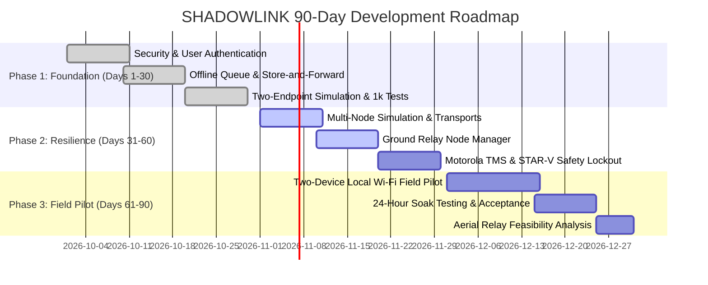

# SHADOWLINK FIELD: PRODUCT ROADMAP & STRATEGY

**Platform**: SHADOWLINK Resilient Communications Framework  
**Repository**: `https://github.com/PriyalSingh23/Final-Project`  
**Target Environment**: macOS / Linux Edge Gateway / Dual-Endpoint Local Field Pilot  
**Version**: 2.0.0-Pilot  
**Status Date**: October 2026  

---

## 1. Product Vision & Architecture

SHADOWLINK evolves the scientific LPI-CGAN/SDR research repository into a dependable, multi-transport, offline-capable communications application. The system prioritizes:
1. **Application-Transport Decoupling**: The application defines the structured message, while modular transport adapters determine delivery path and physical constraints.
2. **Offline Durability**: Store-and-forward persistence guarantees that messages survive network cuts, process restarts, and device reboots.
3. **Honest Delivery Confirmation**: Senders never display `DELIVERED` without a receiver-generated cryptographic receipt acknowledgement (ACK).
4. **Safety Boundaries**: Physical RF transmission and SDR features remain strictly separated from core messaging. Experimental waveforms are never represented as undetectable or unbreakable.

---

## 2. 90-Day Execution Strategy

### Milestone Breakdown

#### Milestone 1: Foundation (Days 1–30) — [COMPLETED & VERIFIED]
- **Core Security Remediation**: Eliminated hard-coded secrets; implemented PBKDF2 password hashing, role-based access control (`ADMINISTRATOR`, `OPERATOR`), session tokens with 60-min expiry, brute-force throttling (5 attempts locks for 15 min), and versioned AES-256-GCM encryption with fresh 96-bit nonces.
- **Durable Queue & Inbox**: SQLite WAL queue, atomic conditional worker leasing, IndexedDB client outbox, signed receipt ACKs, and receiver deduplication.
- **Deterministic Stress Test**: 1,050 simulated actions across 7 fault-injection scenarios passed 100%.

#### Milestone 2: Resilience & Interoperability (Days 31–60) — [ACTIVE IMPLEMENTATION]
- **Transport Abstraction**: Modular `BaseTransportAdapter` interface with intelligent `TransportManager` routing.
- **Relay Nodes**: Portable ground relay registry with battery, temperature, and storage telemetry.
- **Approved Radio Gateways**:
  - Motorola MOTOTRBO adapter with TMS 280-byte burst enforcement.
  - STAR-V adapter with permanent software safety lockout.
- **Incident Coordination**: Incident ID mapping and 10 structured message types (`STATUS_REPORT`, `CHECK_IN`, `ASSISTANCE_REQUEST`, `TASK_ASSIGNMENT`, etc.).

#### Milestone 3: Controlled Field Pilot & Readiness (Days 61–90) — [PLANNED]
- **Dual Physical Device Pilot**: Mac gateway + mobile/laptop endpoint over local Wi-Fi with no internet dependency.
- **24-Hour Soak Testing**: Memory leak, queue growth, and log rotation verification under continuous simulated outages.
- **Regulatory & Aviation Compliance**: Non-radiating vs radiating authorization review under Indian Department of Telecommunications (DoT) and Ministry of Civil Aviation (DGCA) drone rules.
