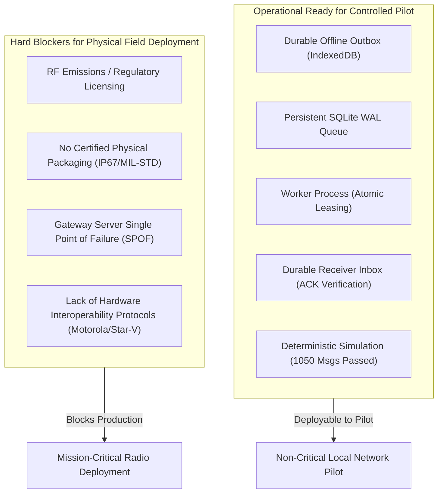

# REAL-WORLD READINESS ASSESSMENT: CONTROLLED PILOT EVALUATION

**System**: ShadowComm / ShadowLink Resilient Offline Messaging Subsystem  
**Target Repository**: `https://github.com/PriyalSingh23/Final-Project`  
**Host Platform Tested**: macOS Darwin (Apple Silicon / radioconda Python 3.12.9)  
**Evaluation Date**: October 2026  
**Operational Scope**: Controlled, Non-Critical Two-Device Field Pilot  

---

## 1. Executive Summary & Deployment Boundaries

The purpose of this evaluation is to establish whether the **Final-Project** codebase is ready for a controlled, non-critical field pilot without radio hardware, and to document what functions are genuinely operational versus what blocks real-world deployment.

### Pilot Boundaries (Strict Non-Critical Scope)
> [!IMPORTANT]
> The application is approved **ONLY** for controlled, non-critical field pilot exercises (e.g., secondary text coordination, outage resilience simulation, operator procedure drills) using local Wi-Fi or ad-hoc IP transport.

- **Prohibited**: Primary life-safety, tactical military command-and-control, mission-critical dispatch, or uncertified RF transmission.
- **RF Hardware Status**: All physical SDR (USRP B200 / GNU Radio) and tactical radio interfaces remain strictly disabled during this phase.

---

## 2. Codebase Audit: Gen 1 vs Gen 2 vs Offline Messaging

An audit of the repository reveals three distinct architectural generations:

1. **Root-Level Research Code (`app.py`, `index.html`)**:
   - Initial experimental prototype using Flask and Socket.IO.
   - `/api/send` generated synthetic waveforms and reported `transmitted` via file writes (`last_tx_waveform.npy`) without UHD integration.
   - Hardcoded cryptographic secrets (`0123456789abcdef` and `shadowcomm-secret-key`) and permissive CORS (`*`).
   - Uses frame size 512, which was superseded by newer research.

2. **LPI-CGAN Generation 2 (`lpi_v4/`)**:
   - Advanced research pipeline with 1024-sample frames, Reed-Solomon RS(42,34), and Covert GAN modulation.
   - Independent scientific research code preserved intact as read-only.
   - Hardware SDR flowgraphs (`uhd_tx_loop.py`, `grc/`) require external USRP B200 hardware and spectrum licensing.

3. **Reliable Offline Messaging Subsystem (`messaging/`)**:
   - Production-oriented store-and-forward messaging engine decoupled from radio hardware.
   - Uses SQLite in WAL mode with robust transaction handling, client-side IndexedDB persistence, background queue worker with atomic conditional leases, and bidirectional simulated transport.
   - Successfully validated across 14 regression tests and a 1,050-message deterministic stress test.

---

## 3. Detailed Audit of the 13 Offline Messaging Functions

The table below provides verified evidence for each required offline messaging capability.

| # | Required Function | Implementation Status | Source File & Line Range | Test Evidence (Passing) |
|---|---|---|---|---|
| **1** | **IndexedDB Client Outbox** | **IMPLEMENTED & TESTED** | [`messaging/templates/offline_messaging.html#L380-L438`](file:///Users/sabhay/Downloads/PROJECT%2013OCT/Final-Project/messaging/templates/offline_messaging.html#L380-L438) | `test_03_client_disconnected_from_backend` `test_14_user_interface_persistence` |
| **2** | **Persistent Backend Queue** | **IMPLEMENTED & TESTED** | [`messaging/models.py#L50-L103`](file:///Users/sabhay/Downloads/PROJECT%2013OCT/Final-Project/messaging/models.py#L50-L103) [`messaging/db.py#L12-L28`](file:///Users/sabhay/Downloads/PROJECT%2013OCT/Final-Project/messaging/db.py#L12-L28) | `test_01_successful_delivery_under_clean_conditions` `test_04_backend_restart_pending_messages` |
| **3** | **Durable Receiver Inbox** | **IMPLEMENTED & TESTED** | [`messaging/models.py#L105-L128`](file:///Users/sabhay/Downloads/PROJECT%2013OCT/Final-Project/messaging/models.py#L105-L128) [`messaging/ack_manager.py#L22-L65`](file:///Users/sabhay/Downloads/PROJECT%2013OCT/Final-Project/messaging/ack_manager.py#L22-L65) | `test_01_successful_delivery_under_clean_conditions` `test_07_lost_acknowledgement_handling` |
| **4** | **Message IDs & Idempotency** | **IMPLEMENTED & TESTED** | [`messaging/service.py#L21-L85`](file:///Users/sabhay/Downloads/PROJECT%2013OCT/Final-Project/messaging/service.py#L21-L85) | `test_06_duplicate_submission_idempotency` `Phase 5: test_1000_message_suite` |
| **5** | **Duplicate Detection** | **IMPLEMENTED & TESTED** | [`messaging/models.py#L74-L77`](file:///Users/sabhay/Downloads/PROJECT%2013OCT/Final-Project/messaging/models.py#L74-L77) [`messaging/ack_manager.py#L32-L42`](file:///Users/sabhay/Downloads/PROJECT%2013OCT/Final-Project/messaging/ack_manager.py#L32-L42) | `test_06_duplicate_submission_idempotency` `test_11_duplicate_receiver_delivery` |
| **6** | **Receiver-Generated ACK** | **IMPLEMENTED & TESTED** | [`messaging/ack_manager.py#L44-L65`](file:///Users/sabhay/Downloads/PROJECT%2013OCT/Final-Project/messaging/ack_manager.py#L44-L65) | `test_01_successful_delivery_under_clean_conditions` `test_07_lost_acknowledgement_handling` |
| **7** | **Sender-Side ACK Validation** | **IMPLEMENTED & TESTED** | [`messaging/ack_manager.py#L67-L95`](file:///Users/sabhay/Downloads/PROJECT%2013OCT/Final-Project/messaging/ack_manager.py#L67-L95) | `test_01_successful_delivery_under_clean_conditions` `test_12_invalid_message_and_ack_validation` |
| **8** | **Retry & Expiry Scheduling** | **IMPLEMENTED & TESTED** | [`messaging/retry_policy.py#L43-L93`](file:///Users/sabhay/Downloads/PROJECT%2013OCT/Final-Project/messaging/retry_policy.py#L43-L93) | `test_08_temporary_delivery_failure_backoff` `test_09_retry_limit_exhausted` `test_10_message_expiry` |
| **9** | **Offline-to-Online Recovery** | **IMPLEMENTED & TESTED** | [`messaging/transport.py#L30-L75`](file:///Users/sabhay/Downloads/PROJECT%2013OCT/Final-Project/messaging/transport.py#L30-L75) [`templates/offline_messaging.html#L440-L476`](file:///Users/sabhay/Downloads/PROJECT%2013OCT/Final-Project/messaging/templates/offline_messaging.html#L440-L476) | `test_02_offline_transport_and_resumption` `Phase 2: test_1000_message_suite` |
| **10** | **Crash & Restart Recovery** | **IMPLEMENTED & TESTED** | [`messaging/worker.py#L60-L126`](file:///Users/sabhay/Downloads/PROJECT%2013OCT/Final-Project/messaging/worker.py#L60-L126) [`messaging/retry_policy.py#L95-L132`](file:///Users/sabhay/Downloads/PROJECT%2013OCT/Final-Project/messaging/retry_policy.py#L95-L132) | `test_04_backend_restart_pending_messages` `test_05_worker_interruption_and_lease_reclamation` `Phase 7: test_1000_message_suite` |
| **11** | **Message Event Timeline** | **IMPLEMENTED & TESTED** | [`messaging/models.py#L170-L208`](file:///Users/sabhay/Downloads/PROJECT%2013OCT/Final-Project/messaging/models.py#L170-L208) [`messaging/api.py#L125-L138`](file:///Users/sabhay/Downloads/PROJECT%2013OCT/Final-Project/messaging/api.py#L125-L138) | `test_01_successful_delivery_under_clean_conditions` `test_08_temporary_delivery_failure_backoff` |
| **12** | **Accurate UI Status** | **IMPLEMENTED & TESTED** | [`messaging/templates/offline_messaging.html#L210-L370`](file:///Users/sabhay/Downloads/PROJECT%2013OCT/Final-Project/messaging/templates/offline_messaging.html#L210-L370) | `test_14_user_interface_persistence_and_status_reconciliation` |
| **13** | **Error Codes & Diagnostics** | **IMPLEMENTED & TESTED** | [`messaging/retry_policy.py#L14-L32`](file:///Users/sabhay/Downloads/PROJECT%2013OCT/Final-Project/messaging/retry_policy.py#L14-L32) [`messaging/worker.py#L190-L285`](file:///Users/sabhay/Downloads/PROJECT%2013OCT/Final-Project/messaging/worker.py#L190-L285) | `test_08_temporary_delivery_failure_backoff` `test_09_retry_limit_exhausted` `test_12_invalid_message_validation` |

---

## 4. Deployment Blockers Analysis

Before advancing from a controlled pilot to an operational field deployment, the following blocking issues must be resolved:

### Detailed Blocker Breakdown:

1. **RF Emission & Spectrum Certification**:
   - *Status*: Experimental SDR transmission on 750 MHz or other UHF/VHF frequencies requires authorized frequency allocation and type-certified hardware.
   - *Remediation*: Keep RF hardware disabled. The pilot must operate over Wi-Fi / Ethernet LAN.

2. **Single Gateway Dependency (SPOF)**:
   - *Status*: Both Endpoint A and Endpoint B rely on the central Flask HTTP server running on the host Mac. If the Mac is turned off, new inter-device deliveries cannot transit (although client outboxes safely preserve messages).
   - *Remediation*: Document fallback procedures; pilot participants must understand that store-and-forward between separate devices requires the gateway Mac to be powered.

3. **Lack of Hardware Radio Driver Specifications**:
   - *Status*: Motorola digital data messaging requires Motorola XCMP or NAI interfaces and certified programming cables. STAR-V tactical radio specs remain restricted.
   - *Remediation*: Restrict integration to software simulator and approved protocol profiles until physical hardware and technical documentation are formally supplied.

---

## 5. Controlled Field Pilot Recommendation

The platform is **READY** for a controlled two-device field pilot under the following operational guidelines:
1. Run gateway server bound to local IP (`--host 0.0.0.0 --port 5050`).
2. Run dedicated queue worker process (`python3 -m messaging.worker`).
3. Connect second mobile/laptop device to same local Wi-Fi.
4. Enforce independent device authentication (`X-Endpoint-Token`).
5. Exercise intentional outage cutoffs (toggling link or Wi-Fi) to verify offline persistence and automatic resynchronization.

---

## 6. Readiness Checklist for Motorola Radio Integration

> [!NOTE]
> Physical radio transmission is strictly prohibited during this milestone. The following readiness checklist defines the prerequisite parameters required from the operator before physical radio adapter testing can be initiated.

### Required Information & Documentation
- [ ] **Exact Product Line & Model**:
  - [ ] MOTOTRBO Digital Mobile/Portable (e.g., XPR 7550e, DP4801e, DM4601e)
  - [ ] APX P25 Mission Critical Series (e.g., APX 6000, APX 8000)
- [ ] **Exact Interface Type**:
  - [ ] **Profile 1: Voice / Audio / PTT (Analog / Acoustic)**: Uses external soundcard interface (e.g., SignaLink USB, RIGblaster) connected via accessory audio connector with hardware or VOX PTT.
  - [ ] **Profile 2: Digital TMS (Text Messaging Service)**: Uses USB/RS-232 accessory cable with IP-over-DMR / XCMP protocol.
  - [ ] **Profile 3: Repeater / Base Gateway (NAI)**: Network Application Interface (MNIS / DDMS) over Ethernet.
- [ ] **Required Configuration & Certifications**:
  - [ ] Motorola CPS / Radio Management codeplug configuration enabling IP data / TMS on target digital channel.
  - [ ] Radio CAI (Common Air Interface) Network ID and Radio ID allocations.
  - [ ] Documented vendor API / XCMP Specification document.
  - [ ] Valid radio station license covering the operational frequencies and emissions designator.

---

## 7. STAR-V Tactical Radio Feasibility Assessment

### 7.1. Factual Technical Background
The STAR-V is a software-defined, multi-band tactical VHF/UHF radio transceiver utilized in defense and specialized security communications, featuring frequency hopping (ECCM) and secure digital voice/data.

### 7.2. Critical Information Deficits & Gaps
1. **Restricted Interface Specifications**: Command-and-control protocols, remote data connectors, baud rates, and pinouts are not publicly standardized and require official defense-vendor integration documentation.
2. **Cryptographic & Air Interface Secrecy**: STAR-V employs dedicated hardware COMSEC/TRANSEC modules. Direct baseband injection or third-party waveform generation without vendor crypto bypass would violate operational security.
3. **Absence of Approved Hardware Interface Drivers**: Implementing hypothetical AT commands or serial controls without hardware manuals creates a risk of radio lockup or unauthorized emergency transmission.

### 7.3. Safety Lockout Enforcement
Until the customer or agency provides:
1. Exact STAR-V hardware variant and firmware revision,
2. Authorized interface control document (ICD) and pinout diagram,
3. Official security authorization for third-party serial/IP data connection,

**The STAR-V radio adapter remains permanently LOCKED OUT in software**, and any attempt to command physical transmission or frequency modification is blocked by software safety checks.

