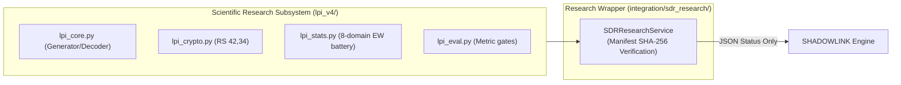

# SDR & LPI-CGAN RESEARCH INTEGRATION GUIDE

**Subsystem**: Scientific LPI-CGAN Covert Modulation Stack (`lpi_v4/`)  
**Scope**: Checkpoint Integrity, Physics Formulation, Model Validation & Hardware Separation  
**Status**: Research Component Guide  

---

## 1. Architectural Preservation & Isolation

The scientific LPI-CGAN research implementation in [`lpi_v4/`](file:///Users/sabhay/Downloads/PROJECT%2013OCT/Final-Project/lpi_v4) is preserved as an independent scientific subsystem:
- **No Coupling to Main Messaging**: The core messaging and store-and-forward engine operates without PyTorch or SDR hardware.
- **Hardware Decoupling**: GNU Radio flowgraphs and UHD transceivers are isolated from web application dispatch.

---

## 2. Core Scientific Parameters (v4 Stack)

| Parameter | Measured Specification | Scientific Rationale |
|:---|:---|:---|
| **Spreading Gain** | **9.03 dB** (4 chips / bit) | 128 info bits mapped to 512 payload samples; provides matched-filter integration gain. |
| **Preamble Type** | **Keyed Zadoff-Chu** (64 samples) | Constant modulus, single correlation peak, zero aperiodic sidelobes, odd root keyed to session. |
| **Total Frame Length** | **576 samples** (512 payload + 64 pilot) | At 245,760 S/s, 1 frame = 2.34 ms; 1 complete AES/RS burst = 3 frames = 7.0 ms. |
| **Error Correction (FEC)**| **Reed-Solomon RS(42,34)** | Protects 34 information bytes with 8 parity bytes over $GF(2^8)$. |
| **Receiver Synchronizer** | Zero-Forcing (ZF) + Learned Head | Inverts the codebook Gram matrix ($A A^T + \lambda I)^{-1}$ to remove multi-access interference. |

---

## 3. Checkpoint Integrity & Export Manifest Verification

TorchScript models in `lpi_v4/run/` are linked to training epochs via cryptographic SHA-256 digests in [`lpi_v4/run/export_manifest.json`](file:///Users/sabhay/Downloads/PROJECT%2013OCT/Final-Project/lpi_v4/run/export_manifest.json).

The [`SDRResearchService`](file:///Users/sabhay/Downloads/PROJECT%2013OCT/Final-Project/integration/sdr_research/service.py) automatically validates checkpoint files on disk:
- `generator_lpi.pt` (Gen 1 256-bit model)
- `decoder_lpi.pt` (Gen 1 decoder)
- `lpi_v4/run/lpi_v4.best.pt` (Gen 2 v4 model)

---

## 4. Scientific Disclaimer & Regulatory Notice

> [!WARNING]
> **RESEARCH DISCLAIMER**:
> - All Low Probability of Intercept (LPI) metrics (Kolmogorov-Smirnov $p$-value, Energy-Waterfall features, CNN warden classification rates) represent **empirical laboratory benchmarks under simulated channel conditions**.
> - Under no circumstances shall these results be marketed or deployed as a "guaranteed undetectable", "invisible", or "unbreakable" radio link.
> - Physical transmission on 2.484 GHz or 750 MHz requires explicit statutory radio frequency authorization from national spectrum regulators (e.g. WPC in India, FCC in the United States).
